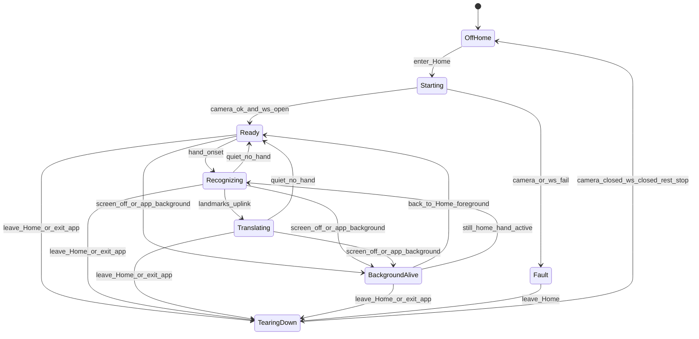

# Flutter App 运行架构：Home 生命周期

> 锁定「识别主页（Home）」与相机、WebSocket、感知、云请求、播音的绑定关系。总览见 [index.md](./index.md)；WS 细节见 [websocket.md](./websocket.md)；模块边界见 [modules.md](./modules.md)。

## 结论（一期锁定）

| # | 规则 |
|---|------|
| 1 | **仅进入 Home** 时：默认打开**后置摄像头**，REST 建会话并连接 `/ws/app`，启动感知 → 转译上行 → 下行播音闭环 |
| 2 | 摄像头未检出有效手语活动时，感知侧处于 **`就绪`**（在线闲置），不中断 WS |
| 3 | **离开 Home**（切到个人中心 / 设置 / 历史等）或 **退出应用**（进程结束）：关闭摄像头、断开 WS、REST stop；识别、转译、云接口请求全部停止；播音 Flushing |
| 4 | **仍停在 Home** 时：允许熄屏、允许 App 进后台；须保持 WS 连接，并继续手语转译与语音播放（系统权限与省电策略允许的前提下） |
| 5 | 非 Home 页不得占用相机，不得维持识别会话 WS |

HTML 原型入口：[ui/home.html](./ui/home.html)。

## 启动与拆除

### 进入 Home（Starting → Ready）

顺序锁定：

1. 请求相机权限（若未授权 → UX 权限提示，不建会话）。
2. 打开**后置**摄像头预览（`facingMode = environment` / Flutter 等价后置镜头）；仅本地预览，不上行视频。
3. REST：`POST /api/v1/sessions` → `sessionId`、`wsUrl`。
4. 连接 `/ws/app`（token、deviceId、protocolVersion、sessionId）；心跳开始。
5. 启动抽帧 / 多器官 / 轨迹 / 手形 / 信封管线；TTS 管线置 Idle，等待下行。
6. UI 感知状态：**就绪**（无有效手语活动时保持此态）。

任一步失败：不半开资源。已开相机则关；已建会话则 REST stop；已连 WS 则关。UI 显示掉线或权限类提示。

### 运行中（Ready / Recognizing / Translating）

- **就绪**：WS 已连、相机已开、未检出应进入 Active 的手语活动；不上行无效手形硬凑；轨迹可随 Idle 停发。
- **识别中 / 转译中**：与算法活动段、landmarks 上行及云端识别对齐；语音播放为并行支路，不单独占顶栏状态（见原型）。
- 云接口：仅 Home 活跃会话期间发起；拆除后进行中的请求取消或不消费结果。

### 离开 Home 或退出应用（TearingDown）

触发（任一）：

- 路由离开 Home（push/replace 到其他页、返回登录等）。
- 应用进程退出 / 用户划掉任务 / 登出。

动作（原子、可重入）：

1. 停止感知调度（不再取帧、不再组信封）。
2. 取消未完成的云侧相关请求；丢弃待发 landmarks 队列。
3. TTS → Flushing → 停播、清空句队列。
4. 关闭 WebSocket（不重连）。
5. `POST /api/v1/sessions/{id}/stop`（若会话仍有效）。
6. 释放摄像头。
7. UI 回到非识别页；再次进入 Home 走完整 Starting。

## 熄屏与后台（仍停在 Home）

与「离开 Home」区分：

| 场景 | 相机 | WS / 会话 | 感知上行 | 播音 |
|------|------|-----------|----------|------|
| Home 前台 | 开 | 保持 | 正常 | 正常 |
| Home + 熄屏 | 尽量保持（系统允许时） | **保持** | **尽量保持** | **保持**（扬声器 / 听筒策略由实现定，默认扬声器） |
| Home + App 进后台（路由仍为 Home） | 尽量保持 | **保持** | **尽量保持** | **保持** |
| 离开 Home | 关 | 断 + REST stop | 停 | Flushing |
| 退出应用 | 关 | 断 + REST stop | 停 | Flushing |

实现约束（设计要求，不绑定具体插件名）：

- Android：Home 存活期间使用前台服务（或等价）声明相机 / 麦克风播放类持续任务，避免熄屏后被杀停 WS。
- iOS：在 Info 背景模式中声明音频播放；相机在后台的能力受系统限制时，以「能采则采、不能采则保持 WS 与已入队播音、回前台立即恢复采帧」为底线，**不得**因熄屏单独 REST stop。
- 省电：仅 Home 绑定的会话享受上述保活；非 Home 禁止保活。

### 来电与音频焦点

- 系统抢走音频焦点 / 来电：暂停或压低播音；**不**因焦点丢失单独 REST stop 或关 WS（只要仍在 Home）。
- 焦点恢复且仍在 Home：恢复播音与采帧。
- 若系统强制收回相机：采帧暂停，WS 保持；相机可用后自动恢复。无法恢复则提示并允许用户回 Home 重试 Starting。

## 与模块的对应

| 模块 | Home 进入 | Home 离开 / 退出应用 | Home 熄屏/后台 |
|------|-----------|----------------------|----------------|
| camera/ | 开后置预览 | 释放 | 尽量保持 |
| session/ | REST 建会话 | REST stop | 会话保持 |
| ws/ | 连接、心跳 | 关闭、禁止重连 | 保持；断线则会话有效时重连 |
| envelope/ 等感知 | 启动调度 | 停止调度 | 尽量保持 |
| tts/ | Idle 待命 | Flushing | 继续播放 |
| ui/ | 显示就绪/识别中/… | 离开识别 UI | 可无预览，状态逻辑不变 |

## 验收口径（生命周期）

| 指标 | 口径 |
|------|------|
| 进 Home 自动启动 | 进入后自动后置相机 + WS；无需二次按钮（权限拒绝除外） |
| 就绪态 | 无手语活动时顶栏为「就绪」，WS 仍为已连接 |
| 离页全停 | 打开设置/个人中心后 1s 内相机释放、WS 断开、无新 landmarks 上行 |
| 退出全停 | 杀进程后云端会话可被 REST stop 或等价清理；无僵尸上行 |
| 熄屏可续 | Home 未离开时熄屏 ≥ 30s，心跳仍在；有手语活动时仍可出字幕/播音（系统限制下的底线见上） |
| 后台可续 | Home 未出栈时进后台，WS 不因「进后台」策略被主动拆掉 |

## 相关文档

- [index.md](./index.md) · [websocket.md](./websocket.md) · [modules.md](./modules.md) · [risks.md](./risks.md) · [roadmap.md](./roadmap.md)
- [ui/home.html](./ui/home.html)
