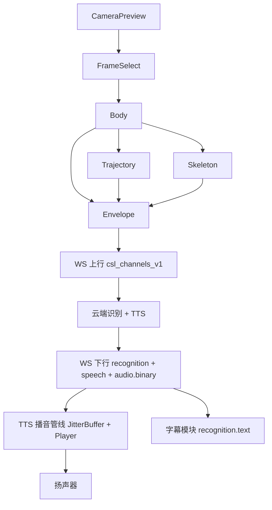

# Flutter App 架构设计

> 一期 Flutter App 的架构总览。算法管线（抽帧/骨架/播音）见 [算法/客户端/](../算法/客户端/index.md)；系统总架构见 [系统架构/](../系统架构/index.md)；协议见 [../../api/protocol.md]。验收口径与 [roadmap.md](./roadmap.md) 相同。

HTML 交互原型（登录 / 识别主页 / 个人中心 / 设置等）见 [ui/index.html](./ui/index.html)。  
**Home 与相机 / WS 生命周期**见 [architecture.md](./architecture.md)（进入 Home 才开后置摄像头并连 WS；离页或退出全停；Home 上熄屏/后台可续）。

## 定位与边界

Flutter App 是一期的**唯一必需客户端**，承担三件事：
1. **端侧感知**：仅在 Home 打开后置相机预览后，同一拍按多器官、轨迹、帧手势的顺序计算，由信封收成 `csl_channels_v1`，按约 15-30 Hz 经 WS 上行。
2. **会话控制**：进入 Home 时 REST 建会话并连 `/ws/app`；离开 Home 或退出应用时关 WS 并 REST stop。字幕展示与播音。
3. **流式播音**：只接收 `ws_binary_audio` 的 PCM，小缓冲边收边播，多句串行不叠音；Home 存活期间熄屏/后台仍可继续播。

**明确不做的**：
- 不上行原始视频（主路径禁止）。
- 不做云端级重推理。
- 一期不实现穿戴播音、边缘抽点。
- 不发送 `session.start` / `session.stop`。
- 不实现 `inline_fallback` / `audioBase64`。
- 不把骨节、`relation`、`segment` 写入 WS。
- **非 Home 页不占用相机、不维持识别会话 WS。**

## Home 生命周期（摘要）

| 时机 | 行为 |
|------|------|
| 进入 Home | 默认后置摄像头 + REST 建会话 + 连 WS；自动识别 / 转译 / 播音 |
| 无手语活动 | 感知状态 **就绪**；WS 保持 |
| 离开 Home / 退出应用 | 关相机、断 WS、REST stop；识别、转译、云请求全部停止；播音 Flushing |
| 仍停在 Home 的熄屏或进后台 | **保持** WS 与会话；尽量保持采帧与播音（见 architecture） |

细则与状态机见 [architecture.md](./architecture.md)。

## 模块划分

同一拍先算多器官，再算轨迹，再算帧手势。轨迹读取身体坐标系；锚点不够时 `body` 缺席，`path.space = image`。帧手势只产出 42 点，与多器官的配合是取景和 `hint.show_upper_body`，肩点不进手槽。信封是这三路的唯一报文产出。

| 模块 | 职责 | 算法文档 |
|------|------|----------|
| Camera+FrameSelect | Home 内后置预览、自适应抽帧；`ts` 用相机帧时钟；离 Home 释放 | [算法/客户端/视频流抽帧.md](../算法/客户端/视频流抽帧.md) · [architecture.md](./architecture.md) |
| Body | 头肩取景、身体坐标系、非手控；同拍最先算 | [算法/客户端/多器官配合.md](../算法/客户端/多器官配合.md) |
| Trajectory | 活动段轨迹节拍、断点；读取身体坐标系 | [算法/客户端/运动轨迹.md](../算法/客户端/运动轨迹.md) |
| Skeleton | Hands 骨架、左右手槽位、交叉/遮挡；不直接上行 | [算法/客户端/帧手势骨架提取.md](../算法/客户端/帧手势骨架提取.md) |
| Envelope | 唯一把三路收成 `csl_channels_v1` | [算法/客户端/手势骨架信封.md](../算法/客户端/手势骨架信封.md) |
| WS客户端 | 连接、握手、心跳、重连、帧路由 | 本文 [websocket.md](./websocket.md) |
| TTS播音管线 | `speech` / `audio.header` + Binary、抖动缓冲、按句串行播放 | [算法/客户端/流式语音播放.md](../算法/客户端/流式语音播放.md) |
| UI/会话层 | token、REST 建停、字幕、UX 提示 | — |

## 数据流（一期最小闭环）



## 一期验收口径（App 层）

与 [roadmap.md](./roadmap.md) 使用同一张表。没有实测数字的项，通过线写「实现期采数」。

### 感知侧

| 指标 | 口径 | 通过线 |
|------|------|--------|
| 漏帧率 | 手势活动区间内应保留关键动作却未抽中的比例 | 实现期采数 |
| 模糊拒帧率 | 因清晰度/拖影门控拒绝的帧占比（活动区间） | 实现期采数 |
| 抖动可控性 | 轻/重晃手机时误升 Active 率、抖峰误 PeakHold 率、机位提示误触发率；持稳后恢复延迟 ≤ T_shake_hold + 短防抖 | 恢复延迟按该不等式；误触发率实现期采数 |
| 远距/复杂背景可识别率 | 满足距离与背景条件时 Hands 检出并最终可上行比例 | 实现期采数 |
| 单双手状态正确率 | hand_state 与标注一致的帧比例 | 实现期采数 |
| 单手槽位正确率 | hand_state∈{left,right} 时上行槽与标注一致 | 实现期采数 |
| 拇指–手性一致率 | 掌心朝镜头子集中，T_thumb 非弃权时与标注手性一致 | 实现期采数 |
| 交叉错误对调率 | 交叉段内左右点集被错误交换的帧比例 | 实现期采数 |
| 遮挡错槽率 | 遮挡段因互遮导致错槽上行的比例 | 实现期采数；行为上宁可拒发不错槽 |
| 分机位可抽帧率 | N0 与 A1–A8 各自抽帧放行率 | 实现期采数 |
| 分机位抽中后可抽点率 | 抽帧放行后信封成功打包 landmarks 的比例（按机位分桶） | 实现期采数 |

### 播音侧

| 指标 | 口径 | 通过线 |
|------|------|--------|
| 端侧开声缓冲时延 | 自队首句首片入队到开声 ≈ T_prime | ≈ T_prime |
| 欠载率 | 活动播报区间内处于 Underrun 的时长占比 | 实现期采数 |
| 句间无叠音 | 同会话任意时刻至多一路 PCM 出声 | 设计锁定 |
| 串行正确性 | 多 utteranceId 在未丢弃前提下按 FIFO 完整播放 | 设计锁定 |
| 弱网播音可恢复 | 重连 / Flushing 后队列空；新句可再次 Priming | 设计锁定 |

### 综合

| 指标 | 口径 | 通过线 |
|------|------|--------|
| 开声延迟 | 识别出词后到扬声器出声 | P50 与 P95 均 < 1.5s |
| 关键点上行频率 | 约 15–30 Hz；积压丢旧 | 设计锁定 |
| 连接稳定性 | 心跳 15s；死连接 45s；退避重连 ≤ 30s | 设计锁定 |
| Home 生命周期 | 进 Home 自动后置相机+WS；离页/退出全停；Home 上熄屏/后台不因策略拆会话 | 设计锁定；见 [architecture.md](./architecture.md) |

## 目标目录（规划）

```text
apps/mobile/lib/
  camera/          # 相机预览 + FrameSelect
  body/            # 多器官：取景、身体坐标系、非手控
  trajectory/      # 活动段轨迹；读取身体坐标系
  skeleton/        # Hands 骨架 + 左右手；不直接上行
  envelope/        # 唯一产出 csl_channels_v1
  ws/              # WebSocket 连接与帧路由
  tts/             # 播音管线
  session/         # REST 建停；不重连
  ui/              # 字幕 + 状态 + UX 提示
  config/          # 阀门；冷启动加载
```
