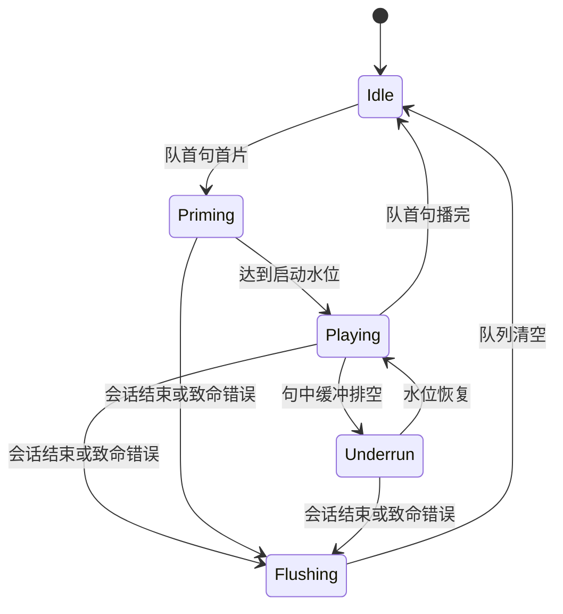
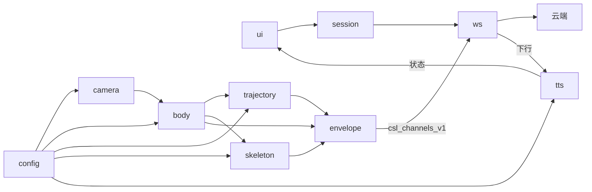

# Flutter App 模块职责

> 一期 Flutter App 各模块的职责与边界；算法细节见 [算法/客户端/](../算法/客户端/)，协议见 [../../api/protocol.md]，系统模块见 [系统架构/modules.md](../系统架构/modules.md)。

同一拍的计算顺序是多器官、轨迹、帧手势。三路算法分开，但多器官与轨迹、多器官与帧手势有配合，不能各写各的报文。`envelope/` 是唯一把三路收成 `csl_channels_v1` 的模块。

**Home 绑定**：相机、会话、WS、感知调度仅在识别主页（Home）存活；离开 Home 或退出应用全量拆除。仍停在 Home 时熄屏 / 后台可续。见 [architecture.md](./architecture.md)。

## 模块一览

客户端源码根：`jianyin_app/lib/`（规划名 `apps/mobile/lib/`；映射见 [系统架构/modules.md](../系统架构/modules.md)）。

```text
jianyin_app/lib/
  camera/          # 相机预览 + 自适应抽帧                 [已落地]
  body/            # 多器官：取景、身体坐标系、非手控        [已落地；Face/nonmanual 待补]
  trajectory/      # 活动段轨迹；读取身体坐标系             [已落地]
  skeleton/        # 骨架提取 + 左右手槽位 + 交叉/遮挡      [已落地]
  envelope/        # 唯一产出 csl_channels_v1             [已落地]
  ws/              # WebSocket 连接与帧路由                [已落地]
  perception/      # 同拍调度 body → path → hands → pack   [已落地]
  native/          # MediaPipe 双端桥（Pose / Hands）       [已落地]
  tts/             # 流式播音管线（规划位置）                [未落地]
  session/         # REST 建停；不重连                      [已落地]
  features/        # 页面与交互（规划名 ui/）                [已落地]
  widgets/         # 复用组件                              [已落地]
  theme/           # 设计 token                            [已落地]
  router/          # 路由                                  [已落地]
  config/          # 阈值与接口配置；冷启动加载             [已落地；机位阀门未接入]
```

## 同拍调度

- `ts` 用相机帧时钟。轨迹节拍与这一时钟相同。
- 感知侧同一时刻只处理最新一帧。排队中的旧帧丢掉。WS 发送队列另行丢旧 landmarks。
- 锚点不够时沿用多器官算法：本拍 `body` 缺席，`path.anchor = false`，`path.space = image`。

## camera/ -- 相机预览 + 自适应抽帧

**职责**：
- **仅 Home 进入时**初始化并打开**后置**摄像头预览（仅本地，不上行）。
- 维护自适应抽帧状态机（Idle / Active / PeakHold / Reject），输出放行帧 + 元数据。无有效手语活动时配合 UI **就绪**态。
- 输出字段：ts、sharpness、roi、hand_state、viewpoint_class、motion_energy。`ts` 取自相机帧时钟。
- 抖动分档（稳/轻抖/重抖）与机位门控（4 个两位小数阀门）。
- **离开 Home 或退出应用**：立即释放相机。Home 上熄屏 / 后台：尽量保持采集（见 architecture）。

**算法文档**：[算法/客户端/视频流抽帧.md](../算法/客户端/视频流抽帧.md)；生命周期：[architecture.md](./architecture.md)

**不做的**：
- 不上行原始视频帧。
- 不做云端稳像。
- 不引入 OIS/电子防抖 SDK。
- 非 Home 页不打开相机。

## body/ -- 多器官

**职责**：
- 同拍最先计算。给轨迹和帧手势提供身体参照。
- 头肩取景、身体坐标系、低频非手控。
- 取景要同时容下鼻、双肩和当前 `hand_state` 要求的手。连续失败发出 `hint.show_upper_body`。

**算法文档**：[算法/客户端/多器官配合.md](../算法/客户端/多器官配合.md)

**不做的**：
- 不上行 468 点脸网格。
- 不重定义机位阀门和左右手槽位。
- 不直接发送 WS。

## trajectory/ -- 运动轨迹

**职责**：
- 在身体结果之后计算。活动段固定节拍，记录腕、掌心、指尖和断点。
- 读取身体坐标系。锚点可用时 `path.space = body`；锚点不够时退回图像坐标。

**算法文档**：[算法/客户端/运动轨迹.md](../算法/客户端/运动轨迹.md)

**不做的**：
- 不重定义手形门控和机位阀门。
- 不上行方向、形状、重复次数。
- 不直接发送 WS。

## skeleton/ -- 骨架提取 + 左右手处理

**职责**：
- 在身体取景结论之后，消费 camera/ 放行的帧，跑 MediaPipe Hands。
- 与多器官的配合只限于取景：头肩和双手需同时入画。肩点不写入手槽。
- 维护左右手 track_id，融合标签（稳定 track > hand_state > T_thumb > 单帧 handedness > 腕 x 序）。
- 处理交叉态（冻结改标）与遮挡（被遮手整槽 v=0）。
- 输出定长 42 点：[0:21) = left，[21:42) = right；缺手槽各位 v=0，不对调。交给 envelope/。

**算法文档**：[算法/客户端/帧手势骨架提取.md](../算法/客户端/帧手势骨架提取.md)、[算法/客户端/左右手骨架提取.md](../算法/客户端/左右手骨架提取.md)

**不做的**：
- 不直接发送 WS。
- 不重定义机位几何或阀门。
- 不镜像/插值编造关键语义坐标。

## envelope/ -- 手势骨架信封

**职责**：
- 提供 gesture_skeleton_envelope_v1 的 catalog 身份（坐标点 id、骨节 id、拓扑）。
- 同一拍收齐 body、trajectory、skeleton，填 frame 的坐标和 relation。
- **唯一**把这三路投影成 `schema: csl_channels_v1` 的 landmarks JSON，交给 ws/ 发送。
- `hands.points` 使用 `mediapipe_hands_v1` 的 42 点布局。手形被拒时省略整个 `hands`。

**算法文档**：[算法/客户端/手势骨架信封.md](../算法/客户端/手势骨架信封.md)

**不做的**：
- 信封本身不是 WS 事件类型。骨节、`relation`、`present`、`valid` 和整个 `segment` 不上行。
- 不修改 `mediapipe_hands_v1` 的 42 点语义。
- 不另设 pack 模块。

## ws/ -- WebSocket 连接管理

**职责**：
- **仅 Home 进入且 REST 建会话成功后**握手：携带 token、deviceId、protocolVersion=1、sessionId 连接 /ws/app。
- 心跳：15s 间隔 ping/pong；死连接 45s 判定。
- 指数退避重连，上限 30s。重连只在**仍停在 Home 且会话未 REST stop** 时进行。离开 Home 后禁止重连。
- 上行：发送 envelope/ 已组装的 landmarks JSON。积压时丢旧保实时。离开 Home 后清空发送队列。
- 下行分派：recognition 交给 UI；speech 交给 tts/；error 交给 session/。
- 帧路由：收到 audio.header 后，把紧随的下一条 Binary 原样交给 tts/。ws/ 不解析 PCM。
- Home 上熄屏 / 后台：**保持连接**；不因进后台主动 close。

**行为文档**：[websocket.md](./websocket.md)；生命周期：[architecture.md](./architecture.md)；系统行为见 [系统架构/websocket.md](../系统架构/websocket.md)

**不做的**：
- 不发送 session.start / session.stop。
- 不实现 /ws/edge 和 /ws/wearable（二期）。
- 不解码 PCM，不接受 inline_fallback。
- 不上行 device.status。device.online 是二期穿戴信号，一期忽略。
- 非 Home 页不维持识别会话 WS。

## tts/ -- 流式播音管线

**落地**：规划位置 `jianyin_app/lib/tts/`，**当前尚未创建**，本节全部职责（Recv / UtteranceAssembler / JitterBuffer / Player）**均未实现**。`ws/` 已具备 `audio.header` + Binary 的接收与分派（见 [ws/](#ws---websocket-连接管理)），待本模块接管；当前「播报中」状态由 `lib/session/home_session_controller.dart` 以占位逻辑维护。

**职责**：
- Recv：校验 speech 与 audio.header 的格式和会话。只接受 `delivery = ws_binary_audio`，且为 PCM s16le / 16 kHz / mono。
- 收到 `inline_fallback` 或 `audioBase64`：拒收该句，提示 `hint.audio_format_error`，不入队。
- UtteranceAssembler：按 utteranceId FIFO 句队列 + 片有序缓冲；预收非队首句。未开播句深度超过 `N_queue_max = 3` 时丢最旧未开播句。
- JitterBuffer：启动水位 T_prime、目标水位 T_target、欠载等待 T_underrun_wait。
- Player：PCM s16le 流式 sink，写入扬声器。
- 状态机：



**算法文档**：[算法/客户端/流式语音播放.md](../算法/客户端/流式语音播放.md)

**一期锁定默认**：
- 编码：PCM s16le / 16 kHz / mono
- 传输：文本 audio.header + 紧随 Binary
- 多句：严格按 utteranceId FIFO 串行，不 barge-in

**不做的**：
- 不等整句文件再播。
- 不实现 Opus 解码主路径。
- 不实现 inline_fallback / audioBase64。
- 不支持双端同时出声（穿戴二期）。

## session/ -- REST 建会话 + 生命周期

**职责**：
- 正式路径：首次注册走 `POST /api/v1/auth/send-otp` + `POST /api/v1/auth/register`（手机号 + 密码 + 验证码 `code`）；已有账号走 `POST /api/v1/auth/login`（手机号 + 密码，不校验验证码）。debug 另有 `/api/v1/auth/demo-token`；release 不得调用，也不回退 demo-token（客户端当前未调用该端点）。
- token 只进入系统安全存储，不写入日志。过期后关 WS 并重新登录，不增加 refresh 接口。
- `deviceId` 是本机随机 ID，首次生成后持久化，随握手上传。它不是账号。
- **进入 Home**：调用 POST /api/v1/sessions 建会话，获得 sessionId 和 wsUrl，再交给 ws/ 连接。
- **离开 Home 或退出应用**：通知感知停止与 tts/ Flushing，关 WS，再 POST /api/v1/sessions/{id}/stop；取消进行中的云相关请求。
- 同一账号只保留最新 App 会话。本端若收到 `session_replaced`，播音 Flushing，关 WS，提示已在其他设备继续。
- **仍停在 Home** 时熄屏或进后台：**不** REST stop、**不**关 WS。
- 来电或音频焦点丢失（仍在 Home）：不 REST stop；仅协调 tts/ 暂停，焦点恢复后继续。
- 不管理重连。重连只归 ws/。

**协议**：[../../api/protocol.md](../../api/protocol.md)；生命周期：[architecture.md](./architecture.md)

**不做的**：
- 不发送 session.start / session.stop。
- 非 Home 不建识别会话。

## ui/（实际 `features/` + `widgets/`）-- 字幕 + 状态 + UX 提示

**落地**：`jianyin_app/lib/features/`（页面：`home/`、`auth/`、`history/`、`membership/`、`profile/`、`settings/`）+ `lib/widgets/`（复用组件）+ `lib/theme/`（设计 token）。规划名 `ui/` 不再单独建目录。

**职责**：
- Home 顶栏感知状态：**就绪**（已连且无手语活动）/ 识别中 / 转译中 / 掉线；语音播放为并行支路，不单独占顶栏。
- 展示 recognition.text 字幕。
- 播报状态指示：Idle / Priming / Playing / Underrun / Flushing。重连中单独显示，占同屏提示位。
- 同屏只展一条。全序见 [risks.md](./risks.md)。采集段内部顺序以 [算法/客户端/视频流抽帧.md](../算法/客户端/视频流抽帧.md) 为准。
- 取景框三色、说明文案与提示胶囊见 [算法/客户端/机位矫正.md](../算法/客户端/机位矫正.md)。
- 路由进入 / 离开 Home 时触发 session/ 与 camera/ 的启动与拆除（见 architecture）。

**不做的**：
- 播放进度不驱动字幕改写。
- 不定义字幕排版与多行策略。
- Flushing 只做状态，不占 hint 条。

## config/ -- 阀门配置管理

**职责**：
- 提供统一的阀门配置入口，供 camera/、body/、trajectory/、skeleton/、tts/ 读取。
- 一期冷启动从配置文件加载，不支持运行时热更新。
- **落地**：感知阈值在 `jianyin_app/lib/config/perception_thresholds.dart`（已落地，被 camera/、body/、trajectory/、skeleton/ 读取）；接口地址在 `lib/config/api_config.dart`。机位 4 阀门与播音水位（`T_prime`/`T_target`/`T_low`/`T_underrun_wait`）当前定义在 `lib/features/settings/settings_store.dart`，**尚未接入运行时**，待收口到本模块。
- 一期主要阀门：
  - 机位：depth.soft=0.17、depth.hard=0.67、bias.soft=0.17、bias.hard=0.78
  - 抖动：`N_shake` 5–8 帧，`T_shake_hold` 150–300 ms。`J_soft` / `J_hard` 按设备标定，本文件不新造数字。见抽帧文档。
  - 播音：T_prime=100ms（允许 80–120）、T_target=120ms（允许 100–150）、T_low=40ms、T_underrun_wait=60ms（允许 60–80）。须保持 `T_low < T_prime ≤ T_target`。

## 模块依赖图


