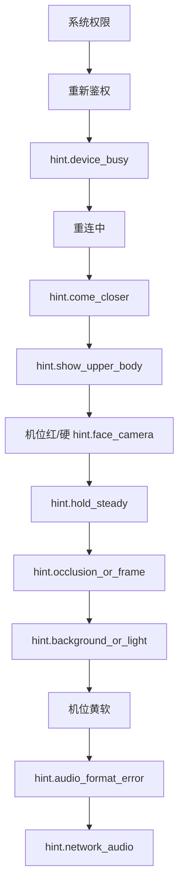

# Flutter App 风险与开放问题

> App 端的失败场景、降级策略、隐私与合规；风险全貌见 [系统架构/risks.md](../系统架构/risks.md)。同屏提示的全序以本文为准。采集段内部顺序以 [算法/客户端/视频流抽帧.md](../算法/客户端/视频流抽帧.md) 为准。

## 已采纳策略

| # | 结论 |
|---|------|
| 1 | **主路径不上行原始视频**；隐私面优于视频上云 |
| 2 | **实时通道仅 WebSocket**；避免多栈污染 |
| 3 | 音频只接受 `ws_binary_audio`。App 不实现 `audioBase64` / `inline_fallback` |
| 4 | 播音严格按 utteranceId **FIFO 串行**；不 barge-in |
| 5 | 端侧抽点失败时**回退为 UX 提示**；不回退为视频上云 |
| 6 | 抖动分档（稳/轻抖/重抖）；重抖拒帧 + hint.hold_steady |
| 7 | 弱网：丢弃更旧的 landmarks；音频侧丢旧未开播句保实时 |
| 8 | 会话只走 REST。同一账号的 App 会话踢旧；边缘设备拒绝后来者 |
| 9 | 阀门一期冷启动加载，不热更新 |
| 10 | **识别会话绑定 Home**：进 Home 开后置相机并连 WS；离 Home / 退出应用全停；Home 上熄屏与后台**保持** WS 与转译播音（见 [architecture.md](./architecture.md)） |

## 失败场景与降级

| 场景 | 期望行为 | UX 提示 |
|------|----------|---------|
| 弱网 | landmarks/音频丢旧保实时；UI 显示重连 | hint.network_audio |
| Token 过期 | 关 WS；重新登录。不回退 demo-token | 重新鉴权 |
| 边缘互斥 | `device_busy`。旧的边缘会话继续，新的附着被拒绝 | hint.device_busy |
| 同一账号新会话 | 旧 App 收到 `session_replaced`，Flushing，关 WS | 已在其他设备继续 |
| 端侧抽点失败 | 提示权限/光线/人手出框；不回退视频上云 | 按根因对应键 |
| 字幕与声音错位 | utteranceId + 串行播句；不重新同步 | — |
| 穿戴离线 | 不阻断 App 播音 | — |
| 摄像头抖动 | 抖动分档拒帧；持稳后自动恢复 | hint.hold_steady |
| 机位异常（A1-A8） | 黄档加严；红档拒发 + 纠偏提示 | hint.vp.* / hint.face_camera |
| 头肩未入画 | 本拍不用身体坐标；连续失败提示取景 | hint.show_upper_body |
| 双手交叉/遮挡 | 交叉冻结改标；遮挡错槽宁可拒发 | hint.occlusion_or_frame |
| 音频欠载 | 跳缺口继续；累计超阈提示弱网 | hint.network_audio |
| 音频格式不一致或兜底帧 | 拒收该句，不入队 | hint.audio_format_error |
| 离开 Home / 退出应用 | 停相机与感知；Flushing；关 WS；REST stop；云请求停止。再次进 Home 完整重开 | — |
| 仍在 Home 时熄屏或进后台 | 保持 WS 与会话；尽量保持采帧与播音；不因进后台拆会话 | — |
| 来电、音频焦点丢失（仍在 Home） | 暂停播音；不 REST stop；不关 WS；焦点恢复后继续 | — |
| 会话边界（REST stop / 死连） | Flushing；队列清空。仍在 Home 且会话有效时重连后 Idle | — |

## UX 提示优先级（同屏只展一条）

从上到下优先级递减。Flushing 只做播报状态，不占这条链。采集段从 `hint.come_closer` 到机位黄软，内部顺序与抽帧文档一致；`hint.occlusion_or_frame` 插在 `hint.hold_steady` 之后。

hint.hold_steady 复用：手速模糊与摄像头抖动共用，避免键膨胀。

## 隐私与合规

- 主路径无原视频出端。
- 端上不持久化预览、坐标和 PCM。日志和崩溃不含画面、PCM、landmarks 坐标。
- `deviceId` 是本机随机 ID，不是账号，不绑定个人身份。
- 历史默认文本级（recognition.text），不含坐标数据。
- 云端若留存关键点，须脱敏，且不绑定个人身份信息。

## 开放问题

| # | 问题 | 影响 |
|---|------|------|
| 1 | 设备互斥 | 已决，分两条。边缘：同一 `edgeDeviceId` 拒绝后来者，`device_busy`。App：同一账号踢旧，旧连接 `session_replaced` |
| 2 | 穿戴与 App 是否允许双端同时出声？ | 二期需求；一期 App 独占播音 |
| 3 | 关键点 schema 是否一期含 Pose？ | 已决：`csl_channels_v1` 含轨迹、身体锚点与非手控；缺锚点时退回手形，轨迹改用图像坐标 |
| 4 | viewpoint_class 是否一期入协议？ | 一期仅端侧模块间元数据，不上行 |
| 5 | 运行时阀门热更新？ | 已决：一期冷启动加载，不热更新 |

## 相关文档

- [architecture.md](./architecture.md) · [websocket.md](./websocket.md)
- [系统架构/risks.md](../系统架构/risks.md) · [系统架构/websocket.md](../系统架构/websocket.md)
- [算法/客户端/流式语音播放.md](../算法/客户端/流式语音播放.md)
- [../../api/protocol.md](../../api/protocol.md)
