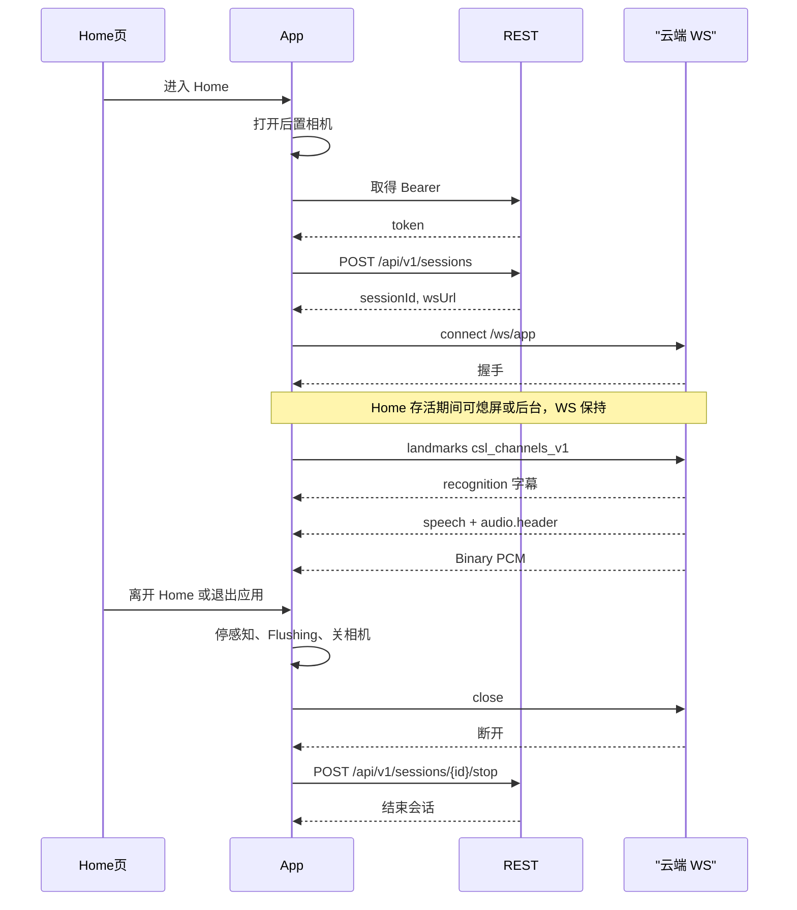

# Flutter App WebSocket 行为

> App 端 /ws/app 的握手、心跳、重连、失败处理；字段与帧格式以 [../../api/protocol.md](../../api/protocol.md) 为准。系统行为见 [系统架构/websocket.md](../系统架构/websocket.md)。

一期 App 只走 REST 建停会话。不发送 `session.start` / `session.stop`。上行 landmarks 的 schema 是 `csl_channels_v1`。

**连接时机锁定**：仅 [architecture.md](./architecture.md) 定义的 **Home 页** 建立与维持 `/ws/app`。离开 Home 或退出应用必须关 WS 并 REST stop。仍停在 Home 时的熄屏 / 进后台 **不得** 因「进后台」策略主动拆会话。

## 连接

| 项 | 说明 |
|----|------|
| 路径 | /ws/app |
| 何时连接 | 进入 Home：后置相机就绪后 REST 建会话，再连 WS |
| 何时断开 | 离开 Home、退出应用、登出、`unauthorized` / `session_replaced` 等失败路径 |
| 握手 Header | `Authorization: Bearer <jwt>`（必需；禁止 Query 传 token） |
| 握手 Query | deviceId、protocolVersion=1、sessionId |
| 鉴权 | JWT Bearer（login/register；debug 可来自 demo-token） |
| 超时 | 死连接 45s 无心跳判定断开 |
| 心跳 | 15s 间隔 ping/pong |
| 重连 | **仅当仍停在 Home 且会话未 REST stop** 时指数退避，上限 30s。已离开 Home 或已 REST stop 的不重连 |

`deviceId` 是本机随机 ID，持久化后上传，不是账号。

## 会话生命周期



debug 构建的 Bearer 可以来自 `POST /api/v1/auth/demo-token`。release 构建不得调用该接口。同一账号的新会话建立后，旧连接收到 `session_replaced`。

**后台策略（替换旧「进后台即 stop」）**：

| 场景 | WS / 会话 |
|------|-----------|
| 仍在 Home + 熄屏 | 保持；断线则会话有效时重连 |
| 仍在 Home + App 后台 | 保持；断线则会话有效时重连 |
| 离开 Home | 关 WS + REST stop；禁止重连 |
| 退出应用 | 关 WS + REST stop |
| 来电 / 音频焦点丢失 | 不单独 REST stop；暂停播音，焦点恢复后若仍在 Home 则继续 |

## 上行帧

| type | 说明 | 频率 |
|------|------|------|
| landmarks | `csl_channels_v1`：手形、轨迹、身体、非手控 | 15-30 Hz |
| ping | 心跳 | 15s |
| （无 `type`）信封身份消息 | `envelope: "gesture_skeleton_envelope_v1"` + `kind: "catalog"`；连接成功后发一次，只用于对齐 catalog 身份与日志，不参与识别 | 每连接 1 次 |

App 不发送 `session.start`、`session.stop`、`device.status`。

### landmarks 格式

一期默认且只发送 `csl_channels_v1`。`mediapipe_hands_v1` 只作为 `hands.points` 的 42 点布局，不是 App 的外层 schema。完整字段见协议。下面的例子省略了部分点对象。

```json
{
  "type": "landmarks",
  "protocolVersion": 1,
  "ts": 1710000000000,
  "sessionId": "sess-xxx",
  "schema": "csl_channels_v1",
  "hands": {
    "schema": "mediapipe_hands_v1",
    "points": [
      { "x": 0.12, "y": 0.34, "z": 0.01, "v": 1.0 }
    ]
  },
  "path": {
    "space": "body",
    "anchor": true,
    "gap": false
  },
  "body": {
    "nose": { "x": 0.50, "y": 0.22, "z": -0.10, "v": 0.98 },
    "shoulderL": { "x": 0.38, "y": 0.42, "z": 0.00, "v": 0.97 },
    "shoulderR": { "x": 0.62, "y": 0.42, "z": 0.00, "v": 0.97 }
  }
}
```

- `hands.points` 定长 42；左 21 + 右 21；缺手槽各位 v=0。手形被拒时省略整个 `hands`。
- 锚点不够时省略 `body`，`path.space` 为 `image`，`path.anchor` 为 false。
- viewpoint_class 一期不上行（端侧内部）。
- 禁止在主路径附带 JPEG/视频 payload。骨节、relation、segment 不上行。

## 下行帧

| type | 说明 |
|------|------|
| recognition | 字幕文本 |
| speech | 播音元数据。App 只接受 `delivery = ws_binary_audio` |
| audio.header | 紧随 Binary 的格式说明 |
| Binary | PCM s16le 音频片。由 ws/ 原样交给 tts/，ws/ 不解码 |
| session.started / session.stopped | 云端确认。App 不依赖它们建停会话 |
| device.online | 穿戴上下线（二期）。一期忽略 |
| error | 错误码 |

### 音频正式路径

1. 先发文本帧 audio.header：

```json
{
  "type": "audio.header",
  "protocolVersion": 1,
  "ts": 0,
  "sessionId": "sess-xxx",
  "utteranceId": "utt-xxx",
  "seq": 0,
  "mimeType": "audio/pcm",
  "sampleRate": 16000,
  "channels": 1,
  "encoding": "s16le",
  "last": false
}
```

2. 紧接着一条 WebSocket Binary 帧（原始 PCM 载荷）。ws/ 只负责配对并原样交给 tts/。
3. 多片递增 seq；最后一片 last: true（可空 Binary）。
4. `speech.delivery = inline_fallback` 或带 `audioBase64`：拒收该句，提示 `hint.audio_format_error`，不入队。

## 背压与丢帧策略

- 感知侧同一时刻只处理最新一帧，排队旧帧丢掉。
- 上行发送队列积压时：丢旧帧（更早的 landmarks），保实时。
- 未开播音频句深度超过 `N_queue_max = 3`：丢最旧未开播句。
- 不下行重传；识别侧容忍丢帧。

## 失败处理

| code 或场景 | 行为 |
|------|------|
| unauthorized | Token 过期或鉴权失败。关 WS，提示重新登录。不回退 demo-token |
| device_busy（REST `409`；**非** WS 错误帧） | 边缘设备已被占用。提示换设备或等待。不踢掉边缘上的旧会话 |
| session_replaced | 同一账号的新会话已建立。本端 Flushing，关 WS，提示已在其他设备继续 |
| session_not_found | sessionId 无效。关 WS，提示重新建会话 |
| 过载（**本版未定义 `rate_limited`**） | 不做专门处理：走下方退避重连规则；播音不叠句 |
| internal | 提示用户。会话是否保留由该次连接是否仍可用决定 |
| 死连接（45s 无心跳） | 播音 Flushing。会话未结束则重连，UI 显示重连中。重连成功后 tts/ 为 Idle，不续播旧句 |
| 网络断开 | 指数退避重连（上限 30s）；播音进入 Flushing |
| 离开 Home / 退出应用 | 停感知与相机，Flushing，关 WS，REST stop。不重连 |
| 仍在 Home 时熄屏或进后台 | **不**因该事件拆 WS；保持心跳与重连资格 |
| 来电、音频焦点丢失（仍在 Home） | 暂停播音；不 REST stop；不关 WS |

## 与播音管线的衔接

- ws/ 收到 speech：若 `delivery` 不是 `ws_binary_audio`，拒收该句。否则把 utteranceId 交给 tts/ 句队列。
- ws/ 收到 audio.header：记住待配对的头，把紧随的下一条 Binary 原样交给 tts/。
- 离开 Home、退出应用、REST stop、`session_replaced`、`unauthorized`：session/ 通知 tts/ 进入 Flushing，然后关 WS。
- 仍在 Home 时的熄屏 / 后台 / 音频焦点丢失：不走上述拆除；焦点类只暂停播音。
- 重连成功后（仍在 Home）tts/ 状态为 Idle，不续播旧句残片。
