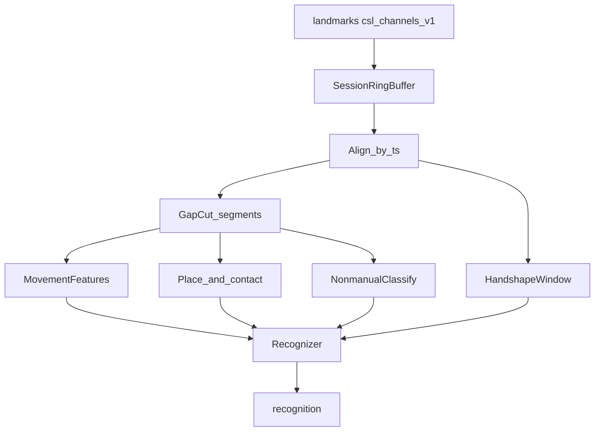

# 云端滑动窗口识别（一期）

> 算法设计。消费端侧上行的 `schema: csl_channels_v1` 多通道序列，在滑动窗口内积成运动 / 部位 / 非手控特征，再映射到词表。端侧观测定义以 [../客户端/](../客户端/) 为准；本文只锁定**云端必须消费什么、如何对齐、缺通道时怎么降级**。

目录规划：`services/inference/`（见 [../../系统架构/modules.md](../../系统架构/modules.md)）。

## 目标与边界

| 项 | 说明 |
|----|------|
| 目标 | 按 `ts` 对齐 `hands` / `path` / `body` / `nonmanual`，积分子特征后出 `recognition` |
| 输入 | WS `landmarks`（`csl_channels_v1`）；可缺个别通道 |
| 输出 | `text`、`glossIds`、`confidence`、`vocabVersion`（协议字段） |
| 不上行回端 | 窗口内的 `shape` / `direction` / `places` / `contactSite` / 头动作归类等 |
| 不做 | 不重定义端侧抽点门限；不消费原视频 |

端侧若只发手形、云端却不算轨迹与部位，则「动态轨迹 + 多器官」场景落空。**演示与生产后端都必须按本文消费多通道**（模型可替换，特征契约不可跳过）。

## 对齐与缓冲

| 规则 | 说明 |
|------|------|
| 键 | 同一 `sessionId`；按 `ts` 升序入环 |
| 窗长 | 滑动窗覆盖最近 `T_win`（实现期标定，起点 0.6–1.2 s） |
| 缺通道 | 该拍对应字段为空；不插值编造关键语义坐标 |
| 背压 | 端侧已丢旧；云端环满时同样丢最旧拍，保实时 |

## 通道消费契约（锁定）

### `path`（动态轨迹）

必须实现 [../客户端/运动轨迹.md](../客户端/运动轨迹.md)「云端运动描述」：

1. 按手切开连续非 `gap` 段；连续 `gap` 时长 `> T_gap` 禁止跨缺口假连接。
2. 选主轨迹 `trace`：默认腕；腕 `v` 低且某指尖连续有效 → 该书空段 `trace` 改指尖。
3. 积 `direction` / `shape` / `repeats` / `net` / `pathLength` / `duration`。
4. `space=image` 或 `anchor=false`：只保留时长与图像平面形状，**不算**身体方向与部位。
5. 双手速度脉冲相位差接近半周期 → 标 `alternating`。

### `body` + 部位（多器官）

必须实现 [../客户端/多器官配合.md](../客户端/多器官配合.md) 的部位与接触：

1. 用上行 `body.frame` 复核轨迹点身体系（或信任端侧已换算的 `path` body 坐标）。
2. 对段内每一拍，按**部位查询点**求最近部位名写入 `places`：
   - `trace` 为腕 → 掌心（无效时腕）
   - `trace` 为指尖 → **该指尖**（`v` 不足回退掌心 → 腕）
3. 速度与持续时间门限区分 `contactSite`（停住）与 `brushSite`（擦过）。
4. 无 `body` 的拍或段：不下部位 / 接触结论。

### `nonmanual`（非手控）

1. 在已由 `T_gap` 切开的时间段上归类 `nod` / `shake` / `tilt` / `still`。
2. 保留口动 `open` / `round` / `spread` 与眉动作序列，供同形词。
3. 缺 `nonmanual` 时仅用手形 + 运动 + 部位（若有）识别；不编造脸部量。

### `hands`（手形）

1. 消费定长 42 点；槽位 `v=0` 表示缺席，不镜像补点。
2. 与轨迹同窗对齐：拖影拍可能无 `hands` 但仍有 `path`——窗口须容忍手形稀疏。
3. 手形序列进入时序模型或模板匹配；具体模型可替换。

## 特征 → 识别

| 特征组 | 来源 | 用途 |
|--------|------|------|
| 手形序列 | `hands.points` | 构型 / 指拼 |
| 运动描述 | `path` 积分 | 动态词、重复、书空 |
| 部位序列与接触 | `path` + `body` | 位置词、接触词 |
| 头口眉 | `nonmanual` | 疑问 / 否定 / 同形区分 |
| 双手交替 | 段间关系 | 交替类词 |

演示后端可用轻量规则或小词表模板；生产可换深度时序模型。**无论哪种，上表特征组都要有显式输入路径**，不得只吃 42 点手形。

## 降级矩阵

| 端侧情况 | 云端行为 |
|----------|----------|
| 仅有 `hands` | 静态 / 指拼子词表；不出身体部位特征 |
| 有 `path` 无 `body`（`space=image`） | 运动形状可用；部位 / 接触关闭 |
| 有 `path`+`body` 无 `hands` | 运动 + 部位识别；构型置信降权或拒识需构型的词 |
| 有 `nonmanual` | 叠加头口特征；无则跳过 |
| 连续 `gap` | 切开两段，分别积分，禁止假连接 |

## 验收口径（云端）

| 指标 | 口径 |
|------|------|
| 多通道消费覆盖 | 演示词表中依赖轨迹或部位的探针，特征日志中确有 `shape`/`places`/`contactSite` 等字段 |
| 假连接率 | 被 `T_gap` 切开的缺口被连成一段位移的次数（目标 0） |
| 指尖部位一致率 | `trace` 为指尖的探针上，部位跟指尖而非掌心的比例 |
| 缺 `body` 保守性 | `anchor=false` 段输出了部位或接触的次数（目标 0） |
| 开声延迟 | 识别出词到 TTS 首包，计入系统 P50/P95 &lt; 1.5 s |

## 相关文档

- [../客户端/index.md](../客户端/index.md) · [../客户端/运动轨迹.md](../客户端/运动轨迹.md) · [../客户端/多器官配合.md](../客户端/多器官配合.md) · [../客户端/手势骨架信封.md](../客户端/手势骨架信封.md)
- [../../系统架构/modules.md](../../系统架构/modules.md) · [../../api/protocol.md](../../api/protocol.md)
