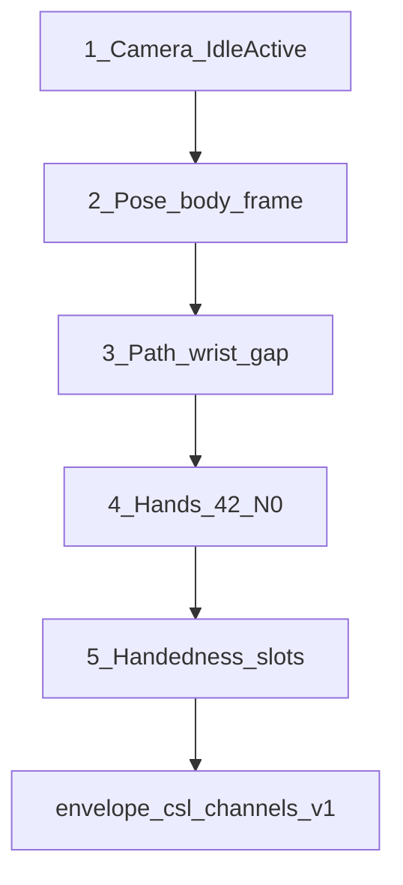
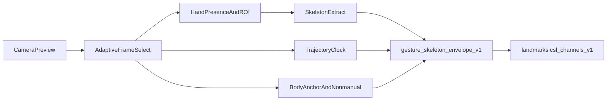
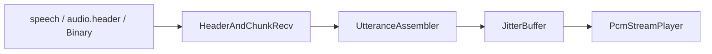
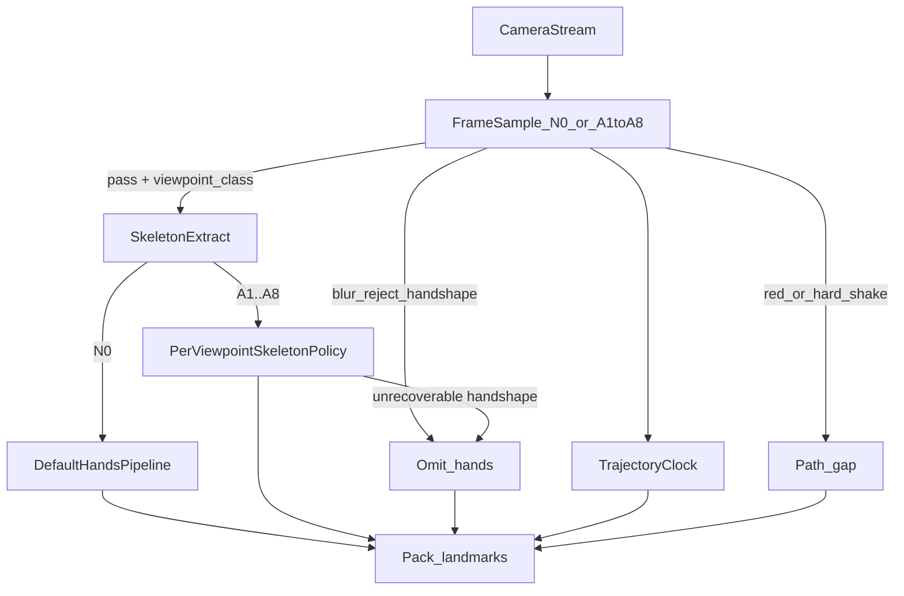
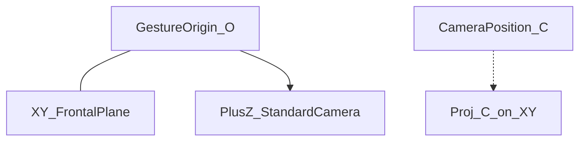
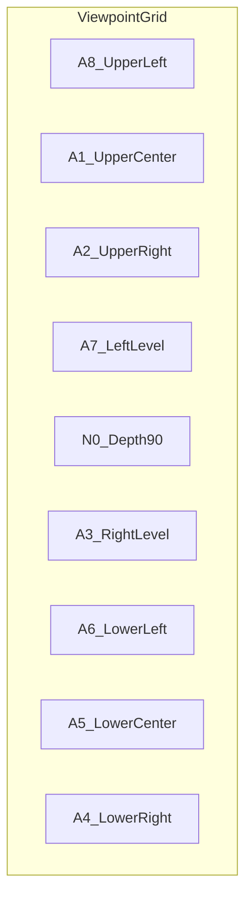

# 一期 Flutter 客户端算法总览

> 仅算法设计；不包含业务代码。对齐方案 A：端侧关键点、主路径不上行原始视频。

协议以 [../../api/protocol.md](../../../api/protocol.md) 为准（上行 `landmarks`；下行 `speech` / `audio.header` + Binary）；系统位置见 [../../系统架构/architecture.md](../../系统架构/architecture.md)、[../../系统架构/modules.md](../../系统架构/modules.md)。云端窗口如何消费多通道见 [../云端/滑动窗口识别.md](../云端/滑动窗口识别.md)。

## 架构锁定（评估结论）

**保持**「抽帧驱动三支路（手形 / 轨迹 / 多器官）→ 信封汇合 → `csl_channels_v1` 上行」；**不**推倒为单通道手形分类或整段视频上云。

| 锁定项 | 说明 |
|--------|------|
| 三支路 | 手形 42 点、活动段 `path`、身体/`nonmanual` 分责；同拍顺序：多器官 → 轨迹 → 帧手势 |
| 信封 | `gesture_skeleton_envelope_v1` 为唯一身份终态；仅 `envelope/` 投影上行 |
| 动态轨迹 | 固定节拍 + 显式 `gap`；形状/方向/重复留云端窗口 |
| 多器官 | 肩鼻建系 + 部位/接触挂窗口；不上行脸网格 |
| 不上行 | 原视频、形状结论、部位名、`segment` 整段 |

实现顺序见 [../../客户端APP/roadmap.md](../../客户端APP/roadmap.md)（P1-0 起接入 MediaPipe）。云端必须按 [../云端/滑动窗口识别.md](../云端/滑动窗口识别.md) 消费 `path`/`body`/`nonmanual`，否则端侧通道落空。

## 文档分工

| 文档 | 唯一职责 | 不写什么 |
|------|----------|----------|
| 本文 | 端侧感知管线、**手势原点三维机位几何**（深度角/偏向角）、枚举与验收口径；下行播音总述 | 不展开抽帧阀门逐步数值以外的实现；不展开抖动缓冲逐步策略 |
| [视频流抽帧.md](./视频流抽帧.md) | 选帧、升降采样、质量门控、**depth/bias 阀门与纠正提示**、摄像头抖动门控；活动段时钟驱动三支路 | 不重定义三维几何；不写关节级 handedness；不积分路径或部位 |
| [机位矫正.md](./机位矫正.md) | Home **取景框与提示胶囊**：三色、说明文案、同屏一条的语气与中文 | 不重定义机位几何与阀门；不重写提示键触发与防抖；不改同屏全序 |
| [帧手势骨架提取.md](./帧手势骨架提取.md) | 抽中帧 Hands **指关节构型（手形）**、质量门控、**A1–A8 逐类抽点** | 不重新定义机位几何与阀门；不展开左右手槽位细则；不积分路径/部位 |
| [左右手骨架提取.md](./左右手骨架提取.md) | 单左/单右/双手槽位、拇指朝向先验、交叉与互遮 | 不重定义机位几何/阀门；不改协议字段 |
| [运动轨迹.md](./运动轨迹.md) | 活动段固定节拍的腕 / 掌心 / 指尖**运动轨迹**、断点、云端运动描述 | 不重定义手形门控与机位阀门；不上行形状结论；不扩 `path` 到 21 关节 |
| [多器官配合.md](./多器官配合.md) | 头肩取景、姿态子集、身体坐标系、**指–器官部位/接触**、低频非手控 | 不重定义左右手槽位；不上行脸网格；不重定义轨迹积分 |
| [手势骨架信封.md](./手势骨架信封.md) | **管线终态**：手形关节与骨节、轨迹点、身体部位、一拍观测和轨迹段的唯一信封 | 不重写抽点门限、左右槽算法和轨迹积分公式；不改 `mediapipe_hands_v1` 的 42 点语义 |
| [流式语音播放.md](./流式语音播放.md) | WS 音频接收、按句组装、抖动缓冲、按 `utteranceId` 串行边收边播 | 不重定义协议帧字段；不写 TTS 云端合成；不写字幕 UI |

> **目录状态**：原 `plans/` 目录的技术栈与落地计划已分别合并进上表各文档的「落地计划（最小可落地单元）」一节；总览（执行顺序 / 技术栈 / 第三方库）见本文下一节；`plans/` 仅保留重定向文件，不再维护正文。

## 落地顺序与技术栈（合并自原 plans/index.md）

> 本节由原 `plans/index.md` 合并而来（内容未改写，仅降级标题层级）。**算法语义以本文其余章节为准**。

### 执行顺序（标号）

同拍运行时顺序是 `body → path → hands`；**编码落地顺序**按下表（先有时钟与锚点，再有腕路径，再 Hands 与槽位）：

| 序号 | 单元 | 文档 | 代码落点 |
|------|------|------|----------|
| **①** | 视频流抽帧 | [视频流抽帧.md](./视频流抽帧.md) | `lib/camera/` → 驱动 `PerceptionPipeline.tick` |
| **②** | 多器官配合 | [多器官配合.md](./多器官配合.md) | `lib/body/` 替 `StubBodyExtractor` |
| **③** | 运动轨迹 | [运动轨迹.md](./运动轨迹.md) | `lib/trajectory/` 替 `StubTrajectoryTracker` |
| **④** | 帧手势骨架提取 | [帧手势骨架提取.md](./帧手势骨架提取.md) | `lib/skeleton/` 替 `StubHandSkeletonExtractor` |
| **⑤** | 左右手骨架提取 | [左右手骨架提取.md](./左右手骨架提取.md) | 同 `lib/skeleton/` 槽位/跟踪加固 |

### 技术栈（锁定）

| 层 | 选型 | 说明 |
|----|------|------|
| 应用 | Flutter / Dart（`jianyin_app`） | 一期客户端；感知仅 Home |
| 相机 | `camera` 插件 + `CameraImage` 流 | 已在 `pubspec.yaml`；后置预览，不上行视频 |
| 视觉推理 | **Google MediaPipe Tasks Vision**（原生） | 点序与协议 `mediapipe_hands_v1` / Pose 索引锁定一致 |
| 桥接 | 薄 Platform Channel（Android `tasks-vision` + iOS MediaPipe Tasks） | 官方模型；避免与协议点序不一致的替代方案 |
| 调度 | 现有 `PerceptionPipeline` | 同拍 `body → path → hands → pack` |
| 上行 | 现有 `envelope/` → WS `landmarks` | 不改协议字段 |
| 图像门控 | Dart 侧对 Y 平面做帧差 / Laplacian | MVP 不引入 OpenCV |

**不采用（MVP）**：整段视频上云、云端稳像 SDK、以 ML Kit Pose 替换 MediaPipe（索引需重映射，易漂协议）。

### 成熟第三方库

| 库 / 制品 | 用途 | 对应序号 | 成熟度说明 |
|-----------|------|----------|------------|
| [`camera`](https://pub.dev/packages/camera) | 预览 + `startImageStream` | ① | 已依赖 `^0.12.0+1` |
| MediaPipe **Hand Landmarker**（`hand_landmarker.task`） | 每手 21 点 + handedness | ④⑤ | Google AI Edge 官方；Android `com.google.mediapipe:tasks-vision` |
| MediaPipe **Pose Landmarker**（lite/full `.task`） | 鼻/肩等姿态子集 | ②③（腕可先用 Pose） | 同上官方 Tasks |
| MediaPipe **Face Landmarker** | 口/眉/头姿 → `nonmanual` | 延后 | 官方；本 MVP 不做 |
| 可选加速：[`hand_landmarker`](https://pub.dev/packages/hand_landmarker)（pub） | Android 快速验证 Hands | ④ | 社区 JNI 封装；正式双端仍以自有 Channel 为准 |
| [`image`](https://pub.dev/packages/image)（可选） | ROI 灰度 / 调试转码 | ① | 纯 Dart；清晰度优先直接扫 `CameraImage` Y 平面 |
| 自研（无新依赖） | Idle/Active、path gap、槽位融合、信封 | ①③⑤ | 算法在端侧 Dart |

模型文件随 App 资产或首次解压分发；阀门冷启动加载（见 App roadmap）。

### 与同拍调度的关系

| 运行时 | 说明 |
|--------|------|
| ① 产出 | `ts`、是否送手形、`hand_state`、`forcePathGap`、帧引用 |
| ②③④⑤ | 仅在活动段 tick 内按 pipeline 已串顺序执行 |
| ③ 腕来源 | ② 后可用 Pose 腕；④ 接入后改为 Hands `track` 腕注入（避免 path↔hands 循环） |
## 管线位置

一期假定：**Flutter 相机预览**。抽帧不只选帧：活动段同时驱动**手形 / 指轨迹 / 多器官**三支路，由信封统一身份后投影上行。手形用 MediaPipe Hands；活动段轨迹用固定节拍（腕/掌心/指尖）；头肩与口动用姿态子集和脸部紧凑量。肩或鼻不可用时，该段可不建身体坐标，轨迹退回图像空间。感知计算在端侧完成；云端只收多通道关键点序列。播音为**独立下行支路**，不依赖相机帧时钟。

### 抽帧 → 骨架因果

| 模块 | 职责 | 输出 |
|------|------|------|
| 抽帧 | 选哪些帧、何时升/降采样、机位可采性门控；活动段时钟 | 放行帧 + 元数据：`ts`、清晰度、ROI、`hand_state`、**`viewpoint_class`**；驱动三支路 |
| 骨架 | 只消费已抽中帧；N0 默认管线；**A1–A8 逐类策略**；指关节构型 | 可上行的手形 `points[]`，或本拍不带 `hands` |
| 轨迹 | 活动段固定节拍；腕/掌心/指尖路径；拖影帧仍可记录腕与掌心 | `path`，或显式 `gap` |
| 多器官 | 头肩取景、身体坐标系、指–器官部位/接触、低频口动与头姿态 | `body`、`nonmanual`；缺锚点则不给部位结论 |
| 信封 | 三支路汇合的身份终态；`frame` 投影上行，`segment` 留窗口 | `gesture_skeleton_envelope_v1`（非 WS 事件） |
| 流式播音 | 收 `speech` / Binary；抖动缓冲；按句串行边收边播 | 扬声器 PCM；状态供 UI |

手形质量不达标时：**该拍不带 `hands`**，不回退为视频上云（与 [../../系统架构/risks.md](../../系统架构/risks.md) 一致）；轨迹节拍可续。轨迹与断点见 [运动轨迹.md](./运动轨迹.md)。播音细节见 [流式语音播放.md](./流式语音播放.md)。

## 与协议映射

| 端侧产物 | 协议字段 | 说明 |
|----------|----------|------|
| 信封 `frame` → 手形 | `hands.points[].x/y/z/v` | 手形通道；旧报文 `schema: mediapipe_hands_v1` 仍只含这 42 点 |
| 信封 `frame` → 轨迹 | `path` | `schema: csl_channels_v1`；活动段固定节拍 |
| 信封 `frame` → 身体 / 非手控 | `body` / `nonmanual` | 同一 schema；缺席则省略该通道 |
| 信封 `segment` | — | 方向/形状/部位/接触等窗口特征，**不上行** |
| 采集时刻 | `ts` | 与帧时钟、轨迹节拍对齐 |
| 会话 | `sessionId` | WS 上行 / 下行 |
| `viewpoint_class` / 清晰度等 | — | **一期仅端侧模块间元数据，不上行**；二期是否入协议为开放项 |
| 播音队列 / 抖动缓冲 | 消费 `speech`、`audio.header` + Binary | 一期默认 PCM s16le 16 kHz mono；按 `utteranceId` 串行 |

上行目标频率约 **15–30 Hz**；发送队列积压时丢旧保实时。下行音频小抖动缓冲边收边播（见 [../../系统架构/websocket.md](../../系统架构/websocket.md)、[流式语音播放.md](./流式语音播放.md)）。

## 机位几何（单一事实来源）

手势工作点为原点的**三维坐标系**；抽帧与骨架共用，骨架**不重定义**。

| 概念 | 定义（锁定） |
|------|----------------|
| 原点 `O` | 手势工作点 |
| xy 面 | 过 `O` 的额状工作面（手势正对平面） |
| +z | 标准机位方向；相机在 +z 上时正对 xy |
| 标准机位 N0 | 相机在 **+z**，距离 `‖C‖ ≤ 5 m`；光轴垂直 xy 面 |
| **深度角** `α_d` | **xy 面与机位光轴（或 O→C）的夹角**。N0：`α_d = 90°`；异常：`α_d ∈ (0°, 90°)` |
| **偏向角** `α_b` | 机位在 xy 上的投影 `P=proj(C)`，射线 `OP` 相对参考轴「北」=+y（正上）的夹角，罗盘语义如 **北偏东 φ**。N0：`P≈O`，**偏向角不存在（N/A）** |
| 锚点 | `北偏东 15°` → 斜机位软阀语义；`北偏东 90°` → **等价机正右 (A3)**，且必有 `α_d < 90°` |

### 机位枚举

机位短名为枚举唯一事实来源；几何用深度角/偏向角描述（**禁止**再用「正视=俯仰 0°」旧极性）。

| 代号 | 机位短名 | 类型 | 几何约定 | 一期态度 |
|------|----------|------|----------|----------|
| N0 | 正常标准机位 | 标准 | `‖C‖≤5 m`；`α_d=90°`；偏向角 N/A | 主路径；默认门限 |
| A1 | 机正上手下 | 正机位 | 近 +y；主判 **深度角** `α_d<90°`；`α_b≈0` 或近轴 | 可采；门控加严 |
| A2 | 机右上手下 | 斜机位 | 北偏东类；主判 **偏向角**；`α_d<90°` | 可采偏难 |
| A3 | 机右正手正 | 正机位 | 近 +x；主判深度角；`北偏东 90°` 为偏向极限同构 | 左右易混 |
| A4 | 机右下手上 | 斜机位 | 右下象限偏向；`α_d<90°` | 自遮挡增 |
| A5 | 机正下手上 | 正机位 | 近 −y；主判深度角 | visibility 加严 |
| A6 | 机左下手上 | 斜机位 | 左下；对称 A4 | 同 A4 左侧 |
| A7 | 机左正手正 | 正机位 | 近 −x；主判深度角 | 同 A3 左侧 |
| A8 | 机左上手下 | 斜机位 | 左上；对称 A2 | 同 A2 左侧 |

| 类型 | 代号 | 主判角量 |
|------|------|----------|
| 4 正机位 | A1 / A3 / A5 / A7 | **深度角** → 配置阀 `depth` |
| 4 斜机位 | A2 / A4 / A6 / A8 | **偏向角** → 配置阀 `bias`（soft≡北偏东 15°） |
| 标准 | N0 | `α_d→90°` 且偏向 N/A |

- **抽帧**：估计 `α_d`/`α_b`，归一为 `depth_score`/`bias_score`（0.00–1.00），用 **4 个两位小数阀门**做绿/黄/红，详见 [视频流抽帧.md](./视频流抽帧.md)。
- **骨架**：不重新定义机位；对抽帧已放行的 A1–A8 **逐类**做抽点策略。

## 一期验收口径（算法侧）

| 指标 | 口径（设计期定义，实现期采数） |
|------|--------------------------------|
| 漏帧率 | 手势活动区间内，应保留关键动作却未抽中的比例 |
| 模糊拒帧率 | 因清晰度/拖影门控拒绝的帧占比（活动区间） |
| 抖动可控性 | 人为轻/重晃手机时：误升 `Active` 率、抖峰误 PeakHold 率、机位提示误触发率；持稳后恢复延迟 ≤ `T_shake_hold` + 短防抖（见抽帧问题 8） |
| 远距/复杂背景可识别率 | 满足距离与背景条件时 Hands 检出并最终可上行比例 |
| 单双手状态正确率 | `hand_state` 与标注一致的帧比例 |
| 单手槽位正确率 | `hand_state∈{left,right}` 时上行 left/right 槽与标注一致的帧比例（见左右手专题） |
| 拇指–手性一致率 | 掌心朝镜头子集中，拇指朝向先验与标注手性一致的比例 |
| 交叉错误对调率 | 交叉段内左右点集被错误交换的帧比例 |
| 遮挡错槽率 | 双手互遮段错槽上行比例（目标：宁可拒发不错槽） |
| 分机位可抽帧率 | N0 与 A1–A8 **各自**抽帧放行率 |
| 分机位抽中后可抽点率 | 抽帧放行后，骨架成功打包手形的比例（按机位分桶） |
| 轨迹断档率 | 腕可见的活动段内被写成 `gap` 的节拍比例（见运动轨迹） |
| 部位一致率 | 额、口、胸、肩、中性空间与标注一致的比例（见多器官配合） |
| 指–部位交互一致率 | 活动段内 `places` / `contactSite`（及擦过 `brushSite`）与标注一致的比例（见多器官配合、运动轨迹） |
| 端侧开声缓冲时延 | 自队首句首片入队到开声 ≈ `T_prime`（见播音文档） |
| 欠载率 | 活动播报区间内处于 `Underrun` 的时长占比 |
| 句间无叠音 | 同会话任意时刻至多一路 PCM 出声 |
| 串行正确性 | 多 `utteranceId` 在未丢弃前提下按入队顺序完整播放 |
| 弱网播音可恢复 | 重连 / `Flushing` 后队列空；新句可再次 `Priming` |

## 相关文档

- [视频流抽帧.md](./视频流抽帧.md) · [机位矫正.md](./机位矫正.md) · [帧手势骨架提取.md](./帧手势骨架提取.md) · [左右手骨架提取.md](./左右手骨架提取.md) · [手势骨架信封.md](./手势骨架信封.md) · [运动轨迹.md](./运动轨迹.md) · [多器官配合.md](./多器官配合.md) · [流式语音播放.md](./流式语音播放.md)
- [../云端/滑动窗口识别.md](../云端/滑动窗口识别.md)
- [../../系统架构/architecture.md](../../系统架构/architecture.md) · [../../系统架构/modules.md](../../系统架构/modules.md) · [../../系统架构/websocket.md](../../系统架构/websocket.md) · [../../api/protocol.md](../../../api/protocol.md)
