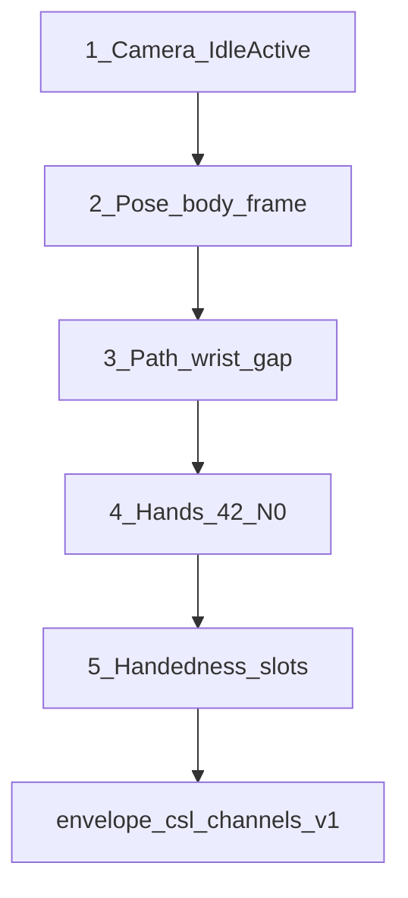

# 客户端算法落地 · 总览

> 最小可落地单元的**技术栈**、**成熟第三方库**与**标号执行顺序**。各切片细节见同目录文档；算法正文见 [../](../)。

对齐 [../../客户端APP/roadmap.md](../../客户端APP/roadmap.md) P1-0→P1-2：替 stub → 经已有 `envelope/` 投影 `csl_channels_v1`。

## 执行顺序（标号）

同拍运行时顺序是 `body → path → hands`；**编码落地顺序**按下表（先有时钟与锚点，再有腕路径，再 Hands 与槽位）：

| 序号 | 单元 | 文档 | 代码落点 |
|------|------|------|----------|
| **①** | 视频流抽帧 | [视频流抽帧.md](./视频流抽帧.md) | `lib/camera/` → 驱动 `PerceptionPipeline.tick` |
| **②** | 多器官配合 | [多器官配合.md](./多器官配合.md) | `lib/body/` 替 `StubBodyExtractor` |
| **③** | 运动轨迹 | [运动轨迹.md](./运动轨迹.md) | `lib/trajectory/` 替 `StubTrajectoryTracker` |
| **④** | 帧手势骨架提取 | [帧手势骨架提取.md](./帧手势骨架提取.md) | `lib/skeleton/` 替 `StubHandSkeletonExtractor` |
| **⑤** | 左右手骨架提取 | [左右手骨架提取.md](./左右手骨架提取.md) | 同 `lib/skeleton/` 槽位/跟踪加固 |

## 技术栈（锁定）

| 层 | 选型 | 说明 |
|----|------|------|
| 应用 | Flutter / Dart（`jianyin_app`） | 一期客户端；感知仅 Home |
| 相机 | `camera` 插件 + `CameraImage` 流 | 已在 `pubspec.yaml`；后置预览，不上行视频 |
| 视觉推理 | **Google MediaPipe Tasks Vision**（原生） | 点序与协议 `mediapipe_hands_v1` / Pose 索引锁定一致 |
| 桥接 | 薄 Platform Channel（Android `tasks-vision` + iOS MediaPipe Tasks） | 官方模型；避免与协议点序不一致的替代方案 |
| 调度 | 现有 `PerceptionPipeline` | 同拍 `body → path → hands → pack` |
| 上行 | 现有 `envelope/` → WS `landmarks` | 不改协议字段 |
| 图像门控 | Dart 侧对 Y 平面做帧差 / Laplacian | MVP 不引入 OpenCV |

**不采用（MVP）**：整段视频上云、云端稳像 SDK、以 ML Kit Pose 替换 MediaPipe（索引需重映射，易漂协议）。

## 成熟第三方库

| 库 / 制品 | 用途 | 对应序号 | 成熟度说明 |
|-----------|------|----------|------------|
| [`camera`](https://pub.dev/packages/camera) | 预览 + `startImageStream` | ① | 已依赖 `^0.12.0+1` |
| MediaPipe **Hand Landmarker**（`hand_landmarker.task`） | 每手 21 点 + handedness | ④⑤ | Google AI Edge 官方；Android `com.google.mediapipe:tasks-vision` |
| MediaPipe **Pose Landmarker**（lite/full `.task`） | 鼻/肩等姿态子集 | ②③（腕可先用 Pose） | 同上官方 Tasks |
| MediaPipe **Face Landmarker** | 口/眉/头姿 → `nonmanual` | 延后 | 官方；本 MVP 不做 |
| 可选加速：[`hand_landmarker`](https://pub.dev/packages/hand_landmarker)（pub） | Android 快速验证 Hands | ④ | 社区 JNI 封装；正式双端仍以自有 Channel 为准 |
| [`image`](https://pub.dev/packages/image)（可选） | ROI 灰度 / 调试转码 | ① | 纯 Dart；清晰度优先直接扫 `CameraImage` Y 平面 |
| 自研（无新依赖） | Idle/Active、path gap、槽位融合、信封 | ①③⑤ | 算法在端侧 Dart |

模型文件随 App 资产或首次解压分发；阀门冷启动加载（见 App roadmap）。

## 与同拍调度的关系

| 运行时 | 说明 |
|--------|------|
| ① 产出 | `ts`、是否送手形、`hand_state`、`forcePathGap`、帧引用 |
| ②③④⑤ | 仅在活动段 tick 内按 pipeline 已串顺序执行 |
| ③ 腕来源 | ② 后可用 Pose 腕；④ 接入后改为 Hands `track` 腕注入（避免 path↔hands 循环） |
