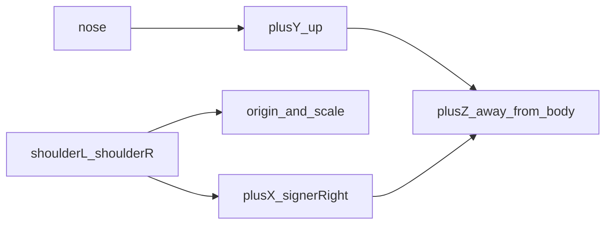

# 多器官配合算法（一期 Flutter）

> 算法设计文档。目标是识别**指关节（掌心 / 腕 / 指尖）相对人体多器官的位置与接触配合**，以及口动与头动作——不是单独的姿态 demo。身体参照来自头肩与脸的观测，不来自双手图像坐标本身。输入为包含鼻、双肩、双手的预览帧（与 [视频流抽帧.md](./视频流抽帧.md) 活动段时钟对齐，取景宽于手 ROI）。输出为身体锚点、身体坐标系、低频非手控。轨迹点如何换到这个坐标系、以及部位序列如何挂到路径段，见 [运动轨迹.md](./运动轨迹.md)。手形 42 点与 [手势骨架信封.md](./手势骨架信封.md) 保持不动。不上行原始视频，不上行 468 点脸网格。

总览见 [index.md](./index.md)。字段以 [../../api/protocol.md](../../api/protocol.md) 的 `schema: csl_channels_v1` 为准。

## 目标与边界

| 项 | 说明 |
|----|------|
| 目标 | 给指轨迹和手形一个稳定的身体参照；输出部位命中、接触/擦过所需锚点；并带上口动与头动作 |
| 输入 | 抽帧活动段预览帧（取景宽于手 ROI）；活动段节拍 `ts`；轨迹样本（换算与部位消费） |
| 输出（上行） | `body`：姿态子集与坐标系；`nonmanual`：头、嘴、眉、眼的紧凑量 |
| 输出（窗口 / 信封 `segment`） | 部位名、`contactSite` / `brushSite`、`places`、点头/摇头/歪头、肘屈伸与躯干倾斜特征 |
| 端侧模型 | 姿态关键点取子集；脸部只取朝向和少量 blendshape。两者都在本地 |
| 与抽帧联动 | 必需点失败 → 不建系 + `hint.show_upper_body`（优先级见抽帧）；不单独发明机位阀门 |
| 保持不动 | 机位深度角 / 偏向角的阀门；左右手槽位算法；手形 42 点身份 |

双手之间的交叉与层叠仍由 [左右手骨架提取.md](./左右手骨架提取.md) 判定。手与头、面、胸、肩的关系用本文的身体坐标系。

## 取景

手 ROI 只交给 Hands 裁剪。整帧取景要同时容下：

| 必须可见 | 用途 |
|----------|------|
| 鼻 | 身体上方 |
| 左肩、右肩 | 原点与尺度 |
| 当前 `hand_state` 要求的手 | 手形与轨迹 |

任一必需点可见度 `< V_anchor`：本拍 `body` 缺席，`path.anchor = false`，`path.space = image`。连续 `N_anchor` 拍失败 → UX `hint.show_upper_body`（请把头部、双肩和双手一起放入画面）。

同屏全序在 [客户端APP/risks.md](../../客户端APP/risks.md)。采集段内部，`hint.show_upper_body` 位于 `hint.come_closer` 之后、机位红档之前，见 [视频流抽帧.md](./视频流抽帧.md)。

工作距离仍以抽帧的 5 m 和手部面积为采集上限。肩宽在图像上过小（`< W_min`）时与过远同样拒用身体坐标。

## 姿态子集

用姿态模型的解剖左右，与 Hands 槽位同一套已固定的相机镜像。算法侧不再翻转。

| 字段 | 姿态点索引 | 作用 |
|------|------------|------|
| `nose` | 0 | 向上方向、面部高度 |
| `eyeL` / `eyeR` | 2 / 5 | 额、眼部位 |
| `earL` / `earR` | 7 / 8 | 耳、颊外侧 |
| `mouthL` / `mouthR` | 9 / 10 | 口、下巴参照 |
| `shoulderL` / `shoulderR` | 11 / 12 | 原点与肩宽 |
| `elbowL` / `elbowR` | 13 / 14 | 上肢屈伸 |
| `wristL` / `wristR` | 15 / 16 | 与手轨迹互证 |
| `hipL` / `hipR` | 23 / 24 | 胸腹下界、躯干倾斜 |

索引是 MediaPipe Pose 的点序。每个点带图像归一化 `x, y, z, v`。`v < V_anchor` 的点不参与原点和部位。

肘的屈伸：上臂 `shoulder → elbow` 与前臂 `elbow → wrist` 的夹角，写入窗口特征，不另上行。躯干倾斜：双肩连线相对图像水平的滚转，以及双髋中点相对肩中点的侧向偏移。

## 身体坐标系

肩、鼻均达到 `V_anchor` 时建立坐标系，并写入 `body.frame`。

| 轴 | 定义 |
|----|------|
| 原点 | 双肩中点 `O = (shoulderL + shoulderR) / 2` |
| 尺度 | 肩宽 `s = \|shoulderR − shoulderL\|`。坐标除以 `s`，单位是肩宽 |
| `+X` | `shoulderR − shoulderL` 的方向，签署人右侧 |
| `+Y` | `nose − O` 的方向，指向鼻，为上方 |
| `+Z` | `+X × +Y`。若该方向与「更靠近镜头」相反，则对 `+Z` 取反。正向是离开身体、朝向镜头 |

换算：`p_body = R^T (p_image − O) / s`。`R` 的列是 `+X、+Y、+Z` 在图像坐标中的方向。姿态点自身的 `z` 只用于判定 `+Z` 极性，以及肘、腕的前后关系。

`body.frame` 每拍携带 `origin`（图像归一化）、`shoulderWidth`、`up` 与 `right` 的图像方向、`zSign`（`+1` 或 `−1`，表示是否对叉积取反）。云端用同一公式复核轨迹点。



机位 A1–A8 仍只决定这一帧的手形能不能抽。身体坐标用来表达词义位置。黄档机位下 `z` 噪声变大时，部位判定提高 `V_anchor`，`+Z` 方向的接触更严格。

## 身体部位

部位锚点由姿态点导出，半径单位是肩宽。云端对掌心和各指尖求最近锚点；距离 `< R_site` 才算落在该部位。多个部位同时满足时取距离更小者。都不满足、且点在胸前（`z > Z_neutral`，水平落在双肩之间，高度在肩与髋之间）时为 `neutral`。否则为 `none`。

| 部位名 | 锚点 |
|--------|------|
| `forehead` | 双眼中点再沿 `+Y` 偏移 `H_brow` |
| `eye` | 最近一只眼 |
| `nose` | 鼻 |
| `mouth` | 两嘴角中点 |
| `chin` | 嘴角中点沿 `−Y` 偏移 `H_chin` |
| `ear` | 最近一只耳 |
| `cheek` | 同侧眼与嘴角的中点 |
| `neck` | 鼻与肩中点的中点 |
| `shoulder` | 最近一侧肩 |
| `chest` | 肩中点沿 `−Y` 半个肩宽，并略向 `+Z` |
| `abdomen` | 肩中点与髋中点之间靠下 |
| `waist` | 双髋中点 |
| `neutral` | 无近身锚点、位于胸前空间 |
| `none` | 不在上述区域 |

**指–器官交互产物（锁定）**：

| 产物 | 谁算 | 是否上行 |
|------|------|----------|
| 该拍部位名 | 见下方**部位查询点**规则，对上表求最近锚点 | 否；挂在窗口 / 信封 `segment.places` |
| `contactSite` | 停住接触 | 否 |
| `brushSite` | 擦过 | 否 |
| 肘屈伸、躯干倾斜 | 由姿态子集导出 | 否（窗口特征） |
| `body` / `nonmanual` | 本拍锚点与脸部紧凑量 | 是（`csl_channels_v1`） |

**部位查询点（锁定，实现期默认）**：

| 段上 `trace`（见 [运动轨迹.md](./运动轨迹.md)） | 该拍求部位 / 接触所用点 |
|-----------------------------------------------|-------------------------|
| 腕（默认） | 掌心；掌心无效时用腕 |
| 某一指尖（书空或指尖驱动） | **该指尖**；该指尖 `v` 不足时回退掌心，再回退腕 |

词内「从额头到胸口」等于轨迹段上部位序列的变化，序列规则见 [运动轨迹.md](./运动轨迹.md) 的分段。`trace` 为指尖时，**不再**默认跟掌心/腕求部位——避免食指点鼻/点颊等词被掌心锚点冲淡。

### 接触

同时满足才记接触：

1. 部位是上表中除 `neutral` 和 `none` 以外的某一项。
2. 该点速度 `< U_contact`，持续 ≥ `T_contact`。

速度用轨迹节拍上的相邻位移。碰到即离开的擦过：速度不低于 `U_contact`，部位序列有一次进入。擦过记入段特征 `brushSite`，与停住的 `contactSite` 分开。

## 非手控

脸部在脸 ROI 上运行，频率低于轨迹节拍：每 `N_face` 个轨迹拍计算一次，默认 2，活动段约 15 Hz。没有结果的节拍省略 `nonmanual` 字段。不上送脸网格。

| 上行量 | 来源 | 范围 |
|--------|------|------|
| `head.pitch` / `yaw` / `roll` | 脸部变换的俯仰、偏航、滚转，单位弧度 | 相对相机 |
| `mouth.open` | `jawOpen` | 0–1 |
| `mouth.round` | `max(mouthPucker, mouthFunnel)` | 0–1 |
| `mouth.spread` | 左右 `mouthSmile` 的均值 | 0–1 |
| `brow.raise` | `browInnerUp` | 0–1 |
| `brow.furrow` | 左右 `browDown` 的均值 | 0–1 |
| `eye.openL` / `eye.openR` | `1 − eyeBlink`；若 `eyeWide` 更大则取 `eyeWide` | 0–1 |

各项带 `v`。脸部检测失败则整组省略。

云端在同一滑动窗口内、在已经由 `T_gap` 切开的时间段上归类（不上行）：

| 特征 | 条件 |
|------|------|
| `nod` | 俯仰来回，幅度 ≥ `A_nod`，偏航幅度更小 |
| `shake` | 偏航来回，幅度 ≥ `A_shake`，俯仰幅度更小 |
| `tilt` | 滚转偏离中性 ≥ `A_tilt`，并保持 ≥ `T_tilt` |
| `still` | 三项都低于各自幅度 |
| 口动序列 | 该段 `open` / `round` / `spread` 随时间的取值，供同形词区分 |
| 眉 | `raise` 或 `furrow` 超过 `A_brow` 的持续时间 |

疑问、否定、程度使用头动作、眉和口动一起作为窗口特征。具体词条如何加权由词表和模型决定，本文只锁定观测和上述归类。

```json
{
  "head": { "pitch": 0.10, "yaw": -0.05, "roll": 0.02, "v": 0.93 },
  "mouth": { "open": 0.35, "round": 0.10, "spread": 0.20, "v": 0.90 },
  "brow": { "raise": 0.15, "furrow": 0.05, "v": 0.88 },
  "eye": { "openL": 0.80, "openR": 0.78, "v": 0.86 }
}
```

## 缺锚点与降频

| 情况 | 行为 |
|------|------|
| 肩或鼻低于 `V_anchor` | 不建立身体坐标。`path.space = image`。部位、接触、肘角不下结论 |
| 脸部失败 | 省略 `nonmanual`。手形与轨迹照常 |
| 仅需手指字母或纯手形 | 允许只有 `hands` 与 `space = image` 的 `path` |
| 算力不足 | 先降低手形全点频率，保留轨迹节拍和肩、鼻。非手控维持每 `N_face` 拍，必要时把 `N_face` 提高到 3 |

姿态腕与 Hands 腕分属两个模型。二者图像距离 `> D_wrist` 时，本拍身体坐标仍可用，但该手接触判定暂停，直到两者重新接近。避免把肘腕骨架安到手形轨迹的错误位置上。

## 与报文的对应

`body` 与 `nonmanual` 是 `csl_channels_v1` 的通道。点对象均为 `{ "x", "y", "z", "v" }`，除 `frame` 与非手控标量外，点坐标保持图像归一化。身体坐标系下的轨迹点在 `path` 里，不在 `body` 里重复。

```json
{
  "nose": { "x": 0.50, "y": 0.22, "z": -0.10, "v": 0.98 },
  "eyeL": { "x": 0.46, "y": 0.20, "z": -0.08, "v": 0.96 },
  "eyeR": { "x": 0.54, "y": 0.20, "z": -0.08, "v": 0.96 },
  "earL": { "x": 0.40, "y": 0.24, "z": 0.02, "v": 0.90 },
  "earR": { "x": 0.60, "y": 0.24, "z": 0.02, "v": 0.90 },
  "mouthL": { "x": 0.47, "y": 0.28, "z": -0.04, "v": 0.92 },
  "mouthR": { "x": 0.53, "y": 0.28, "z": -0.04, "v": 0.92 },
  "shoulderL": { "x": 0.38, "y": 0.42, "z": 0.00, "v": 0.97 },
  "shoulderR": { "x": 0.62, "y": 0.42, "z": 0.00, "v": 0.97 },
  "elbowL": { "x": 0.32, "y": 0.58, "z": 0.05, "v": 0.94 },
  "elbowR": { "x": 0.68, "y": 0.58, "z": 0.05, "v": 0.94 },
  "wristL": { "x": 0.36, "y": 0.70, "z": -0.02, "v": 0.93 },
  "wristR": { "x": 0.64, "y": 0.70, "z": -0.02, "v": 0.93 },
  "hipL": { "x": 0.42, "y": 0.78, "z": 0.04, "v": 0.88 },
  "hipR": { "x": 0.58, "y": 0.78, "z": 0.04, "v": 0.88 },
  "frame": {
    "origin": { "x": 0.50, "y": 0.42, "z": 0.00 },
    "shoulderWidth": 0.24,
    "right": { "x": 1.0, "y": 0.0, "z": 0.0 },
    "up": { "x": 0.0, "y": -1.0, "z": 0.0 },
    "zSign": 1
  }
}
```

`frame.up` 的图像 `y` 为负，表示上方与图像坐标「向下为正」相反。这与 [左右手骨架提取.md](./左右手骨架提取.md) 的图像平面约定一致。

## 默认门限（可调）

| 符号 | 起点 | 含义 |
|------|------|------|
| `V_anchor` | 0.5–0.7 | 鼻、肩及部位锚点最低可见度 |
| `N_anchor` | 8–12 拍 | 连续失败后提示补全上身 |
| `W_min` | 标定 | 图像中肩宽下限，低于则不用身体坐标 |
| `H_brow` / `H_chin` | 0.15 / 0.12 肩宽 | 额、下巴相对眼或嘴的偏移 |
| `R_site` | 0.20 肩宽 | 部位命中半径 |
| `Z_neutral` | 0.3 肩宽 | 胸前中性空间的 `+Z` 下限 |
| `U_contact` | 标定 | 接触时的速度上限 |
| `T_contact` | 80–120 ms | 接触最短持续时间 |
| `N_face` | 2 | 非手控相对轨迹节拍的间隔 |
| `A_nod` / `A_shake` / `A_tilt` | 标定，弧度 | 点头、摇头、歪头幅度 |
| `T_tilt` | 200 ms | 歪头保持时间 |
| `A_brow` | 0.4 | 眉动作阈值 |
| `D_wrist` | 0.15 肩宽 | 姿态腕与手部腕允许的偏差 |

## 验收口径

| 指标 | 口径 |
|------|------|
| 锚点可用率 | 头肩双手在画面内时，成功写出 `body.frame` 的节拍比例 |
| 部位一致率 | 额、口、胸、肩、中性空间探针上，最近部位与标注一致的比例 |
| 接触与擦过区分 | 停住接触记入 `contactSite`、擦过记入 `brushSite` 的比例 |
| 头动作一致率 | 点头、摇头、歪头、静止与标注一致的比例 |
| 口动相关 | `open` / `round` / `spread` 与标注口型同序的比例 |
| 缺锚点保守性 | 肩或鼻不可见的段中，输出了部位或接触结论的次数（目标为 0） |

## 相关文档

- [index.md](./index.md) · [运动轨迹.md](./运动轨迹.md) · [视频流抽帧.md](./视频流抽帧.md) · [帧手势骨架提取.md](./帧手势骨架提取.md) · [手势骨架信封.md](./手势骨架信封.md)
- [../云端/滑动窗口识别.md](../云端/滑动窗口识别.md)
- [../../api/protocol.md](../../api/protocol.md)
