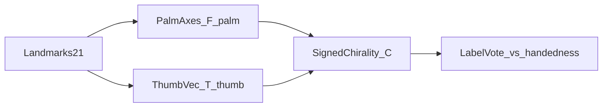
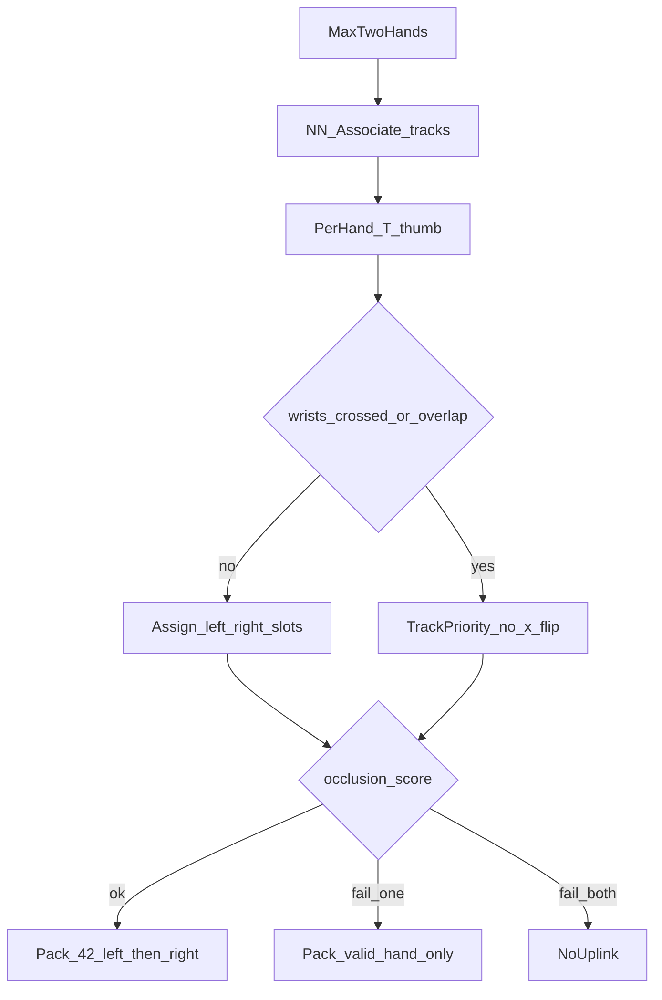

# 左右手骨架提取算法（一期 Flutter）

> 帧手势骨架提取的**左右手专题**：在 [帧手势骨架提取.md](./帧手势骨架提取.md) 管线内，把单左 / 单右 / 双手槽位写透。拇指朝向、交叉、遮挡均为槽位稳定与可打包性的子问题。

**分工**：本文只保证左右槽位上的**指关节构型**可打包。腕/指尖路径与身体部位交互不在此积分（见 [运动轨迹.md](./运动轨迹.md)、[多器官配合.md](./多器官配合.md)）。交叉与遮挡判定写入信封 `relation`（不上行），规则见 [手势骨架信封.md](./手势骨架信封.md)。省略某手或整帧手形 ≠ `path.gap`。

机位几何与阀门不在本文重定义：见 [index.md](./index.md)、[视频流抽帧.md](./视频流抽帧.md)。本文只消费已放行帧的 `hand_state` / `roi` / `viewpoint_class`。

## 目标与边界

| 项 | 说明 |
|----|------|
| 目标 | 稳定得到 `left` / `right` 槽位的 21 点骨架；错槽宁可拒发 |
| 输入 | 抽帧放行帧 + `{ ts, roi, hand_state, viewpoint_class, sharpness }` |
| 输出 | 定长 42 的 `points[]`（先左后右），或本帧拒发 / 单手无效槽；信封侧 `present` / `valid` / `relation` |
| 不上行 | `track_id`、`label`、`T_thumb`、`F_palm`、`label_tension`、`relation` 等内部量 |
| 禁止 | 镜像/插值编造关键语义坐标；不改 `mediapipe_hands_v1` 协议字段；不因槽位拒发改写轨迹节拍 |

## 坐标与点序约定

- **图像平面**：送入 MediaPipe 的归一化坐标；`x` 右增、`y` 下增。相机管线前置镜像（如自拍）固定后，**算法侧不再二次翻转**。
- **每手 21 点**（MediaPipe Hands 标准序）：

| 索引 | 部位 |
|------|------|
| 0 | 腕 |
| 1–4 | 拇指（CMC→tip） |
| 5–8 | 食指 |
| 9–12 | 中指 |
| 13–16 | 无名指 |
| 17–20 | 小指 |

- **几何向量**（2D，除非注明）：
  - 拇指向量 `V_thumb = P4 − P1`
  - 掌轴 `V_palm = P9 − P0`
  - 掌宽 `V_width = P5 − P17`（食指 MCP − 小指 MCP）
- **打包槽位（锁定）**：`points` 定长 **42**；`[0:21) = left`，`[21:42) = right`；缺手或整手拒发时该槽各位 `v=0`（坐标可置 0），**不**省略槽位、**不**对调后变长。

---

## 1. 摄像头视角：拇指朝向几何（左右手共用先验）

拇指朝向仅作端侧**手性校验先验**，不单独上行。

### 1.1 掌面朝向 `F_palm`

1. 取 `A = P5 − P0`，`B = P17 − P0`（需 `v` 均 ≥ `V_min`，否则 `F_palm = uncertain`）。
2. 图像平面叉积 `C_xy = A.x * B.y − A.y * B.x`。
3. 辅以腕相对指根的平均 `z` 趋势（MediaPipe：负 `z` 大致更近镜头，实现期标定极性）。
4. 输出：
   - `palm_to_camera`：掌心大致朝镜头
   - `dorsal_to_camera`：掌背大致朝镜头
   - `uncertain`：`|C_xy| < ε_palm` 或关节无效 → 后续拇指投票**弃权**

### 1.2 拇指侧向 `T_thumb`

1. 若 `P0,P1,P4,P9` 任一点 `v < V_min` → `T_thumb = abstain`。
2. `thumb_side = sign( V_palm.x * V_thumb.y − V_palm.y * V_thumb.x )`（2D 叉积符号）。
3. 将 `thumb_side` 映射为相对掌轴的**屏幕左右**（`screen_right` / `screen_left`）；`|叉积| < ε_thumb` → `abstain`。
4. 按 `F_palm` 极性决定期望手性（见下表）；`uncertain` 时整票弃权。

### 1.3 N0 期望表（掌心朝镜头基线）

| 期望标签 | 掌心朝镜头时拇指相对掌轴 | 掌背朝镜头 |
|----------|--------------------------|------------|
| `left` | **屏幕右侧** | 取反 → 屏幕左侧 |
| `right` | **屏幕左侧** | 取反 → 屏幕右侧 |

- 投票分 `C`：与期望一致 → `T_thumb = +|叉积|`（支持该标签）；相反 → 负分（反对）；`abstain` 不改标。
- 门限：仅当 `|C| ≥ C_min` 且非弃权时参与融合；A3/A7 提高 `C_min`，允许更长弃权。

### 1.4 标签融合优先级

单帧候选来源按序覆盖（高优先胜出；低优先仅在高优先弃权时生效）：

1. **稳定 track 标签**：该 `track_id` 已连续 ≥ `N_lock` 帧持同一 `label`
2. **`hand_state` 先验**（抽帧已防抖）：`left` / `right` / `both`
3. **`T_thumb`**（非 `abstain` 且 `|C| ≥ C_min`）
4. **单帧 MediaPipe `handedness_prob`**（`≥ P_hand` 才采纳，否则继承 track）
5. **腕部 `x` 序**（仅双手、非交叉态、且 `viewpoint_class = N0`）：期望 `left.wrist.x < right.wrist.x`；**A3/A7 禁用**

冲突且无法由 1–2 消解时：短窗继承上一稳定标签；连续 `N_conflict` 帧仍冲突 → 该手或整帧拒发（见各节），**禁止**用镜像编造另一只手的点。

---

## 2. 单手 · 左手骨架提取

**适用**：`hand_state = left`（抽帧已稳定）。

### 2.1 流程

1. 在 `roi`（或全图）跑 MediaPipe Hands；`max_num_hands` 允许 2，但**只保留主轨**（与抽帧主说话人轨一致）；其余检出丢弃。
2. 腕部 + 掌心速度最近邻关联 → `track_id`（IOU/距离门限与父文档一致）。
3. 按 §1.4 融合得 `label`；期望为 `left`。
4. 用 §1.3 左手期望校验 `T_thumb`：
   - 一致 → 可升高本手打包置信
   - 反对且 `|C| ≥ C_min` → 记冲突；**短窗继承 `left`**，不立刻改标为 `right`
   - 连续 `N_conflict` 冲突 → **左槽整手拒发**（`v=0`），可选 `low_quality` 回馈抽帧
5. 关节 `v` 过滤、有效比 ≥ `R_min`、短窗平滑 → 写入 `[0:21)`；`[21:42)` 全 `v=0`。

### 2.2 摄像头视角 · 左手拇指朝向

- N0 掌心朝镜头：拇指应在掌轴**屏幕右侧**。
- 拇指关节低 `v` → `abstain`，**不单独**因拇指拒整手（除非有效关节比已 `< R_min`）。
- A1–A8：沿用父文档逐类 `V_min` / `R_min`；侧视加强弃权，禁止仅靠腕 `x` 改标。

### 2.3 失败与禁止

| 情况 | 处理 |
|------|------|
| 融合结果持续为 `right` | 拒发左槽；不把右手点镜像成左手上行 |
| 有效关节比 `< R_min` | 左槽 `v=0` |
| 第二只手闯入 | 忽略；不升 `both`（升态由抽帧负责） |

---

## 3. 单手 · 右手骨架提取

**适用**：`hand_state = right`。算法为 §2 的**镜像对称**，共用门限符号。

### 3.1 对称表

| 左手（§2） | 右手 |
|------------|------|
| 只填 `[0:21)` | 只填 `[21:42)`；左槽 `v=0` |
| 期望标签 `left` | 期望 `right` |
| 掌心朝镜头：拇指屏幕右侧 | 掌心朝镜头：拇指**屏幕左侧** |
| 冲突继承 `left` | 冲突继承 `right` |
| 连续冲突拒左槽 | 连续冲突拒右槽 |

### 3.2 流程要点

与 §2 相同：主轨关联 → §1.4 融合 → 右手拇指期望校验 → 平滑打包。禁止将检出左手镜像写入右槽。

---

## 4. 双手骨架提取

**适用**：`hand_state = both`。

### 4.1 关联与互斥

1. 最多两只手；腕部位置 + 掌心速度最近邻匹配已有 `track_id`；超距则新建轨。
2. 每手独立算 `F_palm` / `T_thumb` / `handedness_prob`，再按 §1.4 得候选 `label`。
3. **互斥**：同帧禁止两个 `left` 或两个 `right`。若冲突：
   - 优先保留稳定 track 标签对；
   - 否则用 `T_thumb` 对分更高者；
   - 仍平局 → 记 `label_tension`，本帧**整帧拒发**优于错槽上行。
4. 连续 `N_tension` 帧 `label_tension` → 拒发 + 可选回馈抽帧；不交换已打包点集「碰运气」。

### 4.2 摄像头视角 · 左右拇指朝向

- 左槽手：期望同 §2.2；右槽手：期望同 §3.1。
- 一手弃权、另一手有效：有效手可参与消歧；弃权手不强制改标。
- 双拇指均反对当前槽位且 track 未锁满 `N_lock`：允许一次以拇指为准的改标，并重置该轨平滑状态；已锁轨则拒绝改标，走 `label_tension`。

### 4.3 交叉手势

**现象**：双手交叉时腕部 `x` 序颠倒、单帧 handedness 对调、拇指互扰。

**进入交叉态**（满足任一）：

1. 两腕欧氏距离 `< D_cross` 且两手 bbox IoU `> I_cross`；或
2. 腕部 `x` 序相对上一**稳定非交叉**帧发生交换。

**交叉态策略**：

1. **冻结改标**：只允许 `track_id` 最近邻续命，禁止用单帧 handedness / 腕 `x` 对调两槽点集。
2. **关闭**「`left.wrist.x < right.wrist.x`」校验。
3. 提高拇指弃权：交叉时 `|C|` 需 ≥ `C_min_cross`（更严）才采纳 `T_thumb`。
4. 关节仍按 `v` / `R_min` 独立门控；可一只手打包、另一只因质量拒。

**退出交叉态**：连续 `N_uncross` 帧距离与 IoU 恢复，且两手 `T_thumb`（若非弃权）与槽位一致 → 解除冻结。

**禁止**：交叉瞬间交换 `[0:21)` 与 `[21:42)` 的点集。

### 4.4 左右手遮挡

**现象**：一手遮挡另一手，被盖手远端指节大面积低 `v`，或一轨面积陡增、另一轨有效比崩塌。

**判定**（可组合）：

1. bbox IoU `> I_occ`；且
2. 疑似被遮手：远端指节（指尖 4/8/12/16/20 等）有效比明显低于近端，或整手有效比相对上一稳定帧下降超过 `ΔR_occ`；或
3. 另一手 bbox 面积相对陡增且与被遮轨中心接近。

**策略**：

| 角色 | 处理 |
|------|------|
| 遮挡手（可见） | 正常 `v` 过滤与打包 |
| 被遮手 | 低 `v` 点标无效；有效比 `< R_min` → **该槽整手不上行**（`v=0`），`track_id` 保留预测窗 `T_hold` |
| 双手皆不可打包 | 整帧不上行 |

- 与交叉态叠加时：**遮挡规则优先于拇指改标**；交叉冻结仍然有效。
- **禁止**用可见手镜像/插值补被遮手关键点。
- 连续 `N_occ` 帧存在整手因遮挡拒发 → UX `hint.occlusion_or_frame`（与父文档问题 3 同键；障碍物/出框亦用此键，由 UI 统一展示）。

### 4.5 双手打包

1. 左槽、右槽分别通过有效比门控后写入定长 42。
2. 仅一手通过 → 另一槽 `v=0`，仍可上行（识别侧需容忍单侧无效）。
3. 两手皆不通过 → 本帧不上行。
4. 平滑：每 `track_id` 独立；新建或 `T_hold` 超时后重置，避免拖尾幻影。

---

## 5. 与机位策略的衔接

| viewpoint_class | 左右手相关加严 |
|-----------------|----------------|
| N0 | 基线；双手可用腕 `x` 辅助（非交叉） |
| A2/A4/A6/A8 | 跟踪锁定优先；`R_min`↑；冲突暂拒 |
| A3/A7 | **强制**跟踪优先；禁腕 `x` 改标；`C_min`↑、`P_hand`↑ |
| A1/A5 | 指尖/近端 `V_min` 按父文档；拇指易弃权，不单独改标 |

完整 A1–A8 抽点门限见 [帧手势骨架提取.md](./帧手势骨架提取.md) 问题 4；本文不重复机位几何。

---

## 6. 默认门限方向（可调）

| 符号 | N0 起点 | 说明 |
|------|---------|------|
| `V_min` | 中等 | 与父文档一致；拇指弃权用同一门限 |
| `R_min` | 如 ≥0.6 | 斜机位更严 |
| `P_hand` | 如 0.7 | A3/A7 更高才允许单帧改标 |
| `N_lock` | 如 5–8 | 稳定 track 标签帧数 |
| `N_conflict` / `N_tension` | 如 3–5 | 冲突后拒发 |
| `C_min` / `C_min_cross` | 标定 | 交叉态更严 |
| `D_cross` / `I_cross` | 标定 | 交叉进入 |
| `N_uncross` | 如 3–5 | 交叉退出 |
| `I_occ` / `ΔR_occ` | 标定 | 遮挡 |
| `T_hold` | 如 200–400 ms | 被遮轨预测窗 |
| `N_occ` | 如 8–12 | UX 遮挡提示 |

具体数值实现期按机型与词表标定。

---

## 7. 验收口径（本专题）

| 指标 | 口径 |
|------|------|
| 单手槽位正确率 | `hand_state∈{left,right}` 时上行槽位与标注一致的帧比例 |
| 拇指–手性一致率 | 掌心朝镜头子集中，`T_thumb` 非弃权时与标注手性一致的比例 |
| 交叉错误对调率 | 交叉段内左右点集被错误交换的帧比例（目标趋近 0） |
| 遮挡错槽率 | 遮挡段因互遮导致错槽上行的比例（目标：宁可拒发不错槽） |
| 交叉/遮挡恢复延迟 | 退出交叉或遮挡缓解后，恢复双槽稳定打包的帧数/时间 |

---

## 与信封的映射

| 左右手结果 | 信封 `frame` |
|------------|--------------|
| 槽位打包成功 | `hands.<side>.present = true`；关节 `v` 真实；骨节 `valid` 按两端门限 |
| 整手拒发（冲突/遮挡/有效比不足） | 该手 21 点 `v=0`，`present=false`，骨节 `valid=false`；**不**删 `id` |
| §4.3 / §4.4 | 写入 `relation.layout` / `foreground` / `occluder` / `occluded` / `labelFrozen`（判定式只在本文；信封不另设阈值） |
| 手形整帧不上行 | 可不投影 `hands`；同拍 `path` 仍由轨迹算法决定是否 `gap` |

## 相关文档

- [帧手势骨架提取.md](./帧手势骨架提取.md) · [手势骨架信封.md](./手势骨架信封.md) · [视频流抽帧.md](./视频流抽帧.md) · [运动轨迹.md](./运动轨迹.md) · [多器官配合.md](./多器官配合.md) · [index.md](./index.md)
- [../../api/protocol.md](../../api/protocol.md)
