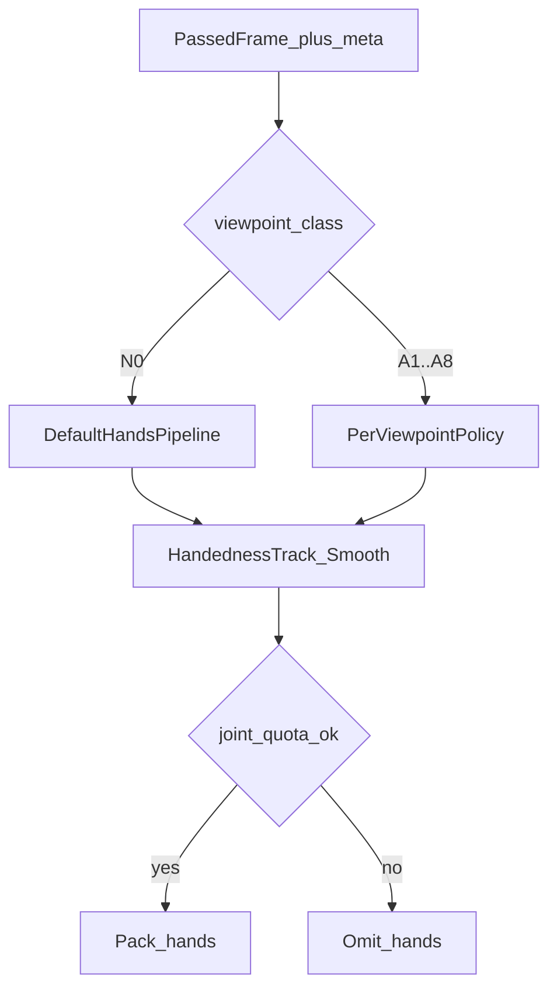

# 帧手势骨架提取算法（一期 Flutter）

> 算法设计文档。输入仅为 [视频流抽帧.md](./视频流抽帧.md) **已放行**的帧及其元数据；输出**指关节构型（手形）**通道，布局仍是 `mediapipe_hands_v1` 的 42 点。手形被拒时省略 `hands`。

**分工（锁定）**：本文只提供一拍上的指关节构型。腕/掌心/指尖的**路径形状**见 [运动轨迹.md](./运动轨迹.md)；相对身体部位的**接触与部位序列**见 [多器官配合.md](./多器官配合.md)。二者均不在本文积分。省略 `hands` **不等于** `path.gap`——同一拍轨迹照发（腕跟踪仍在时）。身份与骨节命名见 [手势骨架信封.md](./手势骨架信封.md)。

机位几何与阀门**不在本文重定义**：以 [index.md](./index.md) 三维系为准（**深度角 `α_d=90°` = N0，偏向角 N/A**；异常 `α_d<90°`），阀门与可采性见 [视频流抽帧.md](./视频流抽帧.md)。本文只定义：**抽中之后怎么抽点**。

## 前置与接口契约

| 输入字段 | 来源 | 用途 |
|----------|------|------|
| 图像帧 | 抽帧放行 | MediaPipe Hands |
| `ts` | 抽帧 | 写入 `landmarks.ts`；与同拍 `path` / `body` 对齐 |
| `roi` | 抽帧 | 推理裁剪 / 主手约束 |
| `hand_state` | 抽帧 | `none/left/right/both` 先验 |
| `viewpoint_class` | 抽帧 | **N0 默认管线；A1–A8 逐类策略** |
| `sharpness` | 抽帧 | 与关节 `v` 联合判质量 |

| 输出 | 说明 |
|------|------|
| 成功 | 可上行 JSON `landmarks`（见协议）；端侧可附内部质量标记；信封 `frame.hands` 填关节坐标，`present=true` |
| 失败 | 本拍省略 `hands`；可选 `low_quality` 回馈抽帧；UX 键与抽帧共用。**轨迹节拍继续**，不写 `path.gap` |
| 不做 | 路径积分、部位名、接触/擦过、非手控 |

缺省：若元数据无 `viewpoint_class`，按 **N0**；若连续多帧低 `v`，可请求抽帧重分类。



## `mediapipe_hands_v1` 布局约定

一期每手 **21** 点（MediaPipe Hands 标准序：0 腕，1–4 拇指，…，17–20 小指）。

**打包锁定**：`points` 定长 **42**；`[0:21) = left`，`[21:42) = right`；缺手或整手拒发时该槽各位 `v=0`（坐标可置 0），不省略槽位、不对调后变长。左右槽位算法见 [左右手骨架提取.md](./左右手骨架提取.md)。

| 字段 | 含义 |
|------|------|
| `x, y` | 归一化图像坐标 |
| `z` | 相对深度；`α_d<90°`（非 N0）时噪声大，按机位降权 |
| `v` | 可见/置信；低于门限视为无效关节 |

**原则**：缺失或低 `v` 关节 **不编造关键语义坐标**（不靠镜像/插值「补全」关键指尖用于上行）。

## 单帧默认流程（N0）

1. 在 `roi`（或全图）上跑 MediaPipe Hands。
2. 解析最多两只手；结合 `hand_state` 与 handedness 概率。
3. 轨迹关联与左右槽位（见问题 1、[左右手骨架提取.md](./左右手骨架提取.md)）→ 定长 42 打包。
4. 关节 `v` 门限过滤；统计有效关节比例。
5. 短窗平滑（One-Euro 或指数平滑）只作用于手形有效点 → 打包 `hands.points[]`。轨迹点不进入该滤波。
6. 有效比例不足 → 该手槽 `v=0`，或本拍省略 `hands`。不把轨迹节拍改成 `gap`。

## 问题 1：左右手骨架关节识别

**现象**：单帧 handedness 翻转；双手交叉时左右槽位对调。

**摘要对策**（完整算法见 [左右手骨架提取.md](./左右手骨架提取.md)）：

1. 每只检测手维护 `track_id`（腕部 + 掌心速度最近邻）；单左 / 单右 / 双手分节处理。
2. 标签融合优先级：稳定 track > `hand_state` > 拇指朝向几何先验 `T_thumb` > 单帧 handedness > 腕 `x` 序（仅双手非交叉且 N0；A3/A7 禁用）。
3. 交叉态冻结改标；遮挡时被遮手可整槽 `v=0` 但保留 track；**禁止**镜像编造、禁止交叉瞬间对调点集。
4. 冲突持续 → 拒发该手或整帧，错槽不上行。

## 问题 2：手势帧非标准到位

**现象**：手未摆到词典标准形，部分指节不可见或折叠。

**对策**：

1. per-joint：`v < V_min` → 该点标记无效（上行时可省略或 `v=0`，实现与协议消费者约定一致；一期建议保留点但 `v` 真实反映）。
2. 一手有效关节比例 `< R_min` → 该手不进入打包（不整帧瞎补）。
3. 平滑只作用于有效点；无效点不参与滤波更新。
4. 整帧勉强：标内部 `low_quality`，回馈抽帧提高清晰度门控 / 降占空比。

## 问题 3：帧内障碍物干扰

**现象**：遮挡、出框、其他物体叠在手上导致关节乱跳。

**对策**：

1. 低 `v` 关节剔除；连续多关节失效 → 整手拒发。
2. 推理限制在抽帧 `roi`；roi 外高响应忽略。
3. 持续失败（如连续 `N_occ` 帧整手拒）→ UX `hint.occlusion_or_frame`（遮挡/出框）；与抽帧 `hint.face_camera` 等键并存时由 UI 按优先级展示。
4. **双手互遮**（一手盖另一手、交叉叠加）：判定、被遮槽拒发、track 预测窗与禁止镜像补点 → 见 [左右手骨架提取.md](./左右手骨架提取.md) §4.4；与上列障碍物/出框共用 UX 键。

## 问题 4：抽帧后非标准机位的骨架提取（A1–A8）

**定位**：机位分类与可否抽帧由抽帧完成（深度角/偏向角 → `depth`/`bias` 阀门）。本节处理 `viewpoint_class ∈ {A1…A8}` 且已 pass 的帧。N0（`α_d=90°`）仅走上文默认管线。

**公共规则（A1–A8）**：

1. 读取 `viewpoint_class`，查下表策略（正机位 ↔ 深度角偏离；斜机位 ↔ 偏向角）。
2. 提高相应 per-joint `V_min`；对 `z` 更强平滑或降权。
3. 有效关节比例超更严的 `R_min(viewpoint)` → **整手不打包上行**。
4. 不可恢复 → 本拍省略 `hands` + 与抽帧相同的 `hint.face_camera`（深度角回 90°、消除偏向）。红档时机位模块已令轨迹写 `gap`。
5. **不**在骨架侧发明第二套机位枚举或阀门。

### A1 机正上手下（正机位 · 深度角）

| 项 | 内容 |
|----|------|
| 主要风险 | 深度角 &lt;90° 且近 +y：俯视重叠、指尖 `v` 降 |
| 门限 | 指尖/远端指节 `V_min`↑；掌心与近端优先 |
| 处理 | `z` 降权；重叠指尖缺失不插值编造 |
| 失败 | 远端大面积无效且掌心不稳 → 整手拒发 |

### A2 机右上手下（斜机位 · 偏向角）

| 项 | 内容 |
|----|------|
| 主要风险 | 右上偏向 + `α_d<90°`；投影左右混淆 |
| 门限 | `V_min`↑；`R_min`↑ |
| 处理 | **跟踪锁定 handedness**；仅 ROI 内主手；冲突 → 整手暂拒 |
| 失败 | 冲突持续 → UX 回正（减小偏向、深度角回升） |

### A3 机右正手正（正机位 · 深度角；偏向极限 ≡ 北偏东 90°）

| 项 | 内容 |
|----|------|
| 主要风险 | 近 +x / 北偏东 90° 同构；左右手镜像风险**最高** |
| 门限 | `P_hand` 提高才允许改标 |
| 处理 | **强制跟踪优先于单帧 handedness**；**禁止**仅靠腕部 `x` 翻转改标 |
| 失败 | 跟踪断裂且单帧置信不足 → 拒发该手 |

### A4 机右下手上（斜机位 · 偏向角）

| 项 | 内容 |
|----|------|
| 主要风险 | 右下偏向 + 深度角偏离；自遮挡增 |
| 门限 | 同 A2，且 `R_min` 更严 |
| 处理 | 同 A2 跟踪锁定；空洞不编造 |
| 失败 | 缺失比例超配额 → 整手拒发 |

### A5 机正下手上（正机位 · 深度角）

| 项 | 内容 |
|----|------|
| 主要风险 | 深度角 &lt;90° 且近 −y：仰视掌背/指根遮挡 |
| 门限 | 掌心与近端指节 `V_min`↑ |
| 处理 | 远端缺失**不**插值编造；掌心稳定才打包 |
| 失败 | 近端无效 → 整手拒发 |

### A6 机左下手上（斜机位）

| 项 | 内容 |
|----|------|
| 主要风险 | 同 A4，左侧对称 |
| 处理 | **镜像 A4** |
| 失败 | 同 A4 |

### A7 机左正手正（正机位）

| 项 | 内容 |
|----|------|
| 主要风险 | 同 A3，左侧对称 |
| 处理 | **镜像 A3**：跟踪强制优先；禁止单靠 `x` 改标 |
| 失败 | 同 A3 |

### A8 机左上手下（斜机位）

| 项 | 内容 |
|----|------|
| 主要风险 | 同 A2，左侧对称 |
| 处理 | **镜像 A2** |
| 失败 | 同 A2 |

### 逐类速查表

| viewpoint_class | 角量类型 | 骨架主要风险 | 骨架侧处理摘要 |
|-----------------|----------|--------------|----------------|
| N0 | `α_d=90°` | 基线 | 默认 Hands → 跟踪平滑 → 打包 |
| A1 | 正·深度 | 俯视重叠、指尖 v 降 | 指尖门限↑；掌心优先；z 降权 |
| A2 | 斜·偏向 | 右上偏向、左右混淆 | 跟踪锁定；ROI 主手；冲突暂拒 |
| A3 | 正·深度 | 侧视/北偏东 90°、镜像错标 | 跟踪强制优先；禁 x 翻转改标 |
| A4 | 斜·偏向 | 右下偏向、自遮挡 | A2 + 更严缺失配额 |
| A5 | 正·深度 | 仰视掌背遮挡 | 近端门限↑；远端不编造 |
| A6 | 斜·偏向 | 同 A4 左 | 镜像 A4 |
| A7 | 正·深度 | 同 A3 左 | 镜像 A3 |
| A8 | 斜·偏向 | 同 A2 左 | 镜像 A2 |

## 时序平滑

| 项 | 建议 |
|----|------|
| 滤波器 | One-Euro（或一阶指数平滑）只作用于手形通道的有效 `x,y`；`α_d<90°` 时机位对 `z` 降权或更强平滑。轨迹点不做 One-Euro，见 [运动轨迹.md](./运动轨迹.md) |
| 重置 | `track_id` 新建或长时间丢失后重置状态，避免拖尾幻影 |
| 与抽帧 | 平滑不能复活已被拒的模糊手形或**摄像头抖动拒帧**（见抽帧问题 8）；只改善已放行帧的手形关节抖动 |

## 打包为 `landmarks` 与信封映射

对齐 [../../api/protocol.md](../../../api/protocol.md)。端侧同一 `ts` 先写入 [手势骨架信封.md](./手势骨架信封.md) 的 `frame`，再投影上行：

| 骨架结果 | 信封 `frame` | 上行 |
|----------|--------------|------|
| 该手有效关节比 ≥ `R_min` | `hands.<side>.present = true`；关节带真实 `v`；骨节按两端 `v` 得 `valid` | `hands.points` 或 `mediapipe_hands_v1.points` 对应槽 |
| 该手整手拒发 | 该手 21 点仍在，`v=0`，`present=false`，骨节 `valid=false` | 该槽各位 `v=0` |
| 本拍省略 `hands` | 可不写手形通道或两槽 `present=false`；**仍可有**同拍 `path` / `body` | 报文省略 `hands`，可有 `path` |
| 交叉/遮挡 | `relation` 由左右手算法写入（不上行） | 仅影响槽位与 `v`，不改协议字段 |

```json
{
  "type": "landmarks",
  "protocolVersion": 1,
  "ts": 0,
  "sessionId": "sess-xxx",
  "schema": "mediapipe_hands_v1",
  "points": [
    { "x": 0.12, "y": 0.34, "z": 0.01, "v": 1.0 }
  ]
}
```

- **禁止**附带 JPEG/视频 payload。
- `viewpoint_class` **一期不上行**（端侧内部）；二期是否扩展协议为开放项。
- `points` **定长 42**：`[0:21)=left`，`[21:42)=right`；缺手槽 `v=0`，不填造假关键语义坐标（详见 [左右手骨架提取.md](./左右手骨架提取.md)）。
- 手形关节的 `x,y,z` 始终是图像坐标；同 `id` 在 `path` 里可为身体坐标，互不覆盖。

## 默认门限方向（可调）

| 符号 | N0 起点 | A1–A8 |
|------|---------|-------|
| `V_min` | 中等 | 按上表↑（指尖或近端） |
| `R_min` | 如 ≥0.6 有效关节 | A2/A4/A6/A8 等更严 |
| `P_hand` | 如 0.7 | A3/A7 更高才允许改标 |
| `N_occ` | 如 8–12 | 触发遮挡/出框提示 |

具体数值实现期按机型与词表标定。

## 落地计划（最小可落地单元）

> 本节由原 `plans/帧手势骨架提取.md` 合并而来（内容未改写，仅降级标题层级、修正相对链接）。**算法语义以本文其余章节为准**；本节只记录技术栈选型、第三方库、落地步骤、代码落点与延后项。
> 原 plans 文档中的「目标 / 非目标」「输入 / 输出契约」与本文对应章节重复，未重复收录。

### 技术栈

| 项 | 选型 |
|----|------|
| 推理 | MediaPipe **Hand Landmarker**（Tasks Vision） |
| 桥接 | 与 ② 同一套 Platform Channel / `tasks-vision` |
| 模型 | `hand_landmarker.task`；`numHands ≤ 2`；LIVE_STREAM |
| 打包 | Dart：21×2 → 定长 42，对齐 `mediapipe_hands_v1` |
| 平滑 | MVP 短指数平滑（有效点） |

### 第三方库

| 库 / 制品 | 用途 | 说明 |
|-----------|------|------|
| MediaPipe Hand Landmarker + `.task` | 21 点 + visibility | 官方；协议点序唯一来源 |
| `com.google.mediapipe:tasks-vision`（及 iOS 对等） | 原生推理 | 与 Pose 共用依赖 |
| 可选：[`hand_landmarker`](https://pub.dev/packages/hand_landmarker) | Android 联调加速 | 社区包；量产双端仍走自有 Channel |
| 现有 `envelope/` | 投影上行 | 已有，不新增 |

### 落地步骤

1. 接入 MediaPipe Hands Tasks；在 `roi`（或全图）推理，`max_num_hands ≤ 2`。
2. 解析每手 21 点（标准序）；按 `hand_state` 先验做初步左右归槽（精细规则交给左右手切片）。
3. per-joint：`v < V_min` 视为无效；一手有效比 `< R_min` → 该槽全 `v=0` 或整拍省略 `hands`。
4. MVP 平滑：短指数平滑即可（有效点）；`track_id` 新建时重置。
5. 禁止镜像/插值编造关键语义坐标；模糊帧若抽帧已拒，本模块不应被调用——若仍调用则直接省略 `hands`。
6. 替换 [`StubHandSkeletonExtractor`](./../../../../jianyin_app/lib/skeleton/hand_skeleton_extractor.dart)；经已有 envelope 投影上行。

### 代码落点

| 位置 | 动作 |
|------|------|
| [`lib/skeleton/hand_skeleton_extractor.dart`](./../../../../jianyin_app/lib/skeleton/hand_skeleton_extractor.dart) | `MediaPipeHandSkeletonExtractor` 实现 |
| [`lib/skeleton/hand_types.dart`](./../../../../jianyin_app/lib/skeleton/hand_types.dart) | 42 点打包工具复用/补齐 |
| [`lib/envelope/`](./../../../../jianyin_app/lib/envelope/) | 已有 pack；手形拒发时省略 `hands` 通道 |
| [`lib/perception/perception_pipeline.dart`](./../../../../jianyin_app/lib/perception/perception_pipeline.dart) | 注入真实 skeleton；顺序在 body/path 之后 |

### 验收口径

| 指标 | 通过线 |
|------|--------|
| N0 可上行 | 标准机位下成功打包并投影 42 点 |
| 拒发不解耦错 | 低 `v` / 低清晰度导致省略 `hands` 时，同拍 `path` 仍可由轨迹决定是否非 gap |
| 定长布局 | 始终 42 槽；缺手 `v=0`，不缩短、不对调变长 |
| 无编造 | 低可见关节不上行假指尖坐标 |

### 延后项

- A1–A8 逐类 `V_min` / `R_min` / `P_hand` 与 z 降权
- One-Euro 完整参数与机位相关 z 平滑
- `viewpoint_class` 缺失时的重分类请求
- 与左右手切片的交叉/遮挡 `relation` 写入信封
## 相关文档

- [index.md](./index.md) · [视频流抽帧.md](./视频流抽帧.md) · [左右手骨架提取.md](./左右手骨架提取.md) · [运动轨迹.md](./运动轨迹.md) · [多器官配合.md](./多器官配合.md) · [手势骨架信封.md](./手势骨架信封.md)
- [../../api/protocol.md](../../../api/protocol.md) · [../../系统架构/architecture.md](../../系统架构/architecture.md)
