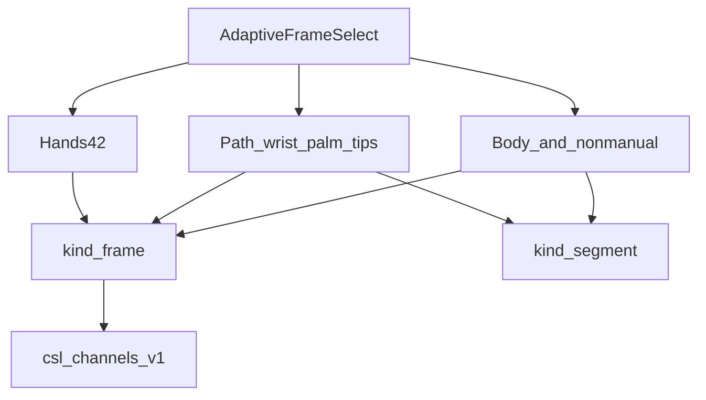
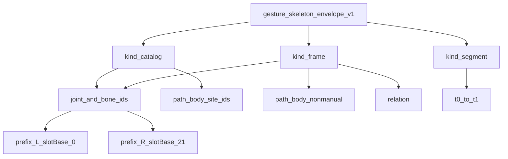
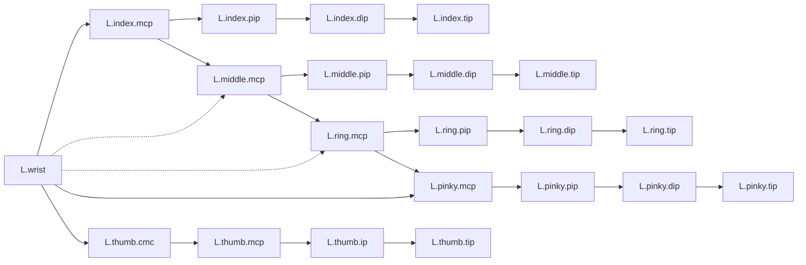
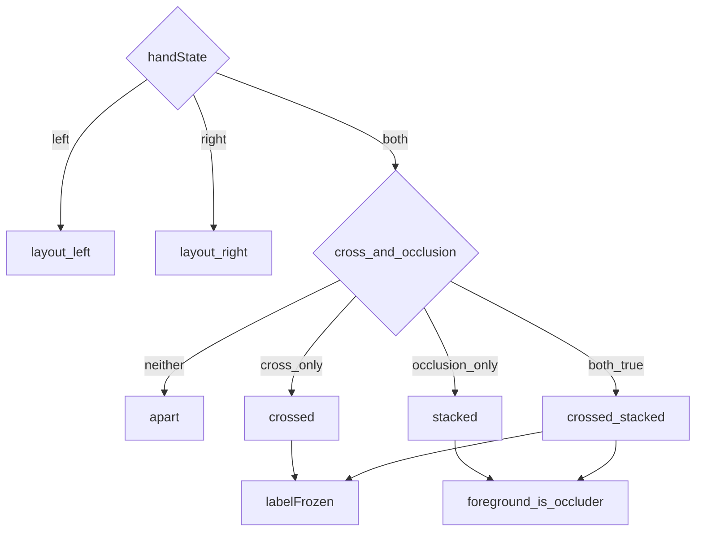

# 手势骨架信封（一期 Flutter）

> **感知管线终态**：抽帧驱动的手形、指轨迹与多器官三支路，在本文汇成同一份观测身份。手形抽点见 [帧手势骨架提取.md](./帧手势骨架提取.md)；左右槽位、交叉与遮挡见 [左右手骨架提取.md](./左右手骨架提取.md)。轨迹节拍、断点与运动描述见 [运动轨迹.md](./运动轨迹.md)。身体坐标系、部位与非手控见 [多器官配合.md](./多器官配合.md)。活动段时钟与放行元数据见 [视频流抽帧.md](./视频流抽帧.md)。本文给手形关节、指骨节、轨迹点、身体点、部位和非手控量命名。播音不在本文。

## 管线终态



| kind | 时间 | 内容 |
|---|---|---|
| `catalog` | 无坐标 | 锁定全部 `id`：手形关节与骨节、轨迹点、身体点、部位名、非手控量 |
| `frame` | 一个 `ts` | 一拍观测：手形图像坐标 + `path` + `body` + `nonmanual` + `relation` |
| `segment` | `t0` 到 `t1` | 一段连续非 `gap` 轨迹 × 部位序列 × 头口动；不上行 |

同一 `ts` 上：手形关节的 `x,y,z` **始终是图像坐标**；`path` 在 `space=body` 时是肩宽归一坐标。两处可同时出现同名 `id`（如 `L.wrist`），**互不覆盖**。

信封名 `gesture_skeleton_envelope_v1`。手形通道仍是定长 42 的 `points`。轨迹样本写在 `path` 里，不写回手形关节。协议见 [../../api/protocol.md](../../api/protocol.md)。

信封不是 WebSocket 事件。`frame` 里能投影到 `csl_channels_v1` 的，是手形点、`path`、`body`、`nonmanual`。骨节、`relation`、`present`、`valid` 和整个 `segment` 不上行。

## 目标与边界

| 项 | 说明 |
|---|---|
| 目标 | 管线终态身份源：命名手形、一拍轨迹与身体、以及跨拍轨迹段 |
| 身份 | `catalog` 锁定 `id`；`frame` 填一拍；`segment` 填一段时间 |
| 输入 | 已定槽的每手 21 点、交叉与遮挡判定、轨迹样本、姿态子集、非手控量、窗口运动描述 |
| 坐标并存 | 同 `ts`：`hands` 图像坐标与 `path` 身体（或图像）坐标并存，互不覆盖 |
| 不上行 | 骨节、`relation`、`present`、`valid`、`segment` |
| 保持不动 | 左右手 42 点与骨节的 `id`、`slot`；`mediapipe_hands_v1` 的定长 42 打包；`path` 仍为腕/掌心/五指尖 |

门限符号仍以源算法文档为准，本文不写数值。身体轴与部位锚点的公式以 [多器官配合.md](./多器官配合.md) 为准，轨迹积分以 [运动轨迹.md](./运动轨迹.md) 为准，本文只给字段命名。

## 术语

每手 21 个坐标点全部进入 `joints`。`role` 把关节腔和指尖端点分开。

| role | 含义 | 关节腔 |
|---|---|---|
| `wrist` | 腕关节 | 是 |
| `cmc` | 腕掌关节 | 是 |
| `mcp` | 掌指关节 | 是 |
| `ip` | 拇指指间关节 | 是 |
| `pip` | 近端指间关节 | 是 |
| `dip` | 远端指间关节 | 是 |
| `tip` | 指尖，远节指骨的远端端点 | 否 |

| 名称 | 定义 |
|---|---|
| 坐标点 | `joints` 中的一个元素。身份是 `id`、`local`、`slot`。帧上的 `x`、`y`、`z`、`v` 是它的本帧坐标 |
| 关节 | `role` 为 `wrist`、`cmc`、`mcp`、`ip`、`pip`、`dip` 的坐标点 |
| 指尖 | `role` 为 `tip` 的坐标点 |
| 指骨节 | 同一根手指上相邻坐标点的直接连线，`boneClass` 为 `phalanx`。每手 14 条：拇指近节与远节；食指、中指、无名指、小指各有近节、中节、远节 |
| 掌骨节 | `boneClass` 为 `metacarpal`，每手 5 条。拇指从腕掌关节指向掌指关节，其余四指从腕关节指向掌指关节。不计入指骨节 |
| 腕掌过渡 | `boneClass` 为 `wristBridge`，仅 `wrist` → `thumb.cmc`，每手 1 条 |
| 掌弓 | `boneClass` 为 `palmArch`，相邻掌指关节的连线，每手 3 条。方向自食指掌指关节指向小指掌指关节，说的是指序，不是屏幕左右。不计入指骨节 |

骨节方向锁定为近端 `from` 指向远端 `to`。指骨节的两端 `local` 相差 1。`segment` 只在指骨节上取值 `proximal`、`middle`、`distal`；拇指没有 `middle`。其他骨节的 `segment` 为 `null`。

每只手的中指掌骨、无名指掌骨，两端是腕关节和该指掌指关节。MediaPipe Hands 的掌部连线包含 `(0,1)`、`(0,5)`、`(5,9)`、`(9,13)`、`(13,17)`、`(0,17)` 以及各指上的相邻点，不包含 `(0,9)` 与 `(0,13)`。因此这两条掌骨 `mediapipeEdge` 为 `false`，绘制时走掌弓。其余骨节 `mediapipeEdge` 为 `true`。

一条骨节是否可画，看两端的 `v`。任一端低于使用侧 `V_min`，帧上该骨节 `valid` 为 `false`。`id` 仍保留，不用插值或镜像另造坐标。

| 手 | 坐标点 | 指骨节 | 掌骨节 | 腕掌过渡 | 掌弓 |
|---|---|---|---|---|---|
| 左手 | 21 | 14 | 5 | 1 | 3 |
| 右手 | 21 | 14 | 5 | 1 | 3 |
| 合计 | 42 | 28 | 10 | 2 | 6 |

## 坐标与槽位

`local` 与 MediaPipe Hands 点序一致：0 腕，1–4 拇指，5–8 食指，9–12 中指，13–16 无名指，17–20 小指。

| 手 | id 前缀 | slotBase | slot |
|---|---|---|---|
| 左手 | `L.` | 0 | `local` |
| 右手 | `R.` | 21 | `local + 21` |

左右手拓扑同构，id 与 slot 各自列全。右手不借用左手的 id。

`landmarks.points[slot]` 的 `x`、`y`、`z`、`v` 等于该 slot 关节的同名字段。骨节不是 `points` 里的元素。缺手或整手拒发时，该手 21 个坐标点仍在信封里，`v` 为 0，坐标可置 0。

## 左手

前缀 `L.`，`slotBase` 为 0，`slot` 等于 `local`。

### 坐标点

| id | 名称 | role | digit | local | slot |
|---|---|---|---|---|---|
| `L.wrist` | 腕关节 | `wrist` | `wrist` | 0 | 0 |
| `L.thumb.cmc` | 拇指腕掌关节 | `cmc` | `thumb` | 1 | 1 |
| `L.thumb.mcp` | 拇指掌指关节 | `mcp` | `thumb` | 2 | 2 |
| `L.thumb.ip` | 拇指指间关节 | `ip` | `thumb` | 3 | 3 |
| `L.thumb.tip` | 拇指尖 | `tip` | `thumb` | 4 | 4 |
| `L.index.mcp` | 食指掌指关节 | `mcp` | `index` | 5 | 5 |
| `L.index.pip` | 食指近端指间关节 | `pip` | `index` | 6 | 6 |
| `L.index.dip` | 食指远端指间关节 | `dip` | `index` | 7 | 7 |
| `L.index.tip` | 食指尖 | `tip` | `index` | 8 | 8 |
| `L.middle.mcp` | 中指掌指关节 | `mcp` | `middle` | 9 | 9 |
| `L.middle.pip` | 中指近端指间关节 | `pip` | `middle` | 10 | 10 |
| `L.middle.dip` | 中指远端指间关节 | `dip` | `middle` | 11 | 11 |
| `L.middle.tip` | 中指尖 | `tip` | `middle` | 12 | 12 |
| `L.ring.mcp` | 无名指掌指关节 | `mcp` | `ring` | 13 | 13 |
| `L.ring.pip` | 无名指近端指间关节 | `pip` | `ring` | 14 | 14 |
| `L.ring.dip` | 无名指远端指间关节 | `dip` | `ring` | 15 | 15 |
| `L.ring.tip` | 无名指尖 | `tip` | `ring` | 16 | 16 |
| `L.pinky.mcp` | 小指掌指关节 | `mcp` | `pinky` | 17 | 17 |
| `L.pinky.pip` | 小指近端指间关节 | `pip` | `pinky` | 18 | 18 |
| `L.pinky.dip` | 小指远端指间关节 | `dip` | `pinky` | 19 | 19 |
| `L.pinky.tip` | 小指尖 | `tip` | `pinky` | 20 | 20 |

### 指骨节

| id | 名称 | digit | segment | from | to | fromSlot | toSlot | mediapipeEdge |
|---|---|---|---|---|---|---|---|---|
| `L.thumb.phalanx.proximal` | 拇指近节指骨 | `thumb` | `proximal` | `L.thumb.mcp` | `L.thumb.ip` | 2 | 3 | `true` |
| `L.thumb.phalanx.distal` | 拇指远节指骨 | `thumb` | `distal` | `L.thumb.ip` | `L.thumb.tip` | 3 | 4 | `true` |
| `L.index.phalanx.proximal` | 食指近节指骨 | `index` | `proximal` | `L.index.mcp` | `L.index.pip` | 5 | 6 | `true` |
| `L.index.phalanx.middle` | 食指中节指骨 | `index` | `middle` | `L.index.pip` | `L.index.dip` | 6 | 7 | `true` |
| `L.index.phalanx.distal` | 食指远节指骨 | `index` | `distal` | `L.index.dip` | `L.index.tip` | 7 | 8 | `true` |
| `L.middle.phalanx.proximal` | 中指近节指骨 | `middle` | `proximal` | `L.middle.mcp` | `L.middle.pip` | 9 | 10 | `true` |
| `L.middle.phalanx.middle` | 中指中节指骨 | `middle` | `middle` | `L.middle.pip` | `L.middle.dip` | 10 | 11 | `true` |
| `L.middle.phalanx.distal` | 中指远节指骨 | `middle` | `distal` | `L.middle.dip` | `L.middle.tip` | 11 | 12 | `true` |
| `L.ring.phalanx.proximal` | 无名指近节指骨 | `ring` | `proximal` | `L.ring.mcp` | `L.ring.pip` | 13 | 14 | `true` |
| `L.ring.phalanx.middle` | 无名指中节指骨 | `ring` | `middle` | `L.ring.pip` | `L.ring.dip` | 14 | 15 | `true` |
| `L.ring.phalanx.distal` | 无名指远节指骨 | `ring` | `distal` | `L.ring.dip` | `L.ring.tip` | 15 | 16 | `true` |
| `L.pinky.phalanx.proximal` | 小指近节指骨 | `pinky` | `proximal` | `L.pinky.mcp` | `L.pinky.pip` | 17 | 18 | `true` |
| `L.pinky.phalanx.middle` | 小指中节指骨 | `pinky` | `middle` | `L.pinky.pip` | `L.pinky.dip` | 18 | 19 | `true` |
| `L.pinky.phalanx.distal` | 小指远节指骨 | `pinky` | `distal` | `L.pinky.dip` | `L.pinky.tip` | 19 | 20 | `true` |

### 掌骨、腕掌过渡与掌弓

| id | 名称 | boneClass | digit | from | to | fromSlot | toSlot | mediapipeEdge |
|---|---|---|---|---|---|---|---|---|
| `L.thumb.metacarpal` | 拇指掌骨 | `metacarpal` | `thumb` | `L.thumb.cmc` | `L.thumb.mcp` | 1 | 2 | `true` |
| `L.index.metacarpal` | 食指掌骨 | `metacarpal` | `index` | `L.wrist` | `L.index.mcp` | 0 | 5 | `true` |
| `L.middle.metacarpal` | 中指掌骨 | `metacarpal` | `middle` | `L.wrist` | `L.middle.mcp` | 0 | 9 | `false` |
| `L.ring.metacarpal` | 无名指掌骨 | `metacarpal` | `ring` | `L.wrist` | `L.ring.mcp` | 0 | 13 | `false` |
| `L.pinky.metacarpal` | 小指掌骨 | `metacarpal` | `pinky` | `L.wrist` | `L.pinky.mcp` | 0 | 17 | `true` |
| `L.thumb.wristBridge` | 拇指腕掌过渡 | `wristBridge` | `thumb` | `L.wrist` | `L.thumb.cmc` | 0 | 1 | `true` |
| `L.palm.arch.index_middle` | 食指至中指掌弓 | `palmArch` | `palm` | `L.index.mcp` | `L.middle.mcp` | 5 | 9 | `true` |
| `L.palm.arch.middle_ring` | 中指至无名指掌弓 | `palmArch` | `palm` | `L.middle.mcp` | `L.ring.mcp` | 9 | 13 | `true` |
| `L.palm.arch.ring_pinky` | 无名指至小指掌弓 | `palmArch` | `palm` | `L.ring.mcp` | `L.pinky.mcp` | 13 | 17 | `true` |

## 右手

前缀 `R.`，`slotBase` 为 21，`slot` 等于 `local + 21`。下表是右手自己的 id 与槽位。

### 坐标点

| id | 名称 | role | digit | local | slot |
|---|---|---|---|---|---|
| `R.wrist` | 腕关节 | `wrist` | `wrist` | 0 | 21 |
| `R.thumb.cmc` | 拇指腕掌关节 | `cmc` | `thumb` | 1 | 22 |
| `R.thumb.mcp` | 拇指掌指关节 | `mcp` | `thumb` | 2 | 23 |
| `R.thumb.ip` | 拇指指间关节 | `ip` | `thumb` | 3 | 24 |
| `R.thumb.tip` | 拇指尖 | `tip` | `thumb` | 4 | 25 |
| `R.index.mcp` | 食指掌指关节 | `mcp` | `index` | 5 | 26 |
| `R.index.pip` | 食指近端指间关节 | `pip` | `index` | 6 | 27 |
| `R.index.dip` | 食指远端指间关节 | `dip` | `index` | 7 | 28 |
| `R.index.tip` | 食指尖 | `tip` | `index` | 8 | 29 |
| `R.middle.mcp` | 中指掌指关节 | `mcp` | `middle` | 9 | 30 |
| `R.middle.pip` | 中指近端指间关节 | `pip` | `middle` | 10 | 31 |
| `R.middle.dip` | 中指远端指间关节 | `dip` | `middle` | 11 | 32 |
| `R.middle.tip` | 中指尖 | `tip` | `middle` | 12 | 33 |
| `R.ring.mcp` | 无名指掌指关节 | `mcp` | `ring` | 13 | 34 |
| `R.ring.pip` | 无名指近端指间关节 | `pip` | `ring` | 14 | 35 |
| `R.ring.dip` | 无名指远端指间关节 | `dip` | `ring` | 15 | 36 |
| `R.ring.tip` | 无名指尖 | `tip` | `ring` | 16 | 37 |
| `R.pinky.mcp` | 小指掌指关节 | `mcp` | `pinky` | 17 | 38 |
| `R.pinky.pip` | 小指近端指间关节 | `pip` | `pinky` | 18 | 39 |
| `R.pinky.dip` | 小指远端指间关节 | `dip` | `pinky` | 19 | 40 |
| `R.pinky.tip` | 小指尖 | `tip` | `pinky` | 20 | 41 |

### 指骨节

| id | 名称 | digit | segment | from | to | fromSlot | toSlot | mediapipeEdge |
|---|---|---|---|---|---|---|---|---|
| `R.thumb.phalanx.proximal` | 拇指近节指骨 | `thumb` | `proximal` | `R.thumb.mcp` | `R.thumb.ip` | 23 | 24 | `true` |
| `R.thumb.phalanx.distal` | 拇指远节指骨 | `thumb` | `distal` | `R.thumb.ip` | `R.thumb.tip` | 24 | 25 | `true` |
| `R.index.phalanx.proximal` | 食指近节指骨 | `index` | `proximal` | `R.index.mcp` | `R.index.pip` | 26 | 27 | `true` |
| `R.index.phalanx.middle` | 食指中节指骨 | `index` | `middle` | `R.index.pip` | `R.index.dip` | 27 | 28 | `true` |
| `R.index.phalanx.distal` | 食指远节指骨 | `index` | `distal` | `R.index.dip` | `R.index.tip` | 28 | 29 | `true` |
| `R.middle.phalanx.proximal` | 中指近节指骨 | `middle` | `proximal` | `R.middle.mcp` | `R.middle.pip` | 30 | 31 | `true` |
| `R.middle.phalanx.middle` | 中指中节指骨 | `middle` | `middle` | `R.middle.pip` | `R.middle.dip` | 31 | 32 | `true` |
| `R.middle.phalanx.distal` | 中指远节指骨 | `middle` | `distal` | `R.middle.dip` | `R.middle.tip` | 32 | 33 | `true` |
| `R.ring.phalanx.proximal` | 无名指近节指骨 | `ring` | `proximal` | `R.ring.mcp` | `R.ring.pip` | 34 | 35 | `true` |
| `R.ring.phalanx.middle` | 无名指中节指骨 | `ring` | `middle` | `R.ring.pip` | `R.ring.dip` | 35 | 36 | `true` |
| `R.ring.phalanx.distal` | 无名指远节指骨 | `ring` | `distal` | `R.ring.dip` | `R.ring.tip` | 36 | 37 | `true` |
| `R.pinky.phalanx.proximal` | 小指近节指骨 | `pinky` | `proximal` | `R.pinky.mcp` | `R.pinky.pip` | 38 | 39 | `true` |
| `R.pinky.phalanx.middle` | 小指中节指骨 | `pinky` | `middle` | `R.pinky.pip` | `R.pinky.dip` | 39 | 40 | `true` |
| `R.pinky.phalanx.distal` | 小指远节指骨 | `pinky` | `distal` | `R.pinky.dip` | `R.pinky.tip` | 40 | 41 | `true` |

### 掌骨、腕掌过渡与掌弓

| id | 名称 | boneClass | digit | from | to | fromSlot | toSlot | mediapipeEdge |
|---|---|---|---|---|---|---|---|---|
| `R.thumb.metacarpal` | 拇指掌骨 | `metacarpal` | `thumb` | `R.thumb.cmc` | `R.thumb.mcp` | 22 | 23 | `true` |
| `R.index.metacarpal` | 食指掌骨 | `metacarpal` | `index` | `R.wrist` | `R.index.mcp` | 21 | 26 | `true` |
| `R.middle.metacarpal` | 中指掌骨 | `metacarpal` | `middle` | `R.wrist` | `R.middle.mcp` | 21 | 30 | `false` |
| `R.ring.metacarpal` | 无名指掌骨 | `metacarpal` | `ring` | `R.wrist` | `R.ring.mcp` | 21 | 34 | `false` |
| `R.pinky.metacarpal` | 小指掌骨 | `metacarpal` | `pinky` | `R.wrist` | `R.pinky.mcp` | 21 | 38 | `true` |
| `R.thumb.wristBridge` | 拇指腕掌过渡 | `wristBridge` | `thumb` | `R.wrist` | `R.thumb.cmc` | 21 | 22 | `true` |
| `R.palm.arch.index_middle` | 食指至中指掌弓 | `palmArch` | `palm` | `R.index.mcp` | `R.middle.mcp` | 26 | 30 | `true` |
| `R.palm.arch.middle_ring` | 中指至无名指掌弓 | `palmArch` | `palm` | `R.middle.mcp` | `R.ring.mcp` | 30 | 34 | `true` |
| `R.palm.arch.ring_pinky` | 无名指至小指掌弓 | `palmArch` | `palm` | `R.ring.mcp` | `R.pinky.mcp` | 34 | 38 | `true` |

## 轨迹点、身体点与非手控

这些 `id` 与左右手关节、骨节使用同一信封。腕和五指尖复用已有关节 `id`。掌心、身体点和非手控量是新增身份，不进入 42 点槽位，也不改上表。

### 轨迹点

| id | 名称 | 来源 | 占 42 点槽 |
|---|---|---|---|
| `L.wrist` / `R.wrist` | 左腕 / 右腕 | 已有关节 | 是，`slot` 0 / 21 |
| `L.palm` / `R.palm` | 左掌心 / 右掌心 | 食指、中指、小指 MCP 的有效点均值；不足两个时记为腕，`v` 降到腕的 `v` | 否 |
| `L.thumb.tip` / `R.thumb.tip` | 拇指尖 | 已有关节 | 是 |
| `L.index.tip` / `R.index.tip` | 食指尖 | 已有关节 | 是 |
| `L.middle.tip` / `R.middle.tip` | 中指尖 | 已有关节 | 是 |
| `L.ring.tip` / `R.ring.tip` | 无名指尖 | 已有关节 | 是 |
| `L.pinky.tip` / `R.pinky.tip` | 小指尖 | 已有关节 | 是 |

`path` 里的坐标按该样本的 `space` 解释。`body` 时是肩宽归一坐标；`image` 时是图像归一化坐标。同一 `id` 在 `hands.joints` 里的 `x,y,z` 始终是图像坐标。两处坐标不要互相覆盖。

### 身体点

前缀 `B.`。姿态索引与 [多器官配合.md](./多器官配合.md) 的姿态子集相同。姿态腕和手形腕是两个 `id`。

| id | 名称 | 姿态索引 |
|---|---|---|
| `B.nose` | 鼻 | 0 |
| `B.eyeL` / `B.eyeR` | 左眼 / 右眼 | 2 / 5 |
| `B.earL` / `B.earR` | 左耳 / 右耳 | 7 / 8 |
| `B.mouthL` / `B.mouthR` | 左嘴角 / 右嘴角 | 9 / 10 |
| `B.shoulderL` / `B.shoulderR` | 左肩 / 右肩 | 11 / 12 |
| `B.elbowL` / `B.elbowR` | 左肘 / 右肘 | 13 / 14 |
| `B.wristL` / `B.wristR` | 姿态左腕 / 姿态右腕 | 15 / 16 |
| `B.hipL` / `B.hipR` | 左髋 / 右髋 | 23 / 24 |

身体轴不另造点。`body.frame` 记录原点、肩宽、`right`、`up`、`zSign`。`+X` 为签署人右侧，`+Y` 指向鼻，`+Z` 离开身体朝向镜头。换算公式不在本文重写。

### 部位名

部位是身体点导出的区域名，不是坐标点。锚点算法见多器官配合文档。

| id | 含义 |
|---|---|
| `forehead` | 额 |
| `eye` | 眼 |
| `nose` | 鼻 |
| `mouth` | 口 |
| `chin` | 下巴 |
| `ear` | 耳 |
| `cheek` | 颊 |
| `neck` | 颈 |
| `shoulder` | 肩 |
| `chest` | 胸 |
| `abdomen` | 腹 |
| `waist` | 腰 |
| `neutral` | 胸前中性空间 |
| `none` | 不在上述区域 |

### 非手控量

这些量没有 `x,y,z`。`head` 的三个角是弧度，其余是 0–1。来源 blendshape 的名字见多器官配合文档。

| id | 含义 |
|---|---|
| `head.pitch` / `head.yaw` / `head.roll` | 俯仰、偏航、滚转 |
| `mouth.open` / `mouth.round` / `mouth.spread` | 嘴的开合、圆展、咧开 |
| `brow.raise` / `brow.furrow` | 眉抬起、眉皱起 |
| `eye.openL` / `eye.openR` | 左眼裂、右眼裂 |

## JSON 信封

字段集合按下表锁定。示例按此顺序书写。比较两份信封时以 `id` 为准，不依赖 JSON 对象键的序列化顺序。

| 位置 | 字段 |
|---|---|
| 根，三种 kind 都有 | `envelope`、`kind` |
| `catalog` 与 `frame` | `coord`（手形图像平面） |
| 仅 catalog | `packing`、`hands`、`pathPoints`、`bodyPoints`、`sites`、`nonmanualQuantities` |
| 仅 frame | `ts`、`hands`、`path`、`relation`；`body` 与 `nonmanual` 可省略 |
| 仅 segment | `t0`、`t1`、`hand`、`trace`、`space`、`movement`、`places`、`head`、`mouth` |
| `hands.left` / `hands.right` | `slotBase`、`joints`、`bones`；frame 另有 `present` |
| 关节，catalog | `id`、`role`、`digit`、`local`、`slot` |
| 关节，frame | catalog 字段，加 `x`、`y`、`z`、`v` |
| 骨节，catalog | `id`、`boneClass`、`segment`、`digit`、`from`、`to`、`fromSlot`、`toSlot`、`mediapipeEdge` |
| 骨节，frame | catalog 字段，加 `valid` |
| `relation` | `handState`、`layout`、`foreground`、`occluder`、`occluded`、`labelFrozen` |
| `path` | `space`、`anchor`、`gap`；`gap` 为 false 时有 `left`、`right` |
| 轨迹点 | `id`、`x`、`y`、`z`、`v` |
| `body` | 身体点的图像坐标，加 `frame` |
| `body.frame` | `origin`、`shoulderWidth`、`right`、`up`、`zSign` |
| `nonmanual` | `head`、`mouth`、`brow`、`eye` |
| `movement` | `duration`、`pathLength`、`net`、`direction`、`shape`、`repeats`、`contactSite`、`brushSite` |

`coord` 只描述手形关节：`image_normalized`、`right_positive`、`down_positive`、`relative_depth`、`visibility`。`packing.schema` 锁定为 `mediapipe_hands_v1`，`length` 为 42，左手 `[0:21)`，右手 `[21:42)`。

`path.space = body` 时，轨迹点是肩宽归一坐标：`+X` 签署人右侧，`+Y` 指向鼻，`+Z` 离开身体朝向镜头。`path.space = image` 时，轨迹点与手形关节同一套图像平面。手形关节的 `x,y,z` 始终是图像坐标。One-Euro 只作用手形关节；轨迹点保持轨迹算法里的轻采样，不套用该滤波。

`ts` 与上行 `landmarks.ts` 是同一采集时刻。`present` 表示该手至少有一个关节的 `v` 达到 `V_min`。`valid` 表示该骨节两端的 `v` 都达到 `V_min`。

活动段每个轨迹节拍都有一帧信封。`path.gap = true` 时保留 `ts`，省略左右轨迹点。`Idle` 不产出带 `path` 的帧。肩或鼻不足以建系时省略 `body`，并把 `path.anchor` 设为 `false`、`path.space` 设为 `image`。没有脸部结果时省略 `nonmanual`。

数组顺序锁定：

1. 阅读顺序是 `left` 然后 `right`。身份认 id 前缀和 `slotBase`。
2. `joints` 按 `local` 从 0 到 20。
3. `bones` 先全部指骨节（拇指到小指，近节到远节），再掌骨节（拇指到小指），再腕掌过渡，再掌弓（食指到小指）。

合法 `frame` 的手形关节 id、骨节 id 与 `catalog` 的左右手目录一一对应，不能增 id，也不能少 id。`path`、`body`、`nonmanual` 使用上文轨迹点、身体点和非手控量的 `id`。`gap` 为 true 时不要求轨迹点出现。`body` 或 `nonmanual` 省略时，不要求它们的 `id` 出现在这一拍。

### catalog

下面是 catalog 的手形部分。轨迹点、身体点、部位名和非手控量的 `id` 在上一节，与这段 JSON 一起才是完整 catalog。手形部分的关节和骨节不能增删。

```json
{
  "envelope": "gesture_skeleton_envelope_v1",
  "kind": "catalog",
  "coord": {
    "space": "image_normalized",
    "x": "right_positive",
    "y": "down_positive",
    "z": "relative_depth",
    "v": "visibility"
  },
  "packing": {
    "schema": "mediapipe_hands_v1",
    "length": 42,
    "left": {
      "range": "[0:21)",
      "slotBase": 0
    },
    "right": {
      "range": "[21:42)",
      "slotBase": 21
    }
  },
  "hands": {
    "left": {
      "slotBase": 0,
      "joints": [
        {
          "id": "L.wrist",
          "role": "wrist",
          "digit": "wrist",
          "local": 0,
          "slot": 0
        },
        {
          "id": "L.thumb.cmc",
          "role": "cmc",
          "digit": "thumb",
          "local": 1,
          "slot": 1
        },
        {
          "id": "L.thumb.mcp",
          "role": "mcp",
          "digit": "thumb",
          "local": 2,
          "slot": 2
        },
        {
          "id": "L.thumb.ip",
          "role": "ip",
          "digit": "thumb",
          "local": 3,
          "slot": 3
        },
        {
          "id": "L.thumb.tip",
          "role": "tip",
          "digit": "thumb",
          "local": 4,
          "slot": 4
        },
        {
          "id": "L.index.mcp",
          "role": "mcp",
          "digit": "index",
          "local": 5,
          "slot": 5
        },
        {
          "id": "L.index.pip",
          "role": "pip",
          "digit": "index",
          "local": 6,
          "slot": 6
        },
        {
          "id": "L.index.dip",
          "role": "dip",
          "digit": "index",
          "local": 7,
          "slot": 7
        },
        {
          "id": "L.index.tip",
          "role": "tip",
          "digit": "index",
          "local": 8,
          "slot": 8
        },
        {
          "id": "L.middle.mcp",
          "role": "mcp",
          "digit": "middle",
          "local": 9,
          "slot": 9
        },
        {
          "id": "L.middle.pip",
          "role": "pip",
          "digit": "middle",
          "local": 10,
          "slot": 10
        },
        {
          "id": "L.middle.dip",
          "role": "dip",
          "digit": "middle",
          "local": 11,
          "slot": 11
        },
        {
          "id": "L.middle.tip",
          "role": "tip",
          "digit": "middle",
          "local": 12,
          "slot": 12
        },
        {
          "id": "L.ring.mcp",
          "role": "mcp",
          "digit": "ring",
          "local": 13,
          "slot": 13
        },
        {
          "id": "L.ring.pip",
          "role": "pip",
          "digit": "ring",
          "local": 14,
          "slot": 14
        },
        {
          "id": "L.ring.dip",
          "role": "dip",
          "digit": "ring",
          "local": 15,
          "slot": 15
        },
        {
          "id": "L.ring.tip",
          "role": "tip",
          "digit": "ring",
          "local": 16,
          "slot": 16
        },
        {
          "id": "L.pinky.mcp",
          "role": "mcp",
          "digit": "pinky",
          "local": 17,
          "slot": 17
        },
        {
          "id": "L.pinky.pip",
          "role": "pip",
          "digit": "pinky",
          "local": 18,
          "slot": 18
        },
        {
          "id": "L.pinky.dip",
          "role": "dip",
          "digit": "pinky",
          "local": 19,
          "slot": 19
        },
        {
          "id": "L.pinky.tip",
          "role": "tip",
          "digit": "pinky",
          "local": 20,
          "slot": 20
        }
      ],
      "bones": [
        {
          "id": "L.thumb.phalanx.proximal",
          "boneClass": "phalanx",
          "segment": "proximal",
          "digit": "thumb",
          "from": "L.thumb.mcp",
          "to": "L.thumb.ip",
          "fromSlot": 2,
          "toSlot": 3,
          "mediapipeEdge": true
        },
        {
          "id": "L.thumb.phalanx.distal",
          "boneClass": "phalanx",
          "segment": "distal",
          "digit": "thumb",
          "from": "L.thumb.ip",
          "to": "L.thumb.tip",
          "fromSlot": 3,
          "toSlot": 4,
          "mediapipeEdge": true
        },
        {
          "id": "L.index.phalanx.proximal",
          "boneClass": "phalanx",
          "segment": "proximal",
          "digit": "index",
          "from": "L.index.mcp",
          "to": "L.index.pip",
          "fromSlot": 5,
          "toSlot": 6,
          "mediapipeEdge": true
        },
        {
          "id": "L.index.phalanx.middle",
          "boneClass": "phalanx",
          "segment": "middle",
          "digit": "index",
          "from": "L.index.pip",
          "to": "L.index.dip",
          "fromSlot": 6,
          "toSlot": 7,
          "mediapipeEdge": true
        },
        {
          "id": "L.index.phalanx.distal",
          "boneClass": "phalanx",
          "segment": "distal",
          "digit": "index",
          "from": "L.index.dip",
          "to": "L.index.tip",
          "fromSlot": 7,
          "toSlot": 8,
          "mediapipeEdge": true
        },
        {
          "id": "L.middle.phalanx.proximal",
          "boneClass": "phalanx",
          "segment": "proximal",
          "digit": "middle",
          "from": "L.middle.mcp",
          "to": "L.middle.pip",
          "fromSlot": 9,
          "toSlot": 10,
          "mediapipeEdge": true
        },
        {
          "id": "L.middle.phalanx.middle",
          "boneClass": "phalanx",
          "segment": "middle",
          "digit": "middle",
          "from": "L.middle.pip",
          "to": "L.middle.dip",
          "fromSlot": 10,
          "toSlot": 11,
          "mediapipeEdge": true
        },
        {
          "id": "L.middle.phalanx.distal",
          "boneClass": "phalanx",
          "segment": "distal",
          "digit": "middle",
          "from": "L.middle.dip",
          "to": "L.middle.tip",
          "fromSlot": 11,
          "toSlot": 12,
          "mediapipeEdge": true
        },
        {
          "id": "L.ring.phalanx.proximal",
          "boneClass": "phalanx",
          "segment": "proximal",
          "digit": "ring",
          "from": "L.ring.mcp",
          "to": "L.ring.pip",
          "fromSlot": 13,
          "toSlot": 14,
          "mediapipeEdge": true
        },
        {
          "id": "L.ring.phalanx.middle",
          "boneClass": "phalanx",
          "segment": "middle",
          "digit": "ring",
          "from": "L.ring.pip",
          "to": "L.ring.dip",
          "fromSlot": 14,
          "toSlot": 15,
          "mediapipeEdge": true
        },
        {
          "id": "L.ring.phalanx.distal",
          "boneClass": "phalanx",
          "segment": "distal",
          "digit": "ring",
          "from": "L.ring.dip",
          "to": "L.ring.tip",
          "fromSlot": 15,
          "toSlot": 16,
          "mediapipeEdge": true
        },
        {
          "id": "L.pinky.phalanx.proximal",
          "boneClass": "phalanx",
          "segment": "proximal",
          "digit": "pinky",
          "from": "L.pinky.mcp",
          "to": "L.pinky.pip",
          "fromSlot": 17,
          "toSlot": 18,
          "mediapipeEdge": true
        },
        {
          "id": "L.pinky.phalanx.middle",
          "boneClass": "phalanx",
          "segment": "middle",
          "digit": "pinky",
          "from": "L.pinky.pip",
          "to": "L.pinky.dip",
          "fromSlot": 18,
          "toSlot": 19,
          "mediapipeEdge": true
        },
        {
          "id": "L.pinky.phalanx.distal",
          "boneClass": "phalanx",
          "segment": "distal",
          "digit": "pinky",
          "from": "L.pinky.dip",
          "to": "L.pinky.tip",
          "fromSlot": 19,
          "toSlot": 20,
          "mediapipeEdge": true
        },
        {
          "id": "L.thumb.metacarpal",
          "boneClass": "metacarpal",
          "segment": null,
          "digit": "thumb",
          "from": "L.thumb.cmc",
          "to": "L.thumb.mcp",
          "fromSlot": 1,
          "toSlot": 2,
          "mediapipeEdge": true
        },
        {
          "id": "L.index.metacarpal",
          "boneClass": "metacarpal",
          "segment": null,
          "digit": "index",
          "from": "L.wrist",
          "to": "L.index.mcp",
          "fromSlot": 0,
          "toSlot": 5,
          "mediapipeEdge": true
        },
        {
          "id": "L.middle.metacarpal",
          "boneClass": "metacarpal",
          "segment": null,
          "digit": "middle",
          "from": "L.wrist",
          "to": "L.middle.mcp",
          "fromSlot": 0,
          "toSlot": 9,
          "mediapipeEdge": false
        },
        {
          "id": "L.ring.metacarpal",
          "boneClass": "metacarpal",
          "segment": null,
          "digit": "ring",
          "from": "L.wrist",
          "to": "L.ring.mcp",
          "fromSlot": 0,
          "toSlot": 13,
          "mediapipeEdge": false
        },
        {
          "id": "L.pinky.metacarpal",
          "boneClass": "metacarpal",
          "segment": null,
          "digit": "pinky",
          "from": "L.wrist",
          "to": "L.pinky.mcp",
          "fromSlot": 0,
          "toSlot": 17,
          "mediapipeEdge": true
        },
        {
          "id": "L.thumb.wristBridge",
          "boneClass": "wristBridge",
          "segment": null,
          "digit": "thumb",
          "from": "L.wrist",
          "to": "L.thumb.cmc",
          "fromSlot": 0,
          "toSlot": 1,
          "mediapipeEdge": true
        },
        {
          "id": "L.palm.arch.index_middle",
          "boneClass": "palmArch",
          "segment": null,
          "digit": "palm",
          "from": "L.index.mcp",
          "to": "L.middle.mcp",
          "fromSlot": 5,
          "toSlot": 9,
          "mediapipeEdge": true
        },
        {
          "id": "L.palm.arch.middle_ring",
          "boneClass": "palmArch",
          "segment": null,
          "digit": "palm",
          "from": "L.middle.mcp",
          "to": "L.ring.mcp",
          "fromSlot": 9,
          "toSlot": 13,
          "mediapipeEdge": true
        },
        {
          "id": "L.palm.arch.ring_pinky",
          "boneClass": "palmArch",
          "segment": null,
          "digit": "palm",
          "from": "L.ring.mcp",
          "to": "L.pinky.mcp",
          "fromSlot": 13,
          "toSlot": 17,
          "mediapipeEdge": true
        }
      ]
    },
    "right": {
      "slotBase": 21,
      "joints": [
        {
          "id": "R.wrist",
          "role": "wrist",
          "digit": "wrist",
          "local": 0,
          "slot": 21
        },
        {
          "id": "R.thumb.cmc",
          "role": "cmc",
          "digit": "thumb",
          "local": 1,
          "slot": 22
        },
        {
          "id": "R.thumb.mcp",
          "role": "mcp",
          "digit": "thumb",
          "local": 2,
          "slot": 23
        },
        {
          "id": "R.thumb.ip",
          "role": "ip",
          "digit": "thumb",
          "local": 3,
          "slot": 24
        },
        {
          "id": "R.thumb.tip",
          "role": "tip",
          "digit": "thumb",
          "local": 4,
          "slot": 25
        },
        {
          "id": "R.index.mcp",
          "role": "mcp",
          "digit": "index",
          "local": 5,
          "slot": 26
        },
        {
          "id": "R.index.pip",
          "role": "pip",
          "digit": "index",
          "local": 6,
          "slot": 27
        },
        {
          "id": "R.index.dip",
          "role": "dip",
          "digit": "index",
          "local": 7,
          "slot": 28
        },
        {
          "id": "R.index.tip",
          "role": "tip",
          "digit": "index",
          "local": 8,
          "slot": 29
        },
        {
          "id": "R.middle.mcp",
          "role": "mcp",
          "digit": "middle",
          "local": 9,
          "slot": 30
        },
        {
          "id": "R.middle.pip",
          "role": "pip",
          "digit": "middle",
          "local": 10,
          "slot": 31
        },
        {
          "id": "R.middle.dip",
          "role": "dip",
          "digit": "middle",
          "local": 11,
          "slot": 32
        },
        {
          "id": "R.middle.tip",
          "role": "tip",
          "digit": "middle",
          "local": 12,
          "slot": 33
        },
        {
          "id": "R.ring.mcp",
          "role": "mcp",
          "digit": "ring",
          "local": 13,
          "slot": 34
        },
        {
          "id": "R.ring.pip",
          "role": "pip",
          "digit": "ring",
          "local": 14,
          "slot": 35
        },
        {
          "id": "R.ring.dip",
          "role": "dip",
          "digit": "ring",
          "local": 15,
          "slot": 36
        },
        {
          "id": "R.ring.tip",
          "role": "tip",
          "digit": "ring",
          "local": 16,
          "slot": 37
        },
        {
          "id": "R.pinky.mcp",
          "role": "mcp",
          "digit": "pinky",
          "local": 17,
          "slot": 38
        },
        {
          "id": "R.pinky.pip",
          "role": "pip",
          "digit": "pinky",
          "local": 18,
          "slot": 39
        },
        {
          "id": "R.pinky.dip",
          "role": "dip",
          "digit": "pinky",
          "local": 19,
          "slot": 40
        },
        {
          "id": "R.pinky.tip",
          "role": "tip",
          "digit": "pinky",
          "local": 20,
          "slot": 41
        }
      ],
      "bones": [
        {
          "id": "R.thumb.phalanx.proximal",
          "boneClass": "phalanx",
          "segment": "proximal",
          "digit": "thumb",
          "from": "R.thumb.mcp",
          "to": "R.thumb.ip",
          "fromSlot": 23,
          "toSlot": 24,
          "mediapipeEdge": true
        },
        {
          "id": "R.thumb.phalanx.distal",
          "boneClass": "phalanx",
          "segment": "distal",
          "digit": "thumb",
          "from": "R.thumb.ip",
          "to": "R.thumb.tip",
          "fromSlot": 24,
          "toSlot": 25,
          "mediapipeEdge": true
        },
        {
          "id": "R.index.phalanx.proximal",
          "boneClass": "phalanx",
          "segment": "proximal",
          "digit": "index",
          "from": "R.index.mcp",
          "to": "R.index.pip",
          "fromSlot": 26,
          "toSlot": 27,
          "mediapipeEdge": true
        },
        {
          "id": "R.index.phalanx.middle",
          "boneClass": "phalanx",
          "segment": "middle",
          "digit": "index",
          "from": "R.index.pip",
          "to": "R.index.dip",
          "fromSlot": 27,
          "toSlot": 28,
          "mediapipeEdge": true
        },
        {
          "id": "R.index.phalanx.distal",
          "boneClass": "phalanx",
          "segment": "distal",
          "digit": "index",
          "from": "R.index.dip",
          "to": "R.index.tip",
          "fromSlot": 28,
          "toSlot": 29,
          "mediapipeEdge": true
        },
        {
          "id": "R.middle.phalanx.proximal",
          "boneClass": "phalanx",
          "segment": "proximal",
          "digit": "middle",
          "from": "R.middle.mcp",
          "to": "R.middle.pip",
          "fromSlot": 30,
          "toSlot": 31,
          "mediapipeEdge": true
        },
        {
          "id": "R.middle.phalanx.middle",
          "boneClass": "phalanx",
          "segment": "middle",
          "digit": "middle",
          "from": "R.middle.pip",
          "to": "R.middle.dip",
          "fromSlot": 31,
          "toSlot": 32,
          "mediapipeEdge": true
        },
        {
          "id": "R.middle.phalanx.distal",
          "boneClass": "phalanx",
          "segment": "distal",
          "digit": "middle",
          "from": "R.middle.dip",
          "to": "R.middle.tip",
          "fromSlot": 32,
          "toSlot": 33,
          "mediapipeEdge": true
        },
        {
          "id": "R.ring.phalanx.proximal",
          "boneClass": "phalanx",
          "segment": "proximal",
          "digit": "ring",
          "from": "R.ring.mcp",
          "to": "R.ring.pip",
          "fromSlot": 34,
          "toSlot": 35,
          "mediapipeEdge": true
        },
        {
          "id": "R.ring.phalanx.middle",
          "boneClass": "phalanx",
          "segment": "middle",
          "digit": "ring",
          "from": "R.ring.pip",
          "to": "R.ring.dip",
          "fromSlot": 35,
          "toSlot": 36,
          "mediapipeEdge": true
        },
        {
          "id": "R.ring.phalanx.distal",
          "boneClass": "phalanx",
          "segment": "distal",
          "digit": "ring",
          "from": "R.ring.dip",
          "to": "R.ring.tip",
          "fromSlot": 36,
          "toSlot": 37,
          "mediapipeEdge": true
        },
        {
          "id": "R.pinky.phalanx.proximal",
          "boneClass": "phalanx",
          "segment": "proximal",
          "digit": "pinky",
          "from": "R.pinky.mcp",
          "to": "R.pinky.pip",
          "fromSlot": 38,
          "toSlot": 39,
          "mediapipeEdge": true
        },
        {
          "id": "R.pinky.phalanx.middle",
          "boneClass": "phalanx",
          "segment": "middle",
          "digit": "pinky",
          "from": "R.pinky.pip",
          "to": "R.pinky.dip",
          "fromSlot": 39,
          "toSlot": 40,
          "mediapipeEdge": true
        },
        {
          "id": "R.pinky.phalanx.distal",
          "boneClass": "phalanx",
          "segment": "distal",
          "digit": "pinky",
          "from": "R.pinky.dip",
          "to": "R.pinky.tip",
          "fromSlot": 40,
          "toSlot": 41,
          "mediapipeEdge": true
        },
        {
          "id": "R.thumb.metacarpal",
          "boneClass": "metacarpal",
          "segment": null,
          "digit": "thumb",
          "from": "R.thumb.cmc",
          "to": "R.thumb.mcp",
          "fromSlot": 22,
          "toSlot": 23,
          "mediapipeEdge": true
        },
        {
          "id": "R.index.metacarpal",
          "boneClass": "metacarpal",
          "segment": null,
          "digit": "index",
          "from": "R.wrist",
          "to": "R.index.mcp",
          "fromSlot": 21,
          "toSlot": 26,
          "mediapipeEdge": true
        },
        {
          "id": "R.middle.metacarpal",
          "boneClass": "metacarpal",
          "segment": null,
          "digit": "middle",
          "from": "R.wrist",
          "to": "R.middle.mcp",
          "fromSlot": 21,
          "toSlot": 30,
          "mediapipeEdge": false
        },
        {
          "id": "R.ring.metacarpal",
          "boneClass": "metacarpal",
          "segment": null,
          "digit": "ring",
          "from": "R.wrist",
          "to": "R.ring.mcp",
          "fromSlot": 21,
          "toSlot": 34,
          "mediapipeEdge": false
        },
        {
          "id": "R.pinky.metacarpal",
          "boneClass": "metacarpal",
          "segment": null,
          "digit": "pinky",
          "from": "R.wrist",
          "to": "R.pinky.mcp",
          "fromSlot": 21,
          "toSlot": 38,
          "mediapipeEdge": true
        },
        {
          "id": "R.thumb.wristBridge",
          "boneClass": "wristBridge",
          "segment": null,
          "digit": "thumb",
          "from": "R.wrist",
          "to": "R.thumb.cmc",
          "fromSlot": 21,
          "toSlot": 22,
          "mediapipeEdge": true
        },
        {
          "id": "R.palm.arch.index_middle",
          "boneClass": "palmArch",
          "segment": null,
          "digit": "palm",
          "from": "R.index.mcp",
          "to": "R.middle.mcp",
          "fromSlot": 26,
          "toSlot": 30,
          "mediapipeEdge": true
        },
        {
          "id": "R.palm.arch.middle_ring",
          "boneClass": "palmArch",
          "segment": null,
          "digit": "palm",
          "from": "R.middle.mcp",
          "to": "R.ring.mcp",
          "fromSlot": 30,
          "toSlot": 34,
          "mediapipeEdge": true
        },
        {
          "id": "R.palm.arch.ring_pinky",
          "boneClass": "palmArch",
          "segment": null,
          "digit": "palm",
          "from": "R.ring.mcp",
          "to": "R.pinky.mcp",
          "fromSlot": 34,
          "toSlot": 38,
          "mediapipeEdge": true
        }
      ]
    }
  }
}
```

完整 catalog 在手形部分之外还包括：

```json
{
  "pathPoints": [
    { "id": "L.palm", "hand": "left", "derivedFrom": ["L.index.mcp", "L.middle.mcp", "L.pinky.mcp"] },
    { "id": "R.palm", "hand": "right", "derivedFrom": ["R.index.mcp", "R.middle.mcp", "R.pinky.mcp"] }
  ],
  "bodyPoints": [
    { "id": "B.nose", "poseIndex": 0 },
    { "id": "B.eyeL", "poseIndex": 2 },
    { "id": "B.eyeR", "poseIndex": 5 },
    { "id": "B.earL", "poseIndex": 7 },
    { "id": "B.earR", "poseIndex": 8 },
    { "id": "B.mouthL", "poseIndex": 9 },
    { "id": "B.mouthR", "poseIndex": 10 },
    { "id": "B.shoulderL", "poseIndex": 11 },
    { "id": "B.shoulderR", "poseIndex": 12 },
    { "id": "B.elbowL", "poseIndex": 13 },
    { "id": "B.elbowR", "poseIndex": 14 },
    { "id": "B.wristL", "poseIndex": 15 },
    { "id": "B.wristR", "poseIndex": 16 },
    { "id": "B.hipL", "poseIndex": 23 },
    { "id": "B.hipR", "poseIndex": 24 }
  ],
  "sites": [
    "forehead", "eye", "nose", "mouth", "chin", "ear", "cheek",
    "neck", "shoulder", "chest", "abdomen", "waist", "neutral", "none"
  ],
  "nonmanualQuantities": [
    "head.pitch", "head.yaw", "head.roll",
    "mouth.open", "mouth.round", "mouth.spread",
    "brow.raise", "brow.furrow",
    "eye.openL", "eye.openR"
  ]
}
```

腕和五指尖的轨迹身份就是手形关节里的同名 `id`，不在 `pathPoints` 里重复登记。`B.wristL` 不是 `L.wrist`。

### 交叉层叠

`relation` 只出现在 `frame`。`handState` 原样沿用抽帧先验 `none`、`left`、`right`、`both`，信封内不重算。`handState` 为 `none` 时父文档整帧拒发，不产出 `frame`。

`layout` 的 `left`、`right` 表示单手，和对象 `hands.left`、`hands.right` 不是同一个字段。

| 字段 | 取值 | 何时取值 |
|---|---|---|
| `handState` | `left` / `right` / `both` | 产出 frame 时沿用抽帧；`none` 不产出 frame |
| `layout` | `left` / `right` | `handState` 为单手时与之同值 |
| `layout` | `apart` | 双手，§4.3 交叉条件与 §4.4 遮挡条件都不成立 |
| `layout` | `crossed` | 双手，只成立 §4.3 |
| `layout` | `stacked` | 双手，只成立 §4.4 |
| `layout` | `crossed_stacked` | 双手，§4.3 与 §4.4 同时成立 |
| `foreground` | `left` / `right` / `unknown` | 层叠时等于遮挡手；否则 `unknown` |
| `occluder` | `left` / `right` / `none` | 层叠时为遮挡手；否则 `none` |
| `occluded` | `left` / `right` / `none` | 层叠时为被遮手；否则 `none` |
| `labelFrozen` | `true` / `false` | `crossed` 与 `crossed_stacked` 为 `true`，其余为 `false` |

判定式只引用 [左右手骨架提取.md](./左右手骨架提取.md) §4.3 与 §4.4，本文不另设距离、IoU 或比例阈值。

1. 单手时 `foreground` 为 `unknown`，`occluder` 与 `occluded` 为 `none`，`labelFrozen` 为 `false`。另一只手的 21 个坐标点仍在，`v` 为 0，`present` 为 `false`。
2. `handState` 为 `both` 时，即使一槽整手 `v` 为 0，`layout` 仍取双手四值之一，不改写成 `left` 或 `right`。`present` 单独表示该槽有没有有效关节。
3. `layout` 为 `stacked` 或 `crossed_stacked` 时，`foreground` 等于 `occluder`。被遮槽可以整手 `v` 为 0，骨节 id 仍在，这些骨节 `valid` 为 `false`。
4. `crossed_stacked` 时，遮挡优先于拇指改标，交叉冻结仍然有效。
5. `labelFrozen` 为 `true` 时，左右关节留在各自槽位，两手 `joints` 不对调。

### frame

> 下面只示范左食指四个坐标点和三条指骨节，以及一组交叉且层叠的 `relation`。合法 `frame` 必须包含 catalog 中的全部关节和骨节，每手 `joints` 长度为 21。示范坐标只说明字段，不是标准手势。此关系下右手 21 点仍要出现；被遮时可以整槽 `v` 为 0。

 > **完整 frame 要求**：合法 `frame` 必须包含 catalog 中左右手的全部 42 个关节和 46 条骨节（每手 14 指骨节 + 5 掌骨节 + 1 腕掌过渡 + 3 掌弓 = 23 条，合计 46 条）。任何删减都会导致校验失败。示范节选仅说明字段结构。

 > **单手法 frame**：当 `handState = left` 或 `right` 时，非活动手的 21 个关节仍在 `hands.<side>.joints` 中，所有关节 `v = 0`、所有骨节 `valid = false`，`present = false`。`relation.layout` 取 `left` 或 `right`，`foreground` / `occluder` / `occluded` 均为 `none`，`labelFrozen = false`。

```json
{
  "envelope": "gesture_skeleton_envelope_v1",
  "kind": "frame",
  "ts": 0,
  "coord": {
    "space": "image_normalized",
    "x": "right_positive",
    "y": "down_positive",
    "z": "relative_depth",
    "v": "visibility"
  },
  "hands": {
    "left": {
      "slotBase": 0,
      "present": true,
      "joints": [
        {
          "id": "L.index.mcp",
          "role": "mcp",
          "digit": "index",
          "local": 5,
          "slot": 5,
          "x": 0.4,
          "y": 0.48,
          "z": -0.01,
          "v": 0.96
        },
        {
          "id": "L.index.pip",
          "role": "pip",
          "digit": "index",
          "local": 6,
          "slot": 6,
          "x": 0.43,
          "y": 0.4,
          "z": -0.02,
          "v": 0.94
        },
        {
          "id": "L.index.dip",
          "role": "dip",
          "digit": "index",
          "local": 7,
          "slot": 7,
          "x": 0.45,
          "y": 0.33,
          "z": -0.03,
          "v": 0.91
        },
        {
          "id": "L.index.tip",
          "role": "tip",
          "digit": "index",
          "local": 8,
          "slot": 8,
          "x": 0.47,
          "y": 0.27,
          "z": -0.03,
          "v": 0.88
        }
      ],
      "bones": [
        {
          "id": "L.index.phalanx.proximal",
          "boneClass": "phalanx",
          "segment": "proximal",
          "digit": "index",
          "from": "L.index.mcp",
          "to": "L.index.pip",
          "fromSlot": 5,
          "toSlot": 6,
          "mediapipeEdge": true,
          "valid": true
        },
        {
          "id": "L.index.phalanx.middle",
          "boneClass": "phalanx",
          "segment": "middle",
          "digit": "index",
          "from": "L.index.pip",
          "to": "L.index.dip",
          "fromSlot": 6,
          "toSlot": 7,
          "mediapipeEdge": true,
          "valid": true
        },
        {
          "id": "L.index.phalanx.distal",
          "boneClass": "phalanx",
          "segment": "distal",
          "digit": "index",
          "from": "L.index.dip",
          "to": "L.index.tip",
          "fromSlot": 7,
          "toSlot": 8,
          "mediapipeEdge": true,
          "valid": true
        }
      ]
    }
  },
  "relation": {
    "handState": "both",
    "layout": "crossed_stacked",
    "foreground": "left",
    "occluder": "left",
    "occluded": "right",
    "labelFrozen": true
  }
}
```

### 一拍上的轨迹、身体与非手控

`path`、`body`、`nonmanual` 与上面的 `hands`、`relation` 属于同一帧、同一个 `ts`。下面只示范左手轨迹点和建系所需的身体字段。合法且 `gap` 为 false 的 `path` 仍要有左右腕、掌心和五指尖。`body` 在建系成功时包含上一节全部 `B.` 点。没有脸部结果时不要写出空的 `nonmanual`。

肩宽归一坐标和图像坐标可以同时出现：`hands` 里的 `L.wrist` 是图像坐标，`path` 里的 `L.wrist` 是身体坐标。

```json
{
  "envelope": "gesture_skeleton_envelope_v1",
  "kind": "frame",
  "ts": 1710000000033,
  "path": {
    "space": "body",
    "anchor": true,
    "gap": false,
    "left": {
      "wrist": { "id": "L.wrist", "x": 0.10, "y": 1.40, "z": 0.80, "v": 0.95 },
      "palm": { "id": "L.palm", "x": 0.12, "y": 1.55, "z": 0.90, "v": 0.90 },
      "tips": {
        "thumb": { "id": "L.thumb.tip", "x": 0.20, "y": 1.70, "z": 0.95, "v": 0.0 },
        "index": { "id": "L.index.tip", "x": 0.18, "y": 1.90, "z": 1.00, "v": 0.88 },
        "middle": { "id": "L.middle.tip", "x": 0.10, "y": 1.95, "z": 1.00, "v": 0.86 },
        "ring": { "id": "L.ring.tip", "x": 0.02, "y": 1.88, "z": 0.98, "v": 0.84 },
        "pinky": { "id": "L.pinky.tip", "x": -0.04, "y": 1.75, "z": 0.96, "v": 0.80 }
      }
    }
  },
  "body": {
    "nose": { "id": "B.nose", "x": 0.50, "y": 0.22, "z": -0.10, "v": 0.98 },
    "shoulderL": { "id": "B.shoulderL", "x": 0.38, "y": 0.42, "z": 0.00, "v": 0.97 },
    "shoulderR": { "id": "B.shoulderR", "x": 0.62, "y": 0.42, "z": 0.00, "v": 0.97 },
    "frame": {
      "origin": { "x": 0.50, "y": 0.42, "z": 0.00 },
      "shoulderWidth": 0.24,
      "right": { "x": 1.0, "y": 0.0, "z": 0.0 },
      "up": { "x": 0.0, "y": -1.0, "z": 0.0 },
      "zSign": 1
    }
  },
  "nonmanual": {
    "head": { "pitch": 0.10, "yaw": -0.05, "roll": 0.02, "v": 0.93 },
    "mouth": { "open": 0.35, "round": 0.10, "spread": 0.20, "v": 0.90 },
    "brow": { "raise": 0.15, "furrow": 0.05, "v": 0.88 },
    "eye": { "openL": 0.80, "openR": 0.78, "v": 0.86 }
  }
}
```

断点拍只留时钟和 `gap`，不把前后坐标连起来：

```json
{
  "envelope": "gesture_skeleton_envelope_v1",
  "kind": "frame",
  "ts": 1710000000066,
  "path": {
    "space": "body",
    "anchor": true,
    "gap": true
  }
}
```

### segment

`segment` 不是一拍。它是一只手从 `t0` 到 `t1` 的连续非 `gap` 轨迹。主轨迹点默认是该手的腕；书空且腕 `v` 低、某一指尖连续有效时，`trace` 改为该指尖的 `id`。

`space` 为 `image` 时填写 `duration`、`pathLength`、`shape`。`direction`、`places`、`contactSite`、`brushSite` 省略。`space` 为 `body` 时这些字段按轨迹算法和多器官算法的窗口定义填写。数值门限不在本文。

`places` 按时间记下**部位查询点**所在部位：`trace` 为腕时用掌心（无效时腕）；`trace` 为指尖时用该指尖（`v` 不足再回退掌心/腕）。用来表达沿轨迹的位置变化。`contactSite` 是停住的接触，`brushSite` 是擦过。头动作取 `nod`、`shake`、`tilt`、`still` 之一。`mouth` 保留该段的开合、圆展、咧开，供同形词使用。查询点规则以 [多器官配合.md](./多器官配合.md)、[运动轨迹.md](./运动轨迹.md) 为准。

这些字段不上行。

```json
{
  "envelope": "gesture_skeleton_envelope_v1",
  "kind": "segment",
  "t0": 1710000000000,
  "t1": 1710000000450,
  "hand": "left",
  "trace": "L.wrist",
  "space": "body",
  "movement": {
    "duration": 0.45,
    "pathLength": 1.20,
    "net": { "x": 0.05, "y": -0.80, "z": 0.10 },
    "direction": "down",
    "shape": "line",
    "repeats": 0,
    "contactSite": "chest",
    "brushSite": "none"
  },
  "places": ["forehead", "neutral", "chest"],
  "head": "still",
  "mouth": { "open": 0.20, "round": 0.05, "spread": 0.10 }
}
```

两手速度脉冲的相位差接近半个周期时，另写一条段间关系，不改两段自己的 `shape`：

```json
{
  "envelope": "gesture_skeleton_envelope_v1",
  "kind": "segment",
  "alternating": true,
  "hands": ["left", "right"],
  "t0": 1710000000000,
  "t1": 1710000000800
}
```

## 图示

图是信封的视图。关节的名字以 JSON `id` 为准。流程图节点 id 只是把 `id` 里的 `.` 换成 `_`，例如标签 `L.wrist` 的节点 id 是 `L_wrist`。

信封用 `joints` 与 `bones` 描述手。骨节的 `from`、`to` 保存两端关节的 `id`。坐标只写在关节上。写法参考工作流画布（LogicFlow 一类）把点与连线分开，但字段不用 `nodes`、`edges`、`sourceNodeId`、`targetNodeId`，也不用画布像素位置。

### 信封结构



### 左手连线

实线表示 `mediapipeEdge` 为 `true`，包括全部指骨节、掌弓、腕掌过渡，以及拇指、食指、小指掌骨。虚线只有中指掌骨和无名指掌骨。



### 右手连线

右手使用自己的 `R.` id。实线和虚线的含义与左手相同。


### 关系

交叉与遮挡菱形使用左右手文档 §4.3、§4.4 的既有条件。



## 与上行 points 的对应

| 信封 | 上行 `landmarks` |
|---|---|
| 手形关节 `slot` 的图像坐标 | `mediapipe_hands_v1` 的 `points`，或 `csl_channels_v1` 的 `hands.points` |
| `path` | `csl_channels_v1` 的 `path`。身体坐标原样上行，不改成图像坐标 |
| `body`、`nonmanual` | 同名通道。该拍省略时报文也省略 |
| 骨节、`relation`、`present`、`valid`、`segment` | 不写入报文 |
| 整份信封 | 不是 WebSocket 事件 |

`hands.points` 保持长度 42，先左后右。低 `v` 与缺手槽的处理与 [帧手势骨架提取.md](./帧手势骨架提取.md)、[左右手骨架提取.md](./左右手骨架提取.md) 的打包锁定一致。`path` 的点集、断点和 `body` 的点集以 [运动轨迹.md](./运动轨迹.md)、[多器官配合.md](./多器官配合.md) 为准，报文形状以 [../../api/protocol.md](../../api/protocol.md) 为准。

- `schema: mediapipe_hands_v1`：只映射 42 个手形关节的图像坐标。
- `schema: csl_channels_v1`：`hands.points` 同样映射这 42 点；`path`、`body`、`nonmanual` 映射同一帧信封里的同名字段。

### WebSocket 报文

手机经 `/ws/app`、边缘经 `/ws/edge` 上行的文本事件是 `landmarks`，约 15–30 Hz。事件字段以 [../../api/protocol.md](../../api/protocol.md) 为准。`points[slot]` 的 `x`、`y`、`z`、`v` 等于信封里该关节的同名字段。

下面这一帧有 42 个点：`points[0]`–`points[20]` 为左手，`points[21]`–`points[41]` 为右手，下标与上文坐标点表的 `slot` 相同。坐标是掌心朝镜头的张开掌示意，只说明报文字段，不是某一句手语的标准形。骨节、`relation`、`present`、`valid` 不在这条报文里。右手若整手拒发，`points[21]`–`points[41]` 仍然保留，各位 `v` 为 0，坐标可置 0。

```json
{
  "type": "landmarks",
  "protocolVersion": 1,
  "ts": 1710000000000,
  "sessionId": "sess-xxx",
  "schema": "mediapipe_hands_v1",
  "points": [
    { "x": 0.30, "y": 0.62, "z": 0.02, "v": 0.98 },
    { "x": 0.38, "y": 0.54, "z": 0.01, "v": 0.96 },
    { "x": 0.46, "y": 0.44, "z": 0.00, "v": 0.95 },
    { "x": 0.51, "y": 0.35, "z": -0.02, "v": 0.93 },
    { "x": 0.54, "y": 0.26, "z": -0.04, "v": 0.90 },
    { "x": 0.35, "y": 0.39, "z": 0.00, "v": 0.97 },
    { "x": 0.36, "y": 0.28, "z": -0.02, "v": 0.95 },
    { "x": 0.38, "y": 0.19, "z": -0.03, "v": 0.93 },
    { "x": 0.38, "y": 0.10, "z": -0.05, "v": 0.91 },
    { "x": 0.29, "y": 0.37, "z": 0.00, "v": 0.97 },
    { "x": 0.29, "y": 0.25, "z": -0.02, "v": 0.95 },
    { "x": 0.29, "y": 0.16, "z": -0.03, "v": 0.93 },
    { "x": 0.29, "y": 0.06, "z": -0.05, "v": 0.91 },
    { "x": 0.23, "y": 0.39, "z": 0.00, "v": 0.97 },
    { "x": 0.22, "y": 0.28, "z": -0.02, "v": 0.95 },
    { "x": 0.20, "y": 0.19, "z": -0.03, "v": 0.93 },
    { "x": 0.20, "y": 0.10, "z": -0.05, "v": 0.91 },
    { "x": 0.17, "y": 0.42, "z": 0.00, "v": 0.94 },
    { "x": 0.15, "y": 0.33, "z": -0.01, "v": 0.92 },
    { "x": 0.14, "y": 0.25, "z": -0.02, "v": 0.90 },
    { "x": 0.12, "y": 0.18, "z": -0.03, "v": 0.88 },
    { "x": 0.70, "y": 0.62, "z": 0.02, "v": 0.98 },
    { "x": 0.62, "y": 0.54, "z": 0.01, "v": 0.96 },
    { "x": 0.54, "y": 0.44, "z": 0.00, "v": 0.95 },
    { "x": 0.49, "y": 0.35, "z": -0.02, "v": 0.93 },
    { "x": 0.46, "y": 0.26, "z": -0.04, "v": 0.90 },
    { "x": 0.65, "y": 0.39, "z": 0.00, "v": 0.97 },
    { "x": 0.64, "y": 0.28, "z": -0.02, "v": 0.95 },
    { "x": 0.62, "y": 0.19, "z": -0.03, "v": 0.93 },
    { "x": 0.62, "y": 0.10, "z": -0.05, "v": 0.91 },
    { "x": 0.71, "y": 0.37, "z": 0.00, "v": 0.97 },
    { "x": 0.71, "y": 0.25, "z": -0.02, "v": 0.95 },
    { "x": 0.71, "y": 0.16, "z": -0.03, "v": 0.93 },
    { "x": 0.71, "y": 0.06, "z": -0.05, "v": 0.91 },
    { "x": 0.77, "y": 0.39, "z": 0.00, "v": 0.97 },
    { "x": 0.78, "y": 0.28, "z": -0.02, "v": 0.95 },
    { "x": 0.80, "y": 0.19, "z": -0.03, "v": 0.93 },
    { "x": 0.80, "y": 0.10, "z": -0.05, "v": 0.91 },
    { "x": 0.83, "y": 0.42, "z": 0.00, "v": 0.94 },
    { "x": 0.85, "y": 0.33, "z": -0.01, "v": 0.92 },
    { "x": 0.86, "y": 0.25, "z": -0.02, "v": 0.90 },
    { "x": 0.88, "y": 0.18, "z": -0.03, "v": 0.88 }
  ]
}
```

`points[0]` 左腕，`points[4]` 左拇指尖，`points[8]` 左食指尖，`points[12]` 左中指尖，`points[16]` 左无名指尖，`points[20]` 左小指尖。右手同一部位是上述下标加 21：`points[21]` 右腕，`points[25]` 右拇指尖，`points[29]` 右食指尖，`points[33]` 右中指尖，`points[37]` 右无名指尖，`points[41]` 右小指尖。

### 运动轨迹

活动段的一拍走 `schema: csl_channels_v1`。`path` 的坐标是肩宽归一值，对应信封里同一 `ts` 的轨迹点，但不带 `id`。下面这一拍手形因拖影省略了 `hands`；左拇指尖 `v` 为 0，左腕仍然有效。坐标只说明字段，不是某一句手语的标准形。方向、形状、重复次数不在这条报文里。

```json
{
  "type": "landmarks",
  "protocolVersion": 1,
  "ts": 1710000000033,
  "sessionId": "sess-xxx",
  "schema": "csl_channels_v1",
  "path": {
    "space": "body",
    "anchor": true,
    "gap": false,
    "left": {
      "wrist": { "x": 0.10, "y": 1.40, "z": 0.80, "v": 0.95 },
      "palm": { "x": 0.12, "y": 1.55, "z": 0.90, "v": 0.90 },
      "tips": {
        "thumb": { "x": 0.20, "y": 1.70, "z": 0.95, "v": 0.0 },
        "index": { "x": 0.18, "y": 1.90, "z": 1.00, "v": 0.88 },
        "middle": { "x": 0.10, "y": 1.95, "z": 1.00, "v": 0.86 },
        "ring": { "x": 0.02, "y": 1.88, "z": 0.98, "v": 0.84 },
        "pinky": { "x": -0.04, "y": 1.75, "z": 0.96, "v": 0.80 }
      }
    },
    "right": {
      "wrist": { "x": -0.10, "y": 1.35, "z": 0.75, "v": 0.94 },
      "palm": { "x": -0.12, "y": 1.50, "z": 0.85, "v": 0.90 },
      "tips": {
        "thumb": { "x": -0.20, "y": 1.65, "z": 0.90, "v": 0.88 },
        "index": { "x": -0.18, "y": 1.85, "z": 0.95, "v": 0.86 },
        "middle": { "x": -0.10, "y": 1.90, "z": 0.95, "v": 0.84 },
        "ring": { "x": -0.02, "y": 1.82, "z": 0.93, "v": 0.82 },
        "pinky": { "x": 0.04, "y": 1.70, "z": 0.91, "v": 0.80 }
      }
    }
  }
}
```

断点拍保留 `ts`，不带左右轨迹点。云端用这个时刻切开路径，不把前后两拍连成一条位移。

```json
{
  "type": "landmarks",
  "protocolVersion": 1,
  "ts": 1710000000066,
  "sessionId": "sess-xxx",
  "schema": "csl_channels_v1",
  "path": {
    "space": "body",
    "anchor": true,
    "gap": true
  }
}
```

手形通过时，同一条报文可以再带 `hands`。`hands.points` 的 42 点与上面的 `mediapipe_hands_v1` 相同，坐标仍是图像平面。

### 多器官配合

身体锚点和非手控是另一拍上的 `landmarks`，schema 仍是 `csl_channels_v1`。`body` 各点是图像归一化坐标，对应信封的 `B.` 身份，报文里不写 `id`。`frame.up` 的图像 `y` 为负，表示上方。坐标只说明字段，不是某一句手语的标准形。部位名、接触和点头摇头不在这条报文里。

```json
{
  "type": "landmarks",
  "protocolVersion": 1,
  "ts": 1710000000033,
  "sessionId": "sess-xxx",
  "schema": "csl_channels_v1",
  "body": {
    "nose": { "x": 0.50, "y": 0.22, "z": -0.10, "v": 0.98 },
    "eyeL": { "x": 0.46, "y": 0.20, "z": -0.08, "v": 0.96 },
    "eyeR": { "x": 0.54, "y": 0.20, "z": -0.08, "v": 0.96 },
    "earL": { "x": 0.40, "y": 0.24, "z": 0.02, "v": 0.90 },
    "earR": { "x": 0.60, "y": 0.24, "z": 0.02, "v": 0.90 },
    "mouthL": { "x": 0.47, "y": 0.28, "z": -0.04, "v": 0.92 },
    "mouthR": { "x": 0.53, "y": 0.28, "z": -0.04, "v": 0.92 },
    "shoulderL": { "x": 0.38, "y": 0.42, "z": 0.00, "v": 0.97 },
    "shoulderR": { "x": 0.62, "y": 0.42, "z": 0.00, "v": 0.97 },
    "elbowL": { "x": 0.32, "y": 0.58, "z": 0.05, "v": 0.94 },
    "elbowR": { "x": 0.68, "y": 0.58, "z": 0.05, "v": 0.94 },
    "wristL": { "x": 0.36, "y": 0.70, "z": -0.02, "v": 0.93 },
    "wristR": { "x": 0.64, "y": 0.70, "z": -0.02, "v": 0.93 },
    "hipL": { "x": 0.42, "y": 0.78, "z": 0.04, "v": 0.88 },
    "hipR": { "x": 0.58, "y": 0.78, "z": 0.04, "v": 0.88 },
    "frame": {
      "origin": { "x": 0.50, "y": 0.42, "z": 0.00 },
      "shoulderWidth": 0.24,
      "right": { "x": 1.0, "y": 0.0, "z": 0.0 },
      "up": { "x": 0.0, "y": -1.0, "z": 0.0 },
      "zSign": 1
    }
  },
  "nonmanual": {
    "head": { "pitch": 0.10, "yaw": -0.05, "roll": 0.02, "v": 0.93 },
    "mouth": { "open": 0.35, "round": 0.10, "spread": 0.20, "v": 0.90 },
    "brow": { "raise": 0.15, "furrow": 0.05, "v": 0.88 },
    "eye": { "openL": 0.80, "openR": 0.78, "v": 0.86 }
  }
}
```

没有脸部结果的节拍省略整个 `nonmanual`。肩或鼻不能建系时省略整个 `body`，同一会话的轨迹报文改为 `path.space = image`、`path.anchor = false`。

## 相关文档

- [index.md](./index.md) · [视频流抽帧.md](./视频流抽帧.md) · [帧手势骨架提取.md](./帧手势骨架提取.md) · [左右手骨架提取.md](./左右手骨架提取.md) · [运动轨迹.md](./运动轨迹.md) · [多器官配合.md](./多器官配合.md)
- [../../api/protocol.md](../../api/protocol.md)
