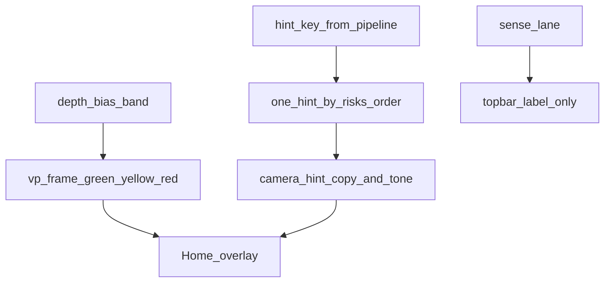

# 机位矫正与前端提示（一期 Flutter）

> 算法设计文档。只定义识别主页（Home）上**取景框**与**提示胶囊**如何消费已经算出的机位档和提示键。不写业务代码。

几何、N0 / A1–A8 与深度角、偏向角以 [index.md](./index.md) 为唯一事实。`depth` / `bias` 四阀、绿黄红档、提示键、防抖与抖动窗内冻结分数，以 [视频流抽帧.md](./视频流抽帧.md) 问题 7、问题 8 为准。同屏只展一条的全序以 [../../客户端APP/risks.md](../../客户端APP/risks.md) 为准。头肩入画的判定以 [多器官配合.md](./多器官配合.md) 为准。

首页稿见 [../../客户端APP/ui/home.html](../../客户端APP/ui/home.html)。稿里的取景框与胶囊是呈现样例；稿内脚本把「掉线」涂成红框并改写成「连接中断」，**不作为实现依据**。

## 目标与边界

| 项 | 说明 |
|----|------|
| 目标 | 预览上用固定构图引导头肩双手入框；用框色表示机位档；用一条胶囊说出当前该做的事 |
| 输入 | 机位档（绿 / 黄 / 红）与 `viewpoint_class`；抽帧与其它模块发出的提示键；感知态（就绪 / 识别中 / 转译中 / 掉线） |
| 输出 | 取景框颜色与框下说明；胶囊一句中文与语气 |
| 不写 | 深度角、偏向角、四阀默认值、抽帧拒发、轨迹 `gap`、骨架 A1–A8 抽点、同屏全序本身 |

框色与胶囊分开走。机位档只决定框。全序赢家只决定胶囊。二者可以同时出现，文案不必相同。

## 两层呈现

对齐首页稿的两个叠加层，都盖在本地预览上，不拦截点击。

| 层 | 稿中的标记 | 内容 |
|----|------------|------|
| 取景框 | `data-vp` = `green` / `yellow` / `red` | 四角、头圆、肩虚线、框下说明 |
| 提示胶囊 | `#camera-hint`，可选 `data-tone` | 顶栏下方一条；`warn` / `danger` / `muted`，无标记为常驻语气 |

顶栏只放感知态，不放进胶囊。语音播放不占顶栏，也不占这两层。

## 取景框

框是写死在预览上的构图模板：位于画面中上，高宽约 3:4。四角、头圆、肩虚线表示「头、肩、双手应对齐到这里」。位置不跟随鼻、肩或手的检出坐标移动，也不随 `viewpoint_class` 变形。

Home 相机预览开着时，框一直在。未进 Home、相机权限未给、预览尚未恢复时不画框。

### 颜色

颜色只由机位档决定。档位判定、`N_vp_soft` / `N_vp_hard` / `N_vp_fail` 与抖动窗内冻结 `depth_score` / `bias_score`，沿用抽帧，本文不另设阈值。

| 框色 | `data-vp` | 何时 |
|------|-----------|------|
| 绿 | `green` | 近 N0，或主 score ≤ soft |
| 黄 | `yellow` | 已归 A1–A8，且软提示已武装（黄档持续达到 `N_vp_soft`） |
| 红 | `red` | 红档短防抖后（`N_vp_hard`），或黄档质量连续失败升为硬提示（`hint.face_camera`） |

尚未武装软提示的短暂黄档，框保持绿色，避免闪色。抖动窗内分数冻结，框色不因晃动跳档。连续绿档达到抽帧的 `T_hint_clear` 后回到绿色。

头肩未入画、过远、持稳、遮挡、掉线、识别中、转译中都不单独改框色。这些情况只可能改胶囊或顶栏。

### 框下说明

说明随框色变，不随胶囊赢家变。黄档用该机位的短纠正；红档一律用正对镜头，不再保留分机位短句。

| 框色 | 代号 | 说明 |
|------|------|------|
| 绿 | N0 或未武装 | 机位矫正 · 头肩双手入框 |
| 黄 | A1 | 机位矫正 · 降低机位 |
| 黄 | A2 | 机位矫正 · 从右上回正 |
| 黄 | A3 | 机位矫正 · 从右侧回正 |
| 黄 | A4 | 机位矫正 · 从右下回正 |
| 黄 | A5 | 机位矫正 · 抬高机位 |
| 黄 | A6 | 机位矫正 · 从左下回正 |
| 黄 | A7 | 机位矫正 · 从左侧回正 |
| 黄 | A8 | 机位矫正 · 从左上回正 |
| 红 | 任意 | 机位矫正 · 请正对镜头 |

取景框对读屏隐藏。可读的一句只放在胶囊。

## 提示胶囊

同一时刻只展示全序中的一条。无采集告警、也无会话告警时，常驻：

> 请正对镜头，露出上半身

此时不设 `data-tone`。有告警时，整句换成赢家的文案，不与常驻句拼接。

感知态「识别中」「转译中」只出现在顶栏。胶囊不改成「正在捕捉手语」或「正在生成语音文案」。

掉线时顶栏为「掉线」，胶囊为「连接已断开，正在重试…」，`data-tone="muted"`。框色与框下说明保持当前机位档，不改成「连接中断」。

### 语气

| 条件 | `data-tone` |
|------|-------------|
| 常驻引导 | 不设 |
| 黄档软提示赢得胶囊 | `warn` |
| 红档或硬提示 `hint.face_camera` 赢得胶囊 | `danger` |
| 掉线重连、设备忙、重新鉴权、已在其他设备继续 | `muted` |

未列入上表、也未列入下文文案表的键（如弱网、音频格式）仍只占这一条胶囊，语气用常驻的默认底，本文不另造句。

### 文案

用户可见中文以本表为唯一事实。抽帧问题 7 只保留键名与纠正方向；软提示升硬之后，胶囊改走 `hint.face_camera`，不再展示该机位的软提示句。

分机位软提示（赢得胶囊时语气为 `warn`）：

| 代号 | 提示键 | 胶囊 |
|------|--------|------|
| A1 | `hint.vp.lower_or_face` | 请略降低手机，或抬头正对镜头 |
| A2 | `hint.vp.less_right_up` | 请从右上方回到正前方 |
| A3 | `hint.vp.face_from_right` | 请从右侧回到正前方 |
| A4 | `hint.vp.less_right_down` | 请抬高手机，并从右下方回到正前方 |
| A5 | `hint.vp.raise_or_face` | 请略抬高手机，正对镜头 |
| A6 | `hint.vp.less_left_down` | 请抬高手机，并从左下方回到正前方 |
| A7 | `hint.vp.face_from_left` | 请从左侧回到正前方 |
| A8 | `hint.vp.less_left_up` | 请从左上方回到正前方 |

红档与硬提示（赢得胶囊时语气为 `danger`）：

| 提示键 | 胶囊 |
|--------|------|
| `hint.face_camera` | 请正对镜头 |

其它会占到胶囊、且不改框色的采集键：

| 提示键 | 胶囊 | 语气 | 来源 |
|--------|------|------|------|
| `hint.come_closer` | 请靠近镜头 | `warn` | 抽帧：过远 |
| `hint.show_upper_body` | 请把头部、双肩和双手一起放入画面 | `warn` | 多器官：头肩双手未同时入画 |
| `hint.hold_steady` | 请持稳手机 | `warn` | 抽帧：手速模糊与摄像头抖动共用 |
| `hint.occlusion_or_frame` | 请减少遮挡，让双手留在画面里 | `warn` | 左右手：遮挡或出框 |
| `hint.background_or_light` | 请改善光线或背景 | `warn` | 抽帧：连续丢手 |

同一提示键的冷却沿用抽帧 `T_hint_cooldown`。冷却期间胶囊可回到常驻句或下一条仍有效的键；框色仍按机位档，不随冷却一起变绿。

## 与顶栏的分工

| 表面 | 只放什么 |
|------|----------|
| 顶栏 | 就绪 / 识别中 / 转译中 / 掉线 |
| 取景框 | 机位档颜色与上表说明 |
| 胶囊 | 全序赢家，或常驻「请正对镜头，露出上半身」 |

会话类提示（设备忙、重新鉴权、已在其他设备继续）走胶囊且为 `muted`，具体句子沿用会话模块已有口径，框色不动。Flushing 只做播报状态，不占胶囊。

## 相关文档

- [index.md](./index.md) · [视频流抽帧.md](./视频流抽帧.md) · [多器官配合.md](./多器官配合.md) · [左右手骨架提取.md](./左右手骨架提取.md)
- [../../客户端APP/risks.md](../../客户端APP/risks.md) · [../../客户端APP/modules.md](../../客户端APP/modules.md) · [../../客户端APP/ui/home.html](../../客户端APP/ui/home.html)
