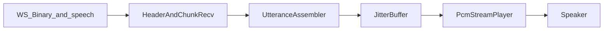
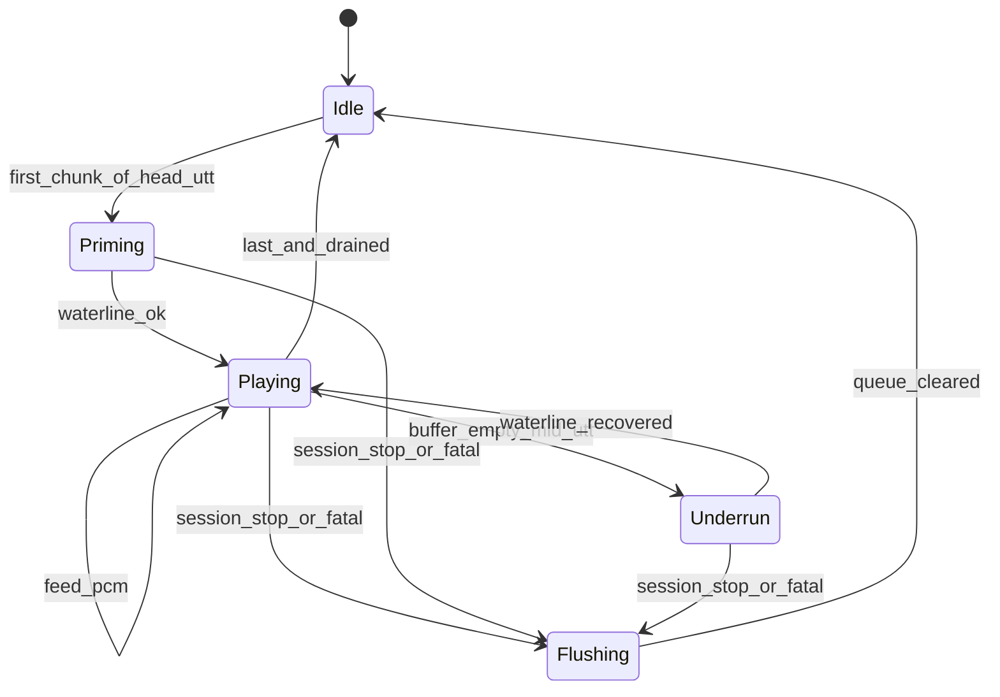
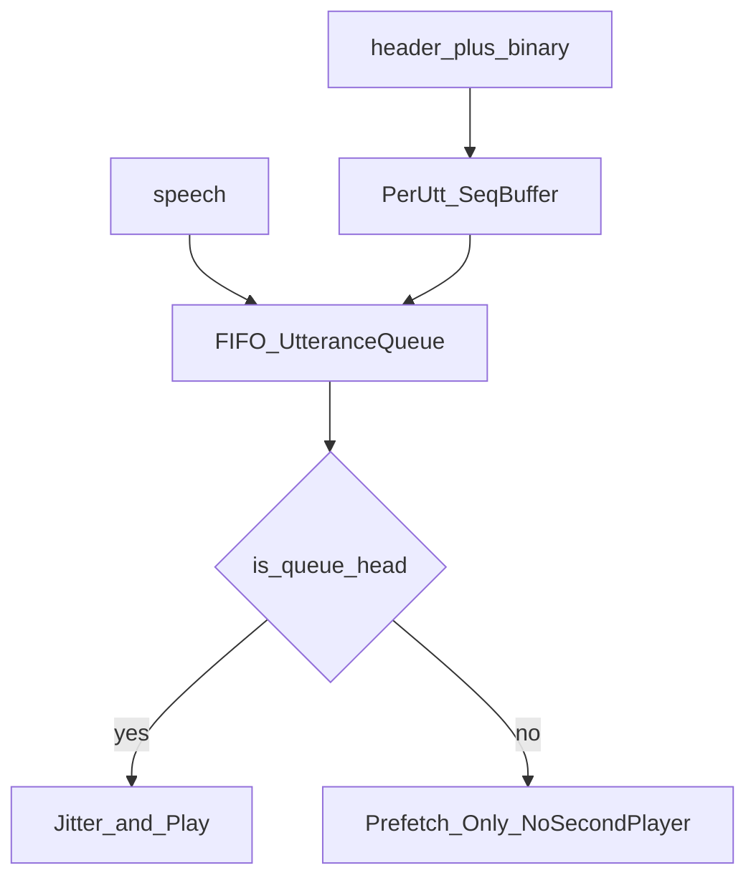

# 流式语音播放算法（一期 Flutter）

> 算法设计文档。输入为 WebSocket 下行的 `speech` / `audio.header` / Binary（及会话边界信号）；输出为扬声器连续 PCM 播报。不写业务代码；不重定义协议字段（以 [../../api/protocol.md](../../../api/protocol.md) 为准）；不写云端 TTS 合成与字幕 UI。

连接与低延迟原则见 [../../系统架构/websocket.md](../../系统架构/websocket.md)；本文只定义：**客户端如何把实时语音流收齐、缓冲、串行、连贯播出**。

## 目标与输入输出

| 项 | 说明 |
|----|------|
| 目标 | 边收边播、句间不叠音、弱网可丢旧保实时；端侧开声缓冲落在架构 60–150 ms 量级 |
| 输入 | `speech`、成对的 `audio.header` + WS Binary、`session.stop` / WS 死连接 / 重连成功 |
| 输出 | 扬声器 PCM；内部状态供 UI：`Idle` / `Priming` / `Playing` / `Underrun` / `Flushing` |
| 非目标 | 等整句文件再播；Opus 解码主路径；barge-in 打断；穿戴双端出声 |

### 一期锁定默认

| 项 | 决策 |
|----|------|
| 编码 | **PCM s16le / 16 kHz / mono**（`audio/pcm`） |
| 传输 | 推荐 **A**：文本 `audio.header` + 紧随 Binary；`speech.delivery = ws_binary_audio` |
| 多句 | **严格按 `utteranceId` FIFO 串行**；不允许打断当前句 |
| 兜底 | 一期 App 不实现。收到 `inline_fallback` / `audioBase64` 时拒收该句，提示 `hint.audio_format_error`，不入队 |

## 管线位置

感知上行与播音下行**解耦**：本模块不依赖相机帧时钟。



| 模块 | 职责 | 输出 |
|------|------|------|
| Recv | 配对 `audio.header` 与下一条 Binary；校验会话与格式 | `(utteranceId, seq, pcmBytes, last)` 或拒收 |
| Asm | 按 `utteranceId` FIFO 句队列 + 片有序缓冲；预收非队首句 | 队首可播 PCM 片流 |
| Jitter | 启动水位 / 目标水位 / 欠载等待 | 连续写入播放器的 PCM |
| Player | PCM 流式 sink | 扬声器 |

## 播放状态机



| 状态 | 行为 |
|------|------|
| `Idle` | 无当前句；等待队首 `utteranceId` 首片 |
| `Priming` | 攒至启动水位 `T_prime` 再开声 |
| `Playing` | 边收边写播放器；维持目标水位 `T_target` |
| `Underrun` | 短静音或短暂停等，上限 `T_underrun_wait`；超时跳缺口继续 |
| `Flushing` | 会话结束 / 致命错误：清空句队列与抖动缓冲 |

### 主流程（事件驱动）

1. 收到 `speech`：登记 `utteranceId`、格式参数；若不在队列则 **FIFO 入队**（不抢占正在播的句）。
2. 收到 `audio.header`：记下待配对的 `(utteranceId, seq, last, mime/rate/channels/encoding)`；启动「等 Binary」计时。
3. 收到紧随 Binary：与上一条 header 配对；写入该句有序片缓冲；重复 `seq` 丢弃。
4. 若该句为**队首**且状态为 `Idle`：进入 `Priming`，片入抖动缓冲。
5. `Priming`：缓冲时长 ≥ `T_prime` → 打开 PCM sink（若未开）并进入 `Playing`，开始 `write`。
6. `Playing`：按 `seq` 顺序喂片；水位 &lt; `T_low` → `Underrun`。
7. `Underrun`：等待新片；水位恢复 → `Playing`；超时 → 跳缺口（见问题 2）后继续。
8. 队首句 `last: true` 且有序片已喂完且播放器排水完毕 → 出队；若队列非空则对新队首 `Priming`（可缩短启动，见问题 4）；否则 `Idle`。
9. `session.stop` / WS 死连接 → `Flushing` → `Idle`。

## 按句组装与串行队列



1. **唯一出声句** = 队列头；任意时刻至多一路 PCM sink 在播。
2. 非队首句的片可**预收**进该句 `SeqBuffer`，降低句间间隙，但**禁止**第二播放器或混音叠播。
3. 关联键：`utteranceId`；片序：`seq`（递增）；结束：`last: true`（可空 binary）。
4. `speech` 可先于首片到达；若首片先到且格式与会话默认一致，可隐式登记后补齐 `speech` 元数据（实现可选）；格式以首个有效 `audio.header` / `speech` 为准，句内不得变更（见问题 8）。

## 抖动缓冲与水位

PCM 时长换算（s16le）：

```
duration_ms = (nbytes / 2 / channels) / sampleRate * 1000
```

一期默认 `sampleRate=16000`、`channels=1` → 每字节约 `1/32` ms，每 320 字节 ≈ 10 ms。

| 符号 | 建议默认 | 含义 |
|------|----------|------|
| `T_prime` | 80–120 ms | 开声前最小缓冲（落在架构 60–150 ms） |
| `T_target` | 100–150 ms | 播放中目标水位 |
| `T_low` | ~40 ms | 低于此进入欠载关注 / `Underrun` |
| `T_underrun_wait` | ≤80 ms | 欠载最长等待；超时跳缺口 |
| `W_reorder` | 如 3–5 个 `seq` 或 ≤60 ms | 乱序重排窗 |
| `T_header_wait` | 如 100–200 ms | header 后无 Binary 则失败片 |
| `N_queue_max` | 如 2–4 句未开播 | 超深触发弱网丢旧（问题 5） |
| `T_stale` | 与句龄 / 队列深度相关 | 未开播旧句或过时尾片可丢 |

水位由**上层自管**（推荐）：抖动缓冲字节数 → `duration_ms`；播放器内部缓冲若不可查，则以上层未消费队列为准。

## 问题 1：首包延迟 vs 连贯

**现象**：水位过低易卡顿；过高拖开声延迟（侵占「识别出词后开声 &lt; 1.5 s」中的端侧预算）。

**对策**：

1. 固定 `T_prime` / `T_target`，禁止「等整句 `last` 再播」。
2. 首片入队即进入 `Priming`；达 `T_prime` 立即开声。
3. 播放中尽量维持 `T_target`，但不主动拉高超过 `T_target` 很多（避免延迟膨胀）。
4. 端侧缓冲时延设计目标 ≈ `T_prime`；其余预算留给云端识别 + TTS 首包。

## 问题 2：欠载卡顿

**现象**：网抖动或 TTS 间隙导致抖动缓冲被抽空，出现可闻卡顿。

**对策**：

1. 水位 &lt; `T_low` → `Underrun`；短静音或短暂停等，最长 `T_underrun_wait`。
2. 超时仍无下一 `seq` → **跳缺口**：从下一已到达的 `seq` 继续（中间当静音丢失）；不永久阻塞整句。
3. 连续欠载累计时长或次数超门限 → UX `hint.network_audio`。
4. 水位恢复 ≥ `T_low`（建议回升近 `T_prime`）→ 回 `Playing`。

**伪代码级步骤**：

```
if buffered_ms < T_low: state = Underrun; t0 = now
while state == Underrun:
  if buffered_ms >= T_prime: state = Playing; break
  if now - t0 > T_underrun_wait:
    advance_to_next_available_seq()  # skip gap
    state = Playing
    break
```

## 问题 3：乱序 / 缺片 `seq`

**现象**：WS 片乱序或中间 `seq` 丢失，导致播放卡死或重复。

**对策**：

1. 每句维护 `next_seq`；片按 `seq` 入有序缓冲。
2. 重复 `seq`：丢弃。
3. 超前片：暂存在重排窗 `W_reorder` 内；窗内凑齐则按序喂。
4. 窗超时仍缺 → 按问题 2 跳缺口，`next_seq` 跳到已有最小 `seq`。
5. **禁止**因单片缺失永久等待 `last`。

## 问题 4：句间间隙

**现象**：上一句结束到下一句开声之间空白过长，听感不连贯。

**对策**：

1. 允许非队首句预收片进 `SeqBuffer`。
2. 队首 `last` 且排水完毕后，立即取新队首；若已缓冲 ≥ `T_prime`，可**缩短或跳过**额外等待直接 `Playing`。
3. 若新队首几乎无缓冲，仍走正常 `Priming`。
4. 绝不并行开第二路播放器填间隙。

## 问题 5：弱网积压保实时

**现象**：下行积压导致播到过时内容，与手语实时性背离。

**对策**：

1. **正在播放的当前句优先播完**（不中途 barge-in）。
2. 未开播队列深度 &gt; `N_queue_max`，或队尾句龄 &gt; `T_stale`：丢弃**最旧未开播句**整句，或其过时尾片；字幕/`recognition` 仍可保留展示。
3. 丢弃时更新 UX（可选 `hint.audio_dropped`）；不叠播追赶。
4. 与上行 landmarks「丢旧保实时」同哲学；音频侧丢旧仅作用于未开播缓冲。

## 问题 6：`header` 与 Binary 失配

**现象**：无 header 的 Binary、或 header 后长时间无 Binary、或中间插入其它文本帧打乱配对。

**对策**：

1. **无匹配 header 的 Binary**：丢弃。
2. header 后超过 `T_header_wait` 无 Binary：该 `seq` 记失败片；可触发问题 3 缺口逻辑。
3. header 与 Binary **必须紧邻配对**（协议推荐 A）；中间若插入无关文本，实现上仍以「最近未消费 header」绑定下一条 Binary；若无法安全绑定则丢 Binary 并计错误。
4. `last: true` 且空 Binary：合法结束片，不写 PCM，仅标记句收齐。

## 问题 7：会话边界 / 重连

**现象**：`session.stop`、死连接、重连后仍播放旧句残片，造成错句或叠音。

**对策**：

1. `session.stop` 或判定死连接 → 立即 `Flushing`：停 sink、`flush/close`、清空 FIFO 与所有 `SeqBuffer`。
2. 重连成功后状态为 `Idle`；**不续播**旧 `utteranceId` 残片。
3. 新会话只接受带新 `sessionId` 的 `speech` / `audio.header`。
4. 心跳 / 退避重连策略本身见 [../../系统架构/websocket.md](../../系统架构/websocket.md)；本文只定义播放队列在边界上的清空语义。

## 问题 8：格式变更

**现象**：句中途或会话中途 `sampleRate` / `encoding` / `channels` 与已打开的 sink 不一致。

**对策**：

1. 一期假定会话内恒定 **16 kHz / mono / s16le**。
2. 队首句首个有效 header / `speech` 锁定该句格式；后续片不一致 → **拒收该句剩余片**，出队并 UX `hint.audio_format_error`。
3. 若实现允许会话级一次 `open(sampleRate, channels)`：整会话格式变更仅在 `Idle` 且队列空时允许重开 sink；播中变更一律拒绝。
4. 一期**不**实现 Opus 主路径，也不实现 `inline_fallback`。收到非 PCM 正式流、`inline_fallback` 或 `audioBase64`：拒收该句并提示 `hint.audio_format_error`。

## 问题 9：与字幕对齐

**现象**：字幕与声音错位，或播放进度误改字幕文案。

**对策**：

1. 字幕文案以 `recognition` / `speech.text` 为准；播放进度**不驱动**字幕改写。
2. UI 可用同一 `utteranceId` 做「当前播报句」高亮。
3. 算法侧保证：同句串行、不叠音；弱网丢音频时字幕仍可保留（见问题 5）。
4. 不在本模块定义字幕排版与多行策略。

## `inline_fallback` 不入队

一期 App 不实现 `speech.delivery = inline_fallback` 和 `audioBase64`。收到这类帧时拒收该句，提示 `hint.audio_format_error`，不解码、不入 FIFO。正式路径只有 `ws_binary_audio`。

## PCM 流式播放器契约（设计级）

不绑定具体 Flutter 插件名；实现期可选原生 `AudioTrack` / `AVAudioEngine` 封装或成熟 PCM 流插件。

| 能力 | 语义 |
|------|------|
| `open(sampleRate, channels, encoding)` | 打开流式 sink；一期 encoding = s16le |
| `write(pcmBytes)` | 追加 PCM；应尽快返回；背压时由上层限速收包或扩缓冲 |
| `bufferedDuration()` 或等价 | 可选；若不可用则上层自管水位 |
| `pause` / `resume` | 可选；欠载策略可用短暂停等 |
| `flush` / `close` | 清空未播数据并释放；`Flushing` 必调 |

**禁止**正式路径「攒成临时文件 / 等整句再 `play(uri)`」。

## 失败与 UX 映射

| 条件 | 行为 | UX 键（建议） |
|------|------|----------------|
| 连续欠载 | 跳缺口继续；累计超阈 | `hint.network_audio` |
| 弱网丢未开播句 | 出队丢弃；字幕可留 | `hint.audio_dropped`（可选） |
| header/Binary 失配频繁 | 计失败；可触发网络提示 | `hint.network_audio` |
| 格式不一致 / 非 PCM 正式流 | 拒收该句 | `hint.audio_format_error` |
| 会话结束 / 死连接 | `Flushing` | 由会话层重连 UI 负责 |

## 默认门限方向（可调）

| 符号 | 起点 | 说明 |
|------|------|------|
| `T_prime` | 100 ms（允许 80–120） | 开声前 |
| `T_target` | 120 ms（允许 100–150） | 稳态水位 |
| `T_low` | 40 ms | 欠载线 |
| `T_underrun_wait` | 60–80 ms | 欠载等待上限 |
| `W_reorder` | 4 seq 或 60 ms | 重排窗取严者 |
| `T_header_wait` | 150 ms | header 等 Binary |
| `N_queue_max` | 3 | 未开播句深度 |
| `N_underrun_hint` | 如 3 次 / 2 s 内 | 触发网络 UX |

具体数值实现期按机型与网络标定；须保持 `T_low < T_prime ≤ T_target`，且整体落在架构 60–150 ms 抖动缓冲叙事内。

## 验收口径（算法侧）

| 指标 | 口径（设计期定义，实现期采数） |
|------|--------------------------------|
| 端侧开声缓冲时延 | 自队首句首片入队到开声 ≈ `T_prime` |
| 欠载率 | 活动播报区间内处于 `Underrun` 的时长占比 |
| 句间无叠音 | 同会话任意时刻至多一路 PCM 出声 |
| 串行正确性 | 多 `utteranceId` 在未丢弃前提下按入队顺序完整播放 |
| 弱网可恢复 | 重连 / `Flushing` 后队列空；新句可再次 `Priming` |
| 正式路径 | 验收以 `ws_binary_audio` 为准。`inline_fallback` 拒收，不入队，不计入指标 |

## 一期落地：播放器与原生桥（待落地）

**实现现状（2026-11）**：客户端**尚无音频播放能力**——`pubspec.yaml` 无音频依赖，`lib/tts/` 未创建；`ws/` 已把 `audio.header` + Binary 分派交 `tts/`，但当前无消费者，「播报中」状态由 `lib/session/home_session_controller.dart` 以占位逻辑维护。

**落地结构**（`jianyin_app/lib/tts/`）：

| 文件 | 职责 |
|------|------|
| `recv.dart` | 校验 `speech` / `audio.header` 的 `session`、`utteranceId`、`mimeType`、`sampleRate`、`channels`、`encoding`；非正式路径拒收 |
| `assembler.dart` | 按 `utteranceId` FIFO 句队列 + 片有序缓冲（`W_reorder` 取严）；预收非队首句，深度超 `N_queue_max` 丢最旧未开播句 |
| `jitter_buffer.dart` | 水位状态机（`T_prime` / `T_target` / `T_low` / `T_underrun_wait`），纯 Dart，可单测 |
| `player.dart` | PCM 流式 sink，经薄 `MethodChannel` 调原生；`Flushing` 必调 `flush` |
| `tts_pipeline.dart` | 门面：`open/pause/resume/flush/reset`；Home 进入置 Idle，离开/`session_replaced` 调 `reset()` |

**原生桥要求**（与 `lib/native/` 的 MediaPipe 桥同构：薄 channel + 明确字节契约）：

- Android：`AudioTrack(MODE_STREAM, 16000, CHANNEL_OUT_MONO, ENCODING_PCM_16BIT)`，按水位 `write(bytes, WRITE_NON_BLOCKING)`。
- iOS：`AVAudioEngine` + `AVAudioPlayerNode`（16 kHz mono Int16 buffer 入队），`AVAudioSessionCategoryPlayback`。
- 回传信号：`bufferedFrames`（供水位判断）与 `underrun` 事件（触发 `Underrun` 状态与 `hint.network_audio`）。
- 备选：成熟播放入口需能提供「按分片写入裸 PCM（s16le / 16 k / mono）」的接口；面向文件或容器格式的入口不适用于本路径。选型须以实现期最小样例验证后再定型。

**实现顺序**：`recv` → `assembler` → `jitter_buffer`（可单测）→ `player`（原生桥）→ UI 状态接线；`ui/` 的播报状态指示复用本文状态机。

**落地验收点**（对应上文「验收口径（算法侧）」）：

1. 端侧开声缓冲时延 ≈ `T_prime`（自队首句首片入队到开声）。
2. 同会话任意时刻至多一路 PCM 出声（`utteranceId` FIFO）。
3. 弱网/重连后队列清空，新句可再次 `Priming`；欠载跳缺口继续，累计超 `N_underrun_hint` 出 `hint.network_audio`。

## 相关文档

- [index.md](./index.md) · [视频流抽帧.md](./视频流抽帧.md) · [帧手势骨架提取.md](./帧手势骨架提取.md)
- [../../api/protocol.md](../../../api/protocol.md) · [../../系统架构/websocket.md](../../系统架构/websocket.md) · [../../系统架构/risks.md](../../系统架构/risks.md)
