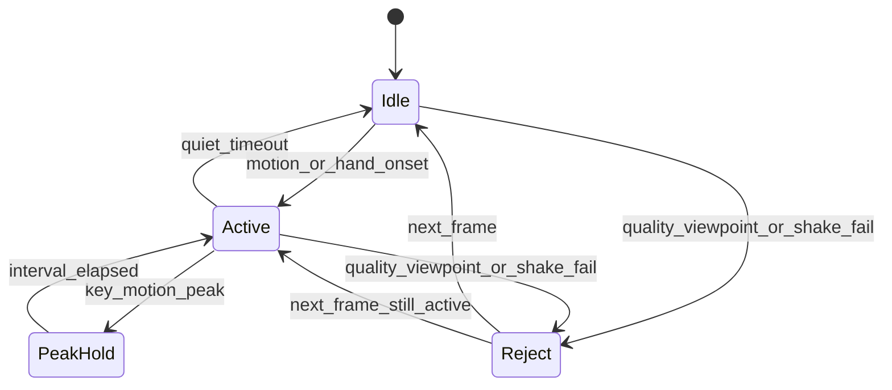
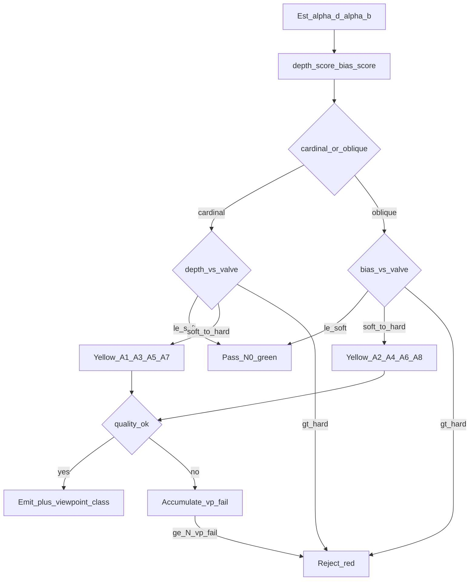
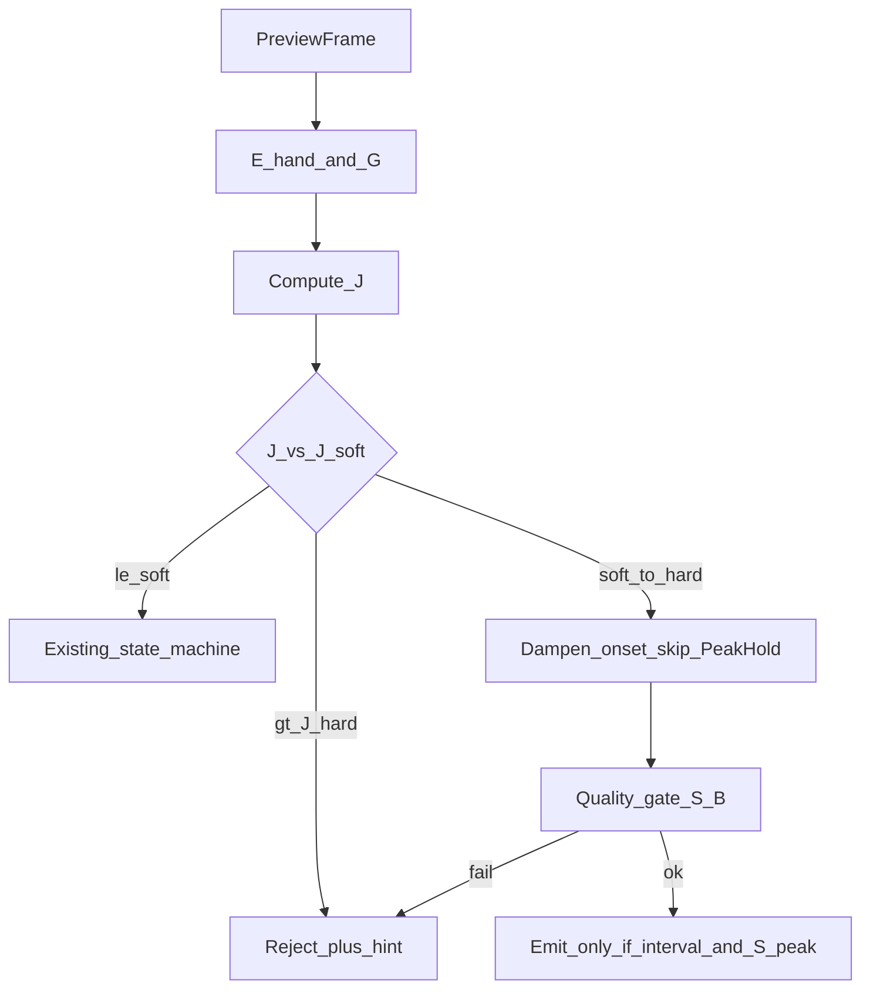

# 视频流抽帧算法（一期 Flutter）

> 算法设计文档。输入为本地相机预览流；输出为放行帧 + 元数据，以及活动段时钟与取景约束。抽帧不只服务手形：同一时钟驱动 [帧手势骨架提取.md](./帧手势骨架提取.md)（指关节构型）、[运动轨迹.md](./运动轨迹.md)（腕/掌心/指尖路径）与 [多器官配合.md](./多器官配合.md)（上身取景与身体坐标）。三支路观测由 [手势骨架信封.md](./手势骨架信封.md) 统一身份后投影为上行。不上行原始视频。

总览与机位枚举见 [index.md](./index.md)。

## 目标与输入输出

| 项 | 说明 |
|----|------|
| 目标 | 在约 15–30 Hz 上行预算内，尽量不漏关键手语动作，同时拒绝模糊/幻影/不可用帧；活动段同时保住手形、指轨迹与上身锚点 |
| 输入 | 相机预览帧序列（本地）；可选设备姿态；上一帧骨架反馈（`low_quality` / 拒发） |
| 输出（放行） | 图像帧引用 + `{ ts, sharpness, roi, hand_state, viewpoint_class, motion_energy }`；`Active`/`PeakHold` 节拍供轨迹与多器官对齐 |
| 输出（拒绝） | 本拍不送手形；重抖/红档机位时轨迹写 `gap`；缺上身时多器官不建系并提示；可选 UX 提示键（光线/背景/靠近/正对摄像头/露出上身等） |
| 下游（并行） | 手形：已放行帧 → 骨架；轨迹：活动段固定 `Δt_path`；多器官：宽于手 ROI 的取景（鼻、双肩、双手） |

## 自适应抽帧状态机



| 状态 | 行为 |
|------|------|
| `Idle` | 低采样（如 8–12 Hz 探测）；仅做轻量运动/人手存在检测 |
| `Active` | 升采样（目标 20–30 Hz）；完整质量门控 + 机位门控 |
| `PeakHold` | 在最小间隔内保留运动能量峰值帧，抑制均匀抽稀导致的漏关键帧；**抖动窗内禁用**（见问题 8） |
| `Reject` | 本帧不送手形；重抖或红档机位时轨迹写 `gap`；累计拒帧触发 UX |

### 主流程（每帧）

1. 取预览帧：手 ROI 运动能量 `E_hand`（无 ROI 时用全图降采样作探测）；全局位移代理 `G`（背景/全图降采样帧差或轻量全局平移）。宽取景同时检查鼻/双肩是否入画（供多器官，见 [多器官配合.md](./多器官配合.md)）。
2. 计算抖动分 `J`（见问题 8）；`J > J_hard` 或连续 `N_shake` 帧 `J > J_soft` → `Reject`，且**不**因全局 `G` 单独触发 onset / PeakHold。**重抖：不送手形，轨迹该拍写 `gap`。**
3. 粗检人手存在（轻量 Hands detect 或上一帧跟踪预测窗）；更新 `hand_state` 候选。抖动窗内 ROI 用上一稳定中心 + 膨胀搜索，**不用抖帧更新主轨中心**。
4. 估计或沿用 `viewpoint_class`（见问题 7）。抖动窗内对 `depth_score`/`bias_score` **冻结或强平滑**，禁止因抖触发黄/红机位提示。
5. 按状态、机位与抖动档查表得到：目标间隔、清晰度下限、检测置信度下限、最小 bbox 面积。`J_soft < J ≤ J_hard` 时抑制升采样、禁用 PeakHold，`S_min` 按黄档系数加严。
6. 质量门控（清晰度、拖影、距离、背景置信）。清晰度或拖影失败 → **本拍不送手形，活动段轨迹节拍继续**，腕跟踪仍在则不写 `gap`（见 [运动轨迹.md](./运动轨迹.md)）。距离过远或人手缺失直到腕跟踪也失败 → 轨迹写 `gap`。持稳 UX 仍按问题 2。
7. 机位门控：超容忍（红档）→ **不送手形，轨迹写 `gap`**，并纠偏 UX；门限内 → 放行并附带 `viewpoint_class`。黄档手形可加严拒发，轨迹仍按节拍发。
8. 上身锚点：鼻或双肩可见度不足 → 多器官本拍不建系（`path.space` 可退 `image`），连续失败 → `hint.show_upper_body`；**不**因此单独把轨迹改成 `gap`。
9. `Active`/`PeakHold`：按间隔与峰值策略决定是否把本帧交给手形模块（抖动余振 `T_shake_hold` 内仍抑 PeakHold）。**轨迹节拍与多器官节拍独立于手形 PeakHold 间隔**，与活动段时钟对齐。重抖 → 不送手形且轨迹写 `gap`。

三支路小结：手形可拒、轨迹可续；重抖/红档 → 手形拒 + `path.gap`；缺上身 → 不建身体坐标 + UX，轨迹可仍发（图像空间）。

## 问题 1：避免手势漏帧

**现象**：固定低帧率或均匀抽稀时，快速起势/收势关键姿态被跳过。

**对策**：

1. **活动检测**：`E_t = mean(|I_t - I_{t-1}|)`（在 ROI 或手 bbox 膨胀区内）；或用上一帧关节点速度均值 `V`。
2. **Onset 升采样**：`E` 或 `V` 超过 `T_onset` 且持续 ≥2 帧 → 进入 `Active`，采样间隔降至 `Δt_active`（对应约 20–30 Hz）。
3. **峰值保留**：在窗口 `W_peak`（如 80–120 ms）内，若某帧 `E` 为局部最大且距上一输出 ≥ `Δt_min`，强制选中（`PeakHold`）。PeakHold 保留手形关键帧；路径的均匀节拍见 [运动轨迹.md](./运动轨迹.md)。
4. **静默回落**：连续 `T_quiet`（如 400–600 ms）低于 `T_idle` → 回 `Idle`。轨迹节拍随 `Idle` 停发。

**伪代码级步骤**：

```
if E > T_onset or V > T_v_onset: state = Active
if state == Active:
  if E is local_max in W_peak and now - last_out >= Δt_min: emit
  else if now - last_out >= Δt_active: emit
if E < T_idle for T_quiet: state = Idle
```

## 问题 2：过快导致模糊 / 手势幻影

**现象**：手相对镜头过快，运动拖影使关节错位或出现「双影」。若根因是**机身全局抖动**，先按问题 8 分档，再套用本门控。

**对策**：

1. **清晰度分** `S`：ROI 灰度 Laplacian 方差（或等价高频能量）。
2. **拖影代理** `B`：归一化帧差残差；或与光流幅值联合（实现可选）。
3. **拒手形**：`S < S_min(viewpoint)` 或 `B > B_max` → 本拍不送手形骨架（严重拖影帧不抽 21 点）。轨迹通道仍按 [运动轨迹.md](./运动轨迹.md) 记录腕与掌心。
4. **替代**：同窗口内选 `S` 最高且 `B` 可接受的邻近帧供手形；若无则本窗口放弃手形，避免硬凑。轨迹节拍不因手形放弃而改写为 `gap`。

默认（N0）：`S_min` 中等；`B_max` 中等。A1–A8 查问题 7 表加严；轻抖档可再乘黄档清晰度系数。

## 问题 3：环境 / 背景复杂，人手识别不出

**现象**：杂乱背景、相似肤色物体导致 Hands 检测失败或误检。

**对策**：

1. 先跑 Hands 检测；`det_conf < C_det` → 不采信全图运动为「手势」。
2. **ROI 重试**：若上一帧有稳定手轨，在预测 bbox 膨胀区裁剪后再检一次。
3. 仍失败：计入 `miss_hand`；连续 `N_miss`（如 8–15 帧）→ UX `hint.background_or_light`。
4. **不**因背景复杂而上行视频；仅提示调整光线/背景或靠近。

## 问题 4：人手距离镜头太远

**现象**：手部分辨率不足，检测与关键点不可靠。

**对策**：

1. 度量：手 bbox 归一化面积 `A = w*h`；或腕–中指尖归一化跨度 `L`。
2. 门限：`A < A_min(viewpoint)` 或 `L < L_min` → 拒抽；UX `hint.come_closer`。
3. 工作距离设计上限 **5 m**；过远门限与机位异常**叠加**，异常机位不放宽 `A_min`。
4. 可选（仅本地）：对 ROI 做有限数字变焦后再检；变焦后仍不达标则拒。

## 问题 5：单手 / 双手（左右手）

**现象**：单手时左右标签跳变；双手进出框导致状态抖动。

**对策**：

1. `hand_state ∈ { none, left, right, both }`。
2. 检测左右 presence；切换需连续 `N_stable`（如 3）帧一致才改态（防抖）。
3. 单手：输出明确 `left` 或 `right`；短时检测翻转时**锁定上一 handedness**（与骨架跟踪策略一致）。
4. 双手：两手 bbox 均有效且非同一轨迹分裂；抽帧对两手 ROI 取并集做运动能量。

## 问题 6：其他动态事物干扰

**现象**：画面内其他人手、走动、摆动物体抢主目标。

**对策**：

1. 多手候选打分：`score = α*A + β*(1 - dist_to_center) + γ*track_continuity`。
2. 选最高分轨为主说话人；其余忽略（ROI 外运动不触发升采样）。
3. 主轨丢失：在 `T_reacquire` 内用上一中心搜索；超时回 `none` 并降为 `Idle`。
4. 与问题 5 联动：主轨 handedness 稳定后才允许 `both` 升为第二手。

## 问题 7：摄像头机位偏差

几何定义以 [index.md](./index.md) 为唯一事实：**深度角 `α_d=90°` 为标准机位，偏向角 N/A；异常时 `α_d<90°`**。**容错阀门与纠正提示由本抽帧模块统一控制**；骨架只消费已放行帧的 `viewpoint_class`。

### 分类（深度角 / 偏向角 → 八异常）

1. 估计相机相对手势原点的位姿 → 得到深度角 `α_d`、（若投影离原点足够远）偏向角 `α_b`（北偏东语义，「北」=+y）。
2. 归一为两位小数 score（配置侧**只见 0.00–1.00**，不写角度）：

| 导出量 | 公式 | 极性 |
|--------|------|------|
| `depth_score` | `round( (90° − α_d) / 90°, 2 )`，再 clamp 到 [0,1] | N0：`α_d=90°` → **0.00**；深度角越小（越偏）→ score **越大** |
| `bias_score` | `round( α_b / 90°, 2 )`（偏向存在时） | `0.17` ≡ **北偏东 15°**；`1.00` ≡ **北偏东 90° ≡ 机正右** |

3. 象限 + 正/斜 → `viewpoint_class`：

| 代号 | 类型 | 主比阀门 |
|------|------|----------|
| A1 / A3 / A5 / A7 | 4 正机位 | `depth`（`depth_score`） |
| A2 / A4 / A6 / A8 | 4 斜机位 | `bias`（`bias_score`）；且须 `α_d < 90°` |
| N0 | 标准 | `α_d→90°`、偏向 N/A，或对应 score ≤ soft |

### 客户端配置：仅 4 个两位小数阀门

```yaml
# 取值范围 [0.00, 1.00]，两位小数
viewpoint_valve:
  depth:           # 正机位主阀；由深度角导出
    soft: 0.17     # ≤soft → 近 N0（绿）；soft~hard → 黄
    hard: 0.67     # >hard → 红拒采
  bias:            # 斜机位主阀；由偏向角导出
    soft: 0.17     # ≡ 北偏东 15°
    hard: 0.78     # 趋向北偏东 90°（机正右极限）前硬拒
```

| 配置项 | 默认 | 说明 |
|--------|------|------|
| `depth.soft` | `0.17` | 4 正机位绿/黄分界（约对应深度角降至 ~75°） |
| `depth.hard` | `0.67` | 4 正机位黄/红分界 |
| `bias.soft` | `0.17` | 4 斜机位绿/黄；≡北偏东 15° |
| `bias.hard` | `0.78` | 4 斜机位黄/红 |

调参只改这 **4 个 float**；八异常共用，不按 A1–A8 分别配阀。

### 三档判定

| 档位 | 判定 | 抽帧行为 | 提示 |
|------|------|----------|------|
| **绿：通采** | 正路径 `depth_score ≤ soft`；斜路径 `bias_score ≤ soft`；或近 N0 | 默认门限 | 不提示 |
| **黄：限采** | 已归 A1–A8，且主 score 满足 `soft < score ≤ hard` | 放行 + 加严质量门控 + 写 `viewpoint_class` | 软提示 |
| **红：拒采** | 主 score `> hard`，或黄档连续质量失败 ≥ `N_vp_fail` | **不送手形**；轨迹写 `gap` | 硬提示 |

黄档质量加严：

| 类型 | 代号 | 相对 N0 |
|------|------|---------|
| 正机位 | A1/A3/A5/A7 | `S_min`×1.15，`C_det`+0.05～0.08；A3/A7 侧重保峰值 |
| 斜机位 | A2/A4/A6/A8 | 同上 + `A_min`×1.2；强制主手 ROI；仰视侧 `B_max`×0.85 |

距离：`A < A_min` 一律拒；黄档不放宽过远（`‖C‖≤5 m` 仍有效）。



### 纠正提示方案

机位提示**只由抽帧发出**（骨架拒发可复用同一文案键）。

**触发与防抖**：

| 参数 | 默认 | 说明 |
|------|------|------|
| `N_vp_soft` | 10 帧或 ~0.5 s | 黄档持续达到后才出**软提示** |
| `N_vp_fail` | 8–12 帧 | 黄档质量连续失败 → **硬提示**并本段拒采 |
| `N_vp_hard` | 3 帧 | 红档：短防抖后立即硬提示 |
| `T_hint_cooldown` | 3–5 s | 同一提示键冷却 |
| `T_hint_clear` | 连续绿档 ≥ 1 s | 回到 N0 后清除机位条 |

**分机位提示键**：

| 代号 | 提示键 | 纠正方向 | 软→硬 |
|------|--------|----------|--------|
| A1 | `hint.vp.lower_or_face` | 略降低机位 / 抬头正对，使深度角回近 90° | 是 |
| A2 | `hint.vp.less_right_up` | 减小右上偏向，回正前方 | 是 |
| A3 | `hint.vp.face_from_right` | 从右侧回正（离开北偏东 90° 极限） | 是（易升硬） |
| A4 | `hint.vp.less_right_down` | 减小右下偏：抬高并回正 | 是 |
| A5 | `hint.vp.raise_or_face` | 抬高机位 / 正对，深度角回近 90° | 是 |
| A6 | `hint.vp.less_left_down` | 减小左下偏（镜像 A4） | 是 |
| A7 | `hint.vp.face_from_left` | 从左侧回正（镜像 A3） | 是 |
| A8 | `hint.vp.less_left_up` | 减小左上偏（镜像 A2） | 是 |
| 红档通配 | `hint.face_camera` | 请正对摄像头（深度角→90°，消除偏向） | 硬 |

**同屏主提示优先级**（只展一条）的全序在 [客户端APP/risks.md](../../客户端APP/risks.md)。本文件只锁定采集段内部顺序：`hint.come_closer` → `hint.show_upper_body`（头肩双手未同时入画，见 [多器官配合.md](./多器官配合.md)） → 机位红/硬 → `hint.hold_steady`（手速模糊与摄像头抖动共用） → `hint.background_or_light` → 机位黄软提示。`hint.occlusion_or_frame` 由左右手算法发出，排在 `hint.hold_steady` 之后，见 App 全序。

**统一流程**：

1. 估计 `α_d`/`α_b` → `depth_score`/`bias_score` → 正/斜路径 → `viewpoint_class`。  
2. 比阀门：`≤soft` 绿；`(soft, hard]` 黄；`>hard` 红。  
3. 红 → 拒帧 + 硬提示；绿 → 默认状态机；黄 → 加严门控后放行并写 `viewpoint_class`。  
4. 黄档质量连续失败 → 升红；触发提示键与冷却见上。

放行帧必须带 `viewpoint_class`；**超 `hard` 不进入手形骨架**，轨迹节拍写 `gap`。

提示键、防抖与升档仍以本节为准。Home 上取景框如何上色、说明与胶囊如何写文案，见 [机位矫正.md](./机位矫正.md)。

## 问题 8：摄像头抖动

**现象**：机身晃动（手持不稳、步行、碰触机身）导致整幅全局位移/旋转，与「手相对镜头过快」（问题 2）根因不同。

| 表现 | 对抽帧的伤害 |
|------|----------------|
| 全局运动能量飙高 | 误判 onset → 假 `Active`、浪费预算、选中废帧 |
| 全帧清晰度 `S` 跌 / 拖影 `B` 升 | 与问题 2 同类门控，根因是机身抖而非手速 |
| ROI / bbox 跳 | 运动能量算在错误区域；主轨易丢 |
| `depth_score` / `bias_score` 短时乱跳 | 绿黄红档位闪烁、机位提示刷屏 |
| PeakHold 选中抖峰 | 「峰值」实为抖动尖峰，漏真关键姿态 |

**判定优先级**：先分**全局抖** vs **局部手势运动**；确认全局抖时走本问题，再叠加清晰度/拖影拒帧（问题 2）。不上行原视频做云端稳像；不引入 OIS/电子防抖 SDK 选型。

### 检测量

1. **全局位移代理** `G`：背景或全图降采样帧差，或相对上一帧的轻量全局平移估计。
2. **手区运动** `E_hand`：ROI / 手 bbox 膨胀区内帧差（与问题 1 的 `E` 同义；有 ROI 时禁止用裸 `G` 当手势能量）。
3. **抖动分** `J_vis`：短窗（约 100–200 ms）内 `G` 的均值或方差（设备相关归一化）。
4. **可选 IMU**：输入侧设备姿态 → 加速度/角速度能量 `J_imu`；`use_imu_shake: true` 时 `J = max(J_vis, J_imu)`，否则 `J = J_vis`（一期非硬依赖）。
5. **局部/全局比** `R = E_hand / max(G, ε)`：`G` 高且 `R` 低 → 偏「纯抖」；`G` 与 `E_hand` 同高 → 抖+手势叠加，仍**优先抑抖再选帧**。

### 档位与行为



| 档位 | 判定 | 抽帧行为 |
|------|------|----------|
| 稳 | `J ≤ J_soft` | 默认状态机（问题 1–7） |
| 轻抖 | `J_soft < J ≤ J_hard` | 抑制升采样（保持 Idle 间隔或仅微升）；**禁用 PeakHold**；放行须更高 `S_min`（可复用机位黄档 ×1.15）；不因 `G` 单独 onset |
| 重抖 | `J > J_hard`，或连续 `N_shake` 帧 `J > J_soft` | 本帧 `Reject`；不进入 PeakHold；触发持稳 UX |

附加约束：

1. **ROI**：抖动窗内用上一稳定中心 + 膨胀搜索；抖帧不更新主轨中心。
2. **机位 score**：抖动窗内冻结或强平滑 `depth_score`/`bias_score`，**禁止**因抖触发黄/红机位提示（避免与 `hint.hold_steady` 抢屏）。
3. **余振**：`J` 回落到 `≤ J_soft` 后仍保持 `T_shake_hold`（150–300 ms）抑制 PeakHold。
4. **与问题 2**：抖导致的低 `S`/高 `B` 仍拒帧；提示统一 `hint.hold_steady`，不新开机位类文案。

### UX

- 提示键：**复用** `hint.hold_steady`（语义：请持稳手机/减少晃动；手势可稍慢）。手速模糊与摄像头抖动共用，避免新增键膨胀优先级表。
- 触发：单次 `J > J_hard`，或连续 `N_shake` 帧轻抖；冷却同 `T_hint_cooldown`。
- 同屏全序以 [客户端APP/risks.md](../../客户端APP/risks.md) 为准。采集段内部顺序不变：`hint.come_closer` → `hint.show_upper_body` → 机位红/硬 → **`hint.hold_steady`** → `hint.background_or_light` → 机位黄软提示。

## 默认门限表（可调）

| 符号 | N0 建议起点 | 含义 |
|------|-------------|------|
| `Δt_idle` | ~100–125 ms | Idle 探测间隔 |
| `Δt_active` | ~33–50 ms | Active 目标间隔（20–30 Hz） |
| `Δt_min` | ~25–33 ms | 峰值强制输出最小间隔 |
| `T_onset` / `T_idle` | 相对标定 | 运动能量开/关阈值 |
| `T_quiet` | 400–600 ms | 回 Idle |
| `S_min` | 设备相关标定 | 清晰度下限 |
| `B_max` | 标定 | 拖影上限 |
| `C_det` | 0.5–0.7 | Hands 检测置信度 |
| `A_min` | 归一化面积标定 | 过远拒绝 |
| `N_stable` | 3 | hand_state 防抖帧数 |
| `N_miss` | 8–15 | 触发背景/光线提示 |
| `depth.soft` / `.hard` | `0.17` / `0.67` | 正机位阀门（由深度角导出） |
| `bias.soft` / `.hard` | `0.17` / `0.78` | 斜机位阀门；soft≡北偏东 15° |
| `N_vp_soft` / `N_vp_fail` / `N_vp_hard` | 10 / 8–12 / 3 | 机位提示与升档防抖 |
| `T_hint_cooldown` | 3–5 s | 提示冷却 |
| `J_soft` / `J_hard` | 设备相关标定 | 抖动绿/黄与黄/红分界（视觉归一化） |
| `N_shake` | 5–8 帧 | 连续轻抖升重抖拒帧 |
| `T_shake_hold` | 150–300 ms | 抖后余振内仍抑 PeakHold |
| `use_imu_shake` | false（可选 true） | true 时 `J = max(J_vis, J_imu)` |

机位调参：**只动 viewpoint 的 4 个 float**；勿为 A1–A8 单独配角度表；勿使用「正视=0°」旧极性。抖动门限为独立符号，**不**并入机位阀门。

## 与上行背压的关系

- 抽帧输出速率以骨架可处理与 WS 预算为上限（约 15–30 Hz）。
- 若发送队列积压：手形点可丢更旧样本。活动段 `path` 只做均匀抽稀，规则见 [运动轨迹.md](./运动轨迹.md)。抽帧侧可缩短 PeakHold、提高 `Δt_active`，但**不可**为保数量而放行模糊手形、红档机位帧或重抖帧。
- 骨架返回 `low_quality`：本轨短时提高 `S_min` / 降低输出占空比；若伴随非 N0，可提前触发对应机位软提示（抖动窗内仍优先 `hint.hold_steady`，不抢发机位提示）。

## 失败与 UX 提示映射

| 条件 | 提示键（建议） | 用户含义 |
|------|----------------|----------|
| 连续低 `S` / 高 `B` | `hint.hold_steady` | 手势稍慢、持稳手机 |
| `J > J_hard` 或连续 `N_shake` 轻抖 | `hint.hold_steady` | 减少晃动、持稳手机（与上共用键） |
| 连续 `miss_hand` | `hint.background_or_light` | 光线/背景 |
| `A`/`L` 过小 | `hint.come_closer` | 靠近镜头 |
| 黄档持续 / 红档超角 | `hint.vp.*` 或 `hint.face_camera` | 见问题 7 纠正提示方案 |
| 权限/相机失败 | （系统层） | 非本算法 |

## 相关文档

- [index.md](./index.md) · [帧手势骨架提取.md](./帧手势骨架提取.md) · [左右手骨架提取.md](./左右手骨架提取.md) · [运动轨迹.md](./运动轨迹.md) · [多器官配合.md](./多器官配合.md) · [手势骨架信封.md](./手势骨架信封.md)
- [../../系统架构/websocket.md](../../系统架构/websocket.md) · [../../api/protocol.md](../../api/protocol.md)
