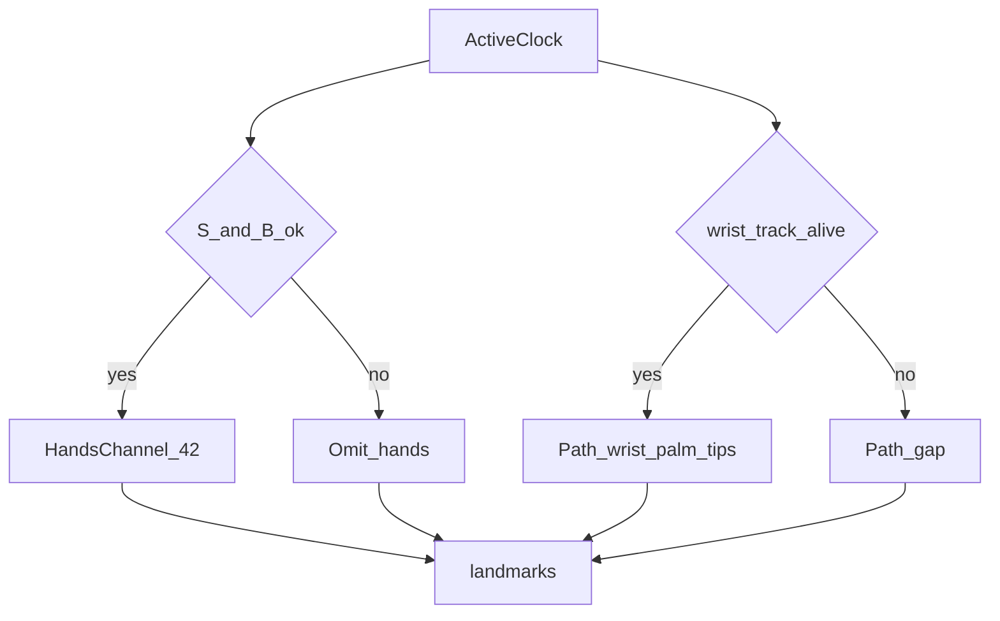

# 运动轨迹算法（一期 Flutter）

> 算法设计文档。手语**指关节运动轨迹**的端侧观测层：活动段上固定节拍的腕、掌心、五指尖路径。方向、路径形状、重复和敲击来自这些样本的积分，不来自单帧手形。中间指节（PIP/DIP 等）的构型由多拍手形通道表达，**不**再塞进 `path`。输入为抽帧活动段的预览时钟、左右手跟踪，以及 [多器官配合.md](./多器官配合.md) 的身体坐标系。输出为固定节拍的 `path`。手形仍由 [帧手势骨架提取.md](./帧手势骨架提取.md) 决定。云端滑动窗口把样本积成运动描述；信封侧见 `frame.path` 与 `segment`（[手势骨架信封.md](./手势骨架信封.md)）。不上行原始视频，不上行「直线 / 圆」结论。

总览见 [index.md](./index.md)。字段以 [../../api/protocol.md](../../api/protocol.md) 的 `schema: csl_channels_v1` 为准。

## 目标与边界

| 项 | 说明 |
|----|------|
| 目标 | 活动段内腕、掌心、指尖的路径连续可积，断点显式可辨；书空可用指尖作主轨迹 `trace` |
| 输入 | 抽帧状态与 `ts`；左右手 `track_id`；清晰度 `S`、拖影 `B`、抖动分 `J`、机位档；身体坐标系（可缺） |
| 输出 | 每个轨迹节拍一条 `path`：左右腕、掌心、五指尖，带 `v`；必要时 `gap: true` |
| 与多器官 | `space=body` 时消费部位名；`contactSite` / `brushSite` / `places` 的公式在多器官文，本文只积分路径并挂接部位序列 |
| 留在端侧 | 光流兜底、跟踪速度、未换算前的图像坐标缓存 |
| 留在云端窗口 / 信封 `segment` | 方向、形状、重复次数、接触部位、`places`。这些是识别特征，不是 WS 字段 |
| 保持不动 | 手形 42 点的打包规则；信封的关节与骨节身份；`path` 点集不扩到全部 21 关节 |

掌心与指尖的图像点序沿用 MediaPipe Hands：腕 `local 0`；指尖 `4 / 8 / 12 / 16 / 20`。左右槽位沿用 [左右手骨架提取.md](./左右手骨架提取.md)，本算法不另判左右手。

## 与手形门控的分工



| 通道 | 何时有内容 |
|------|------------|
| `hands` | `S ≥ S_min` 且 `B ≤ B_max`，且该手有效关节比达到 `R_min`。拖影、低清晰度、红档机位、重抖：本拍不带 `hands` |
| `path` | 活动段每个节拍都有记录。腕跟踪有效则写入腕、掌心和当时仍可信的指尖。腕跟踪失效、重抖或红档机位则 `gap: true` |

PeakHold 继续只为手形保留运动能量峰值附近的清晰帧。路径的均匀性由本节拍保证，不由 PeakHold 代替。

## 活动段时钟

时钟跟随抽帧状态机（见 [视频流抽帧.md](./视频流抽帧.md)）：

| 抽帧状态 | 轨迹行为 |
|----------|----------|
| `Idle` | 停发 `path` |
| `Active` / `PeakHold` | 固定间隔 `Δt_path` 取样，目标 30 Hz |
| 重抖 `J > J_hard`，或连续 `N_shake` 帧轻抖 | 该拍 `gap: true`，机身位移不记入手语路径 |
| 红档机位 | 该拍 `gap: true` |
| 黄档机位且手形被加严门控拒绝 | `path` 照发；`hands` 可缺 |

节拍用采集时钟，不跟 Hands 推理耗时对齐。推理超时的那一拍仍占一个 `ts`：腕跟踪有预测则写低 `v`，预测也过期则 `gap`。

进入 `Active` 的条件沿用抽帧 onset（`E_hand` 或关节点速度）。轨迹不单独发明第二套活动检测。

## 样本内容

每一拍、每一只仍在跟踪的手：

| 点 | 来源 | 写入条件 |
|----|------|----------|
| `wrist` | 该 `track_id` 的腕 | 跟踪距离在门限内，或预测龄 ≤ `T_predict` |
| `palm` | 食指、中指、小指 MCP（`local` 5、9、17）的有效点均值 | 至少两个 MCP 的 `v ≥ V_path`；否则本拍掌心记为腕，并把掌心 `v` 降到腕的 `v` |
| `tips.thumb` 等 | 五指尖 | 该点 `v ≥ V_path` 才带坐标；否则该指尖 `v = 0` |

`V_path` 可以低于手形用的 `V_min`。指尖因拖影不可信时，手形通道整手缺席，轨迹里对应指尖 `v = 0`，腕仍可有效。

坐标：

- 身体锚点有效时，`path.space = body`。点是 [多器官配合.md](./多器官配合.md) 定义的肩宽归一坐标：`+X` 签署人右侧，`+Y` 指向鼻，`+Z` 离开身体朝向镜头。
- 肩或鼻不可用时，`path.space = image`，`path.anchor = false`。点保持图像归一化坐标。云端窗口对这一段不算身体部位和接触。

```json
{
  "space": "body",
  "anchor": true,
  "gap": false,
  "left": {
    "wrist": { "x": 0.10, "y": 1.40, "z": 0.80, "v": 0.95 },
    "palm": { "x": 0.12, "y": 1.55, "z": 0.90, "v": 0.90 },
    "tips": {
      "thumb": { "x": 0.20, "y": 1.70, "z": 0.95, "v": 0.0 },
      "index": { "x": 0.18, "y": 1.90, "z": 1.00, "v": 0.88 },
      "middle": { "x": 0.10, "y": 1.95, "z": 1.00, "v": 0.86 },
      "ring": { "x": 0.02, "y": 1.88, "z": 0.98, "v": 0.84 },
      "pinky": { "x": -0.04, "y": 1.75, "z": 0.96, "v": 0.80 }
    }
  },
  "right": {
    "wrist": { "x": 0.0, "y": 0.0, "z": 0.0, "v": 0.0 },
    "palm": { "x": 0.0, "y": 0.0, "z": 0.0, "v": 0.0 },
    "tips": {
      "thumb": { "x": 0.0, "y": 0.0, "z": 0.0, "v": 0.0 },
      "index": { "x": 0.0, "y": 0.0, "z": 0.0, "v": 0.0 },
      "middle": { "x": 0.0, "y": 0.0, "z": 0.0, "v": 0.0 },
      "ring": { "x": 0.0, "y": 0.0, "z": 0.0, "v": 0.0 },
      "pinky": { "x": 0.0, "y": 0.0, "z": 0.0, "v": 0.0 }
    }
  }
}
```

缺手的槽位保留，各位 `v = 0`。`gap: true` 时可以只留 `space`、`anchor`、`gap`，不再填点。

## 断点

腕跟踪丢失、预测超龄、重抖或红档机位：该拍发送 `gap: true`，`ts` 仍是这个节拍的采集时刻。

云端分段规则：

1. 同一只手连续 `gap` 时长 `> T_gap`，路径从这里切开。
2. 切开的两段各自积分。窗口把缺口两端连成一条位移，会造出没有发生过的书空或画圆。
3. `Idle` 停发之后，下一次 `Active` 的第一拍是新段的起点。

## 平滑

| 序列 | 滤波 |
|------|------|
| 手形 42 点 | One-Euro，见 [帧手势骨架提取.md](./帧手势骨架提取.md) |
| `path` 的腕、掌心、指尖 | 不做 One-Euro。最多一拍的跟踪预测，预测点的 `v` 乘 `K_predict`（小于 1） |

短促敲击和重复次数留在 `path` 的原始节拍上。

## 背压

活动段里队列超长时，把该段 `path` 按固定倍数整段抽稀（例如隔拍保留），抽稀后的间隔仍然均匀。

静默段没有 `path` 可丢。手形点可以随抽稀一起减少。`nonmanual` 的降频见 [多器官配合.md](./多器官配合.md)。先降手形全点和非手控，再考虑降低轨迹节拍；活动段中间不挖连续缺口。

## 腕跟踪丢失时的光流兜底

Hands 与姿态都丢失腕点、而手 ROI 里仍有局部运动时，用 ROI 内稀疏光流估计腕的图像位移，最多衔接 `N_flow` 拍。衔接点 `v` 乘 `K_flow`。超过 `N_flow` 改为 `gap`。

光流位移只存在于端侧跟踪器里，不出现在 `landmarks` 中。它不提供手形，也不提供身体部位。

## 云端运动描述

推理窗口按 `ts` 对齐 `path`。描述在窗口内计算，模型可改，描述定义以本文为准。`space = image` 的段只保留时长和图像平面上的形状，不输出身体方向和接触。

对每一只手、每一段连续非 `gap` 样本（主轨迹默认用腕；腕 `v` 低而某一指尖连续有效时，书空改用该指尖）：

1. 速度 `u_i = |p_i − p_{i−1}| / Δt`。
2. 净位移 `net = p_end − p_start`，路径长度 `L = Σ |p_i − p_{i−1}|`。
3. **主方向**（仅 `space = body`）：比较 `|net.z|` 与水平投影。`|net.z|` 更大时取 `away`（`+Z`）或 `toward`（`−Z`）。否则按 `atan2(net.y, net.x)` 量化为八向：`right`、`upRight`、`up`、`upLeft`、`left`、`downLeft`、`down`、`downRight`。`+X` 为签署人右侧，`+Y` 向上。
4. **形状**：
   - `line`：`|net| / L ≥ R_line`，且累计转角 `< θ_line`
   - `fold`：方向反转 1 次，且终点靠近起点（距离 `< D_fold`）
   - `wave`：方向反转 ≥ 2 次，且 `|net| / L ≥ R_wave`
   - `circle`：`|net| / L ≤ R_circle`，累计转角 ≥ `θ_circle`
   - `arc`：累计转角落在 `θ_line` 与 `θ_circle` 之间，反转次数为 0
   - 其余记 `other`
5. **重复**：沿主方向的投影每完成一对反向极值，计数加 1。敲击表现为路径短、速度脉冲次数等于重复数。
6. **接触与部位序列**：部位区域与速度门限见 [多器官配合.md](./多器官配合.md)。本文只消费其部位名；**部位查询点跟随本段 `trace`**：
   - `trace` 为腕：每拍用掌心（无效时腕）求部位
   - `trace` 为某指尖：每拍用**该指尖**求部位；指尖 `v` 不足时回退掌心，再回退腕
   - `places`：段内上述查询点所在部位随时间的序列（如额→中性→胸）
   - `contactSite`：停住接触的部位（同一查询点）
   - `brushSite`：擦过的部位（同一查询点）
   - `space=image` 或 `anchor=false` 的段：**不算**身体部位与接触

窗口内部结构（不上行；与信封 `kind: segment` 同义字段）：

| 字段 | 含义 |
|------|------|
| `hand` | `left` / `right` |
| `t0` / `t1` | 段的首尾 `ts` |
| `trace` | 主轨迹点 id：默认腕；书空且腕 `v` 低、某指尖连续有效时改为该指尖 |
| `duration` / `pathLength` | 时长、路径长度 |
| `net` | 身体坐标净位移；图像段则为图像坐标 |
| `direction` | 上表八向或 `away` / `toward`；图像段为空 |
| `shape` | `line` / `arc` / `circle` / `wave` / `fold` / `other` |
| `repeats` | 完成的重复次数 |
| `contactSite` / `brushSite` | 部位名，或 `none` |
| `places` | 部位名序列 |

双手交替：两手速度脉冲相位差接近半个周期时，窗口另标 `alternating`。这是段与段的关系，不改每只手自己的形状。一拍样本写入信封 `frame.path`；连续非 `gap` 段写入 `segment.movement` / `places`。

## 默认门限（可调）

| 符号 | 起点 | 含义 |
|------|------|------|
| `Δt_path` | 33 ms | 活动段轨迹节拍，约 30 Hz |
| `V_path` | 低于手形 `V_min` | 轨迹点最低可见度 |
| `T_predict` | 40–50 ms | 腕预测最长龄 |
| `K_predict` | 0.6 | 预测点 `v` 系数 |
| `T_gap` | 100 ms | 超过则切开轨迹段 |
| `N_flow` | 3 拍 | 光流兜底上限 |
| `K_flow` | 0.4 | 光流衔接点 `v` 系数 |
| `R_line` | 0.75 | 直线的净位移 / 路径长 |
| `R_circle` | 0.25 | 圆的净位移 / 路径长 |
| `R_wave` | 0.35 | 波浪仍有明显净位移 |
| `θ_line` | 30° | 低于此转角才可称直线 |
| `θ_circle` | 300° | 累计转角达到则倾向为圆 |
| `D_fold` | 0.25 肩宽 | 折返终点靠近起点 |

`J_hard`、`N_shake`、红档机位沿用抽帧，本文不另设数值。

## 验收口径

| 指标 | 口径 |
|------|------|
| 轨迹断档率 | 腕实际可见的活动段内，被写成 `gap` 的节拍比例 |
| 假连接率 | 被 `T_gap` 切开的缺口又被连成一段位移的次数（目标为 0） |
| 形状一致率 | 直线、弧、圆、波浪、折返探针上，`shape` 与标注一致的比例 |
| 重复计数误差 | 探针重复次数与 `repeats` 之差的绝对值 |
| 书空可用率 | 食指尖连续有效时，以指尖为主轨迹的段比例 |

## 相关文档

- [index.md](./index.md) · [视频流抽帧.md](./视频流抽帧.md) · [帧手势骨架提取.md](./帧手势骨架提取.md) · [多器官配合.md](./多器官配合.md) · [手势骨架信封.md](./手势骨架信封.md)
- [../云端/滑动窗口识别.md](../云端/滑动窗口识别.md)
- [../../api/protocol.md](../../api/protocol.md)
